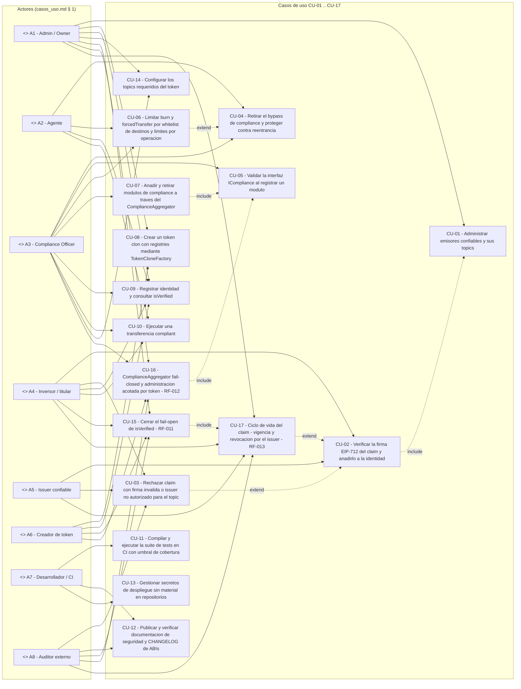
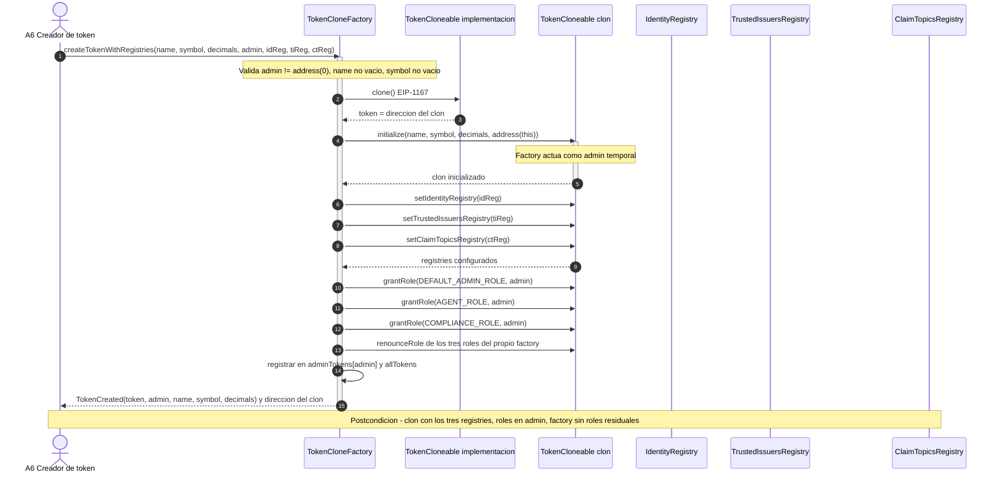
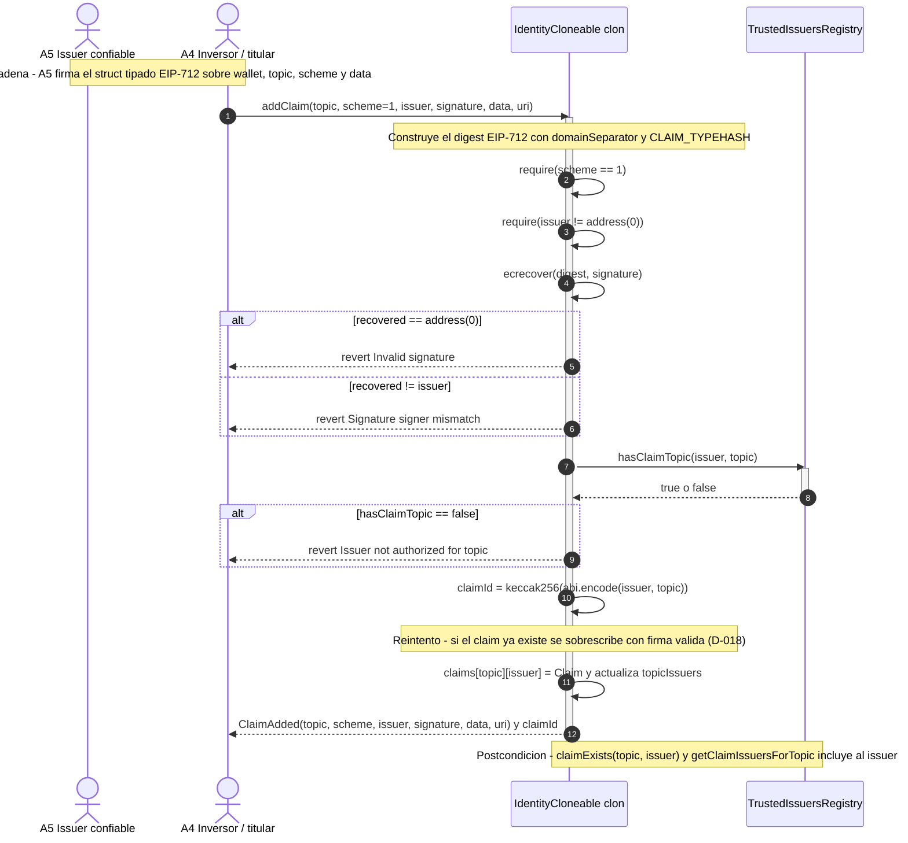
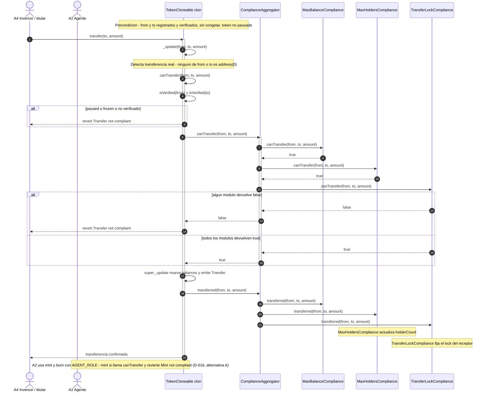
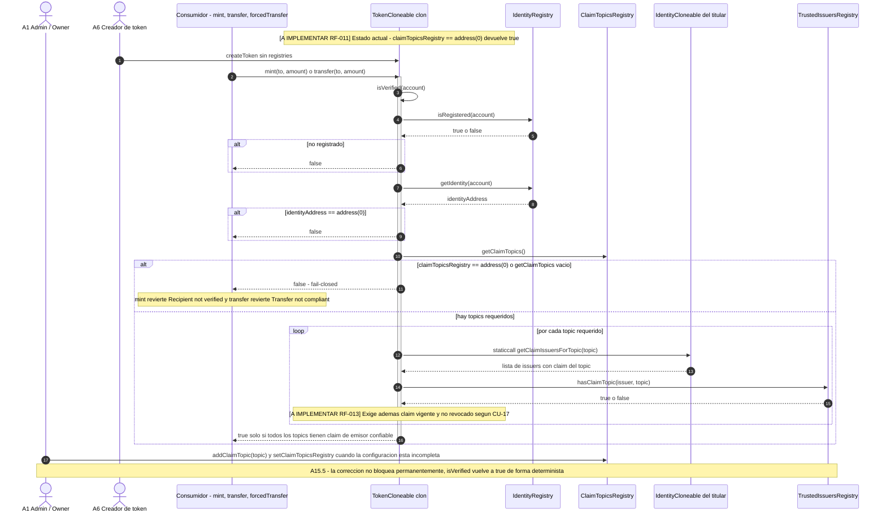
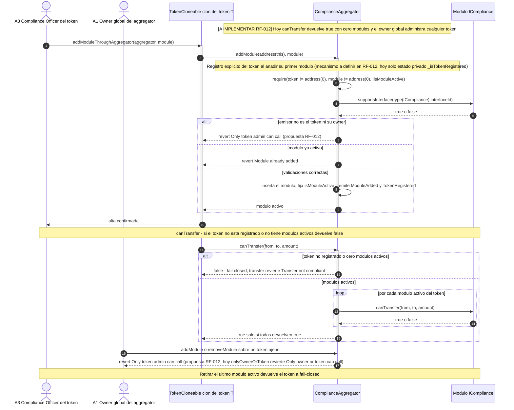
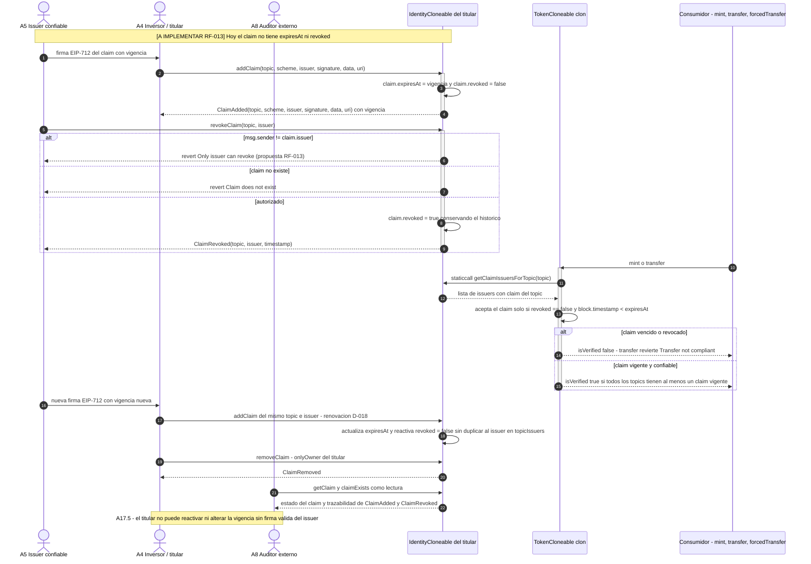

# Diagramas del Modelo de Casos de Uso — RWA (`rwa-sc`)

| Campo | Valor |
|---|---|
| **Versión de este documento** | v1.1 · 2026-10-03 (revisión de alineación con `casos_uso.md` **v1.3**) |
| **Fuente de verdad** | [`casos_uso.md`](./casos_uso.md) **v1.3 · 2026-10-03** (actores A1..A8, casos CU-01..CU-17) |
| **Fuente de la nota de brechas** | [`INFORME_OPTIMIZACION_V1.md`](../INFORME_OPTIMIZACION_V1.md) § 7 (Stakeholders faltantes) y § 8 (Plan de acción) |
| **Alcance** | Solo `rwa-sc` (contratos Solidity), decisión D-003 |
| **Estado de RF-011 / RF-012 / RF-013** | **A IMPLEMENTAR** — cubren CU-15, CU-16 y CU-17 respectivamente (fail-closed de `isVerified()`, fail-closed del `ComplianceAggregator` y ciclo de vida del claim) |

> **Nota de estado (obligatoria).** Los casos **CU-15** (`isVerified()` fail-closed, RF-011 / H-05 auditoría V1),
> **CU-16** (`ComplianceAggregator` fail-closed y administración acotada por token, RF-012 / H-22 auditoría V1) y
> **CU-17** (vigencia y revocación del claim por el issuer, RF-013 / H-08 auditoría V1) están marcados en el
> documento fuente como **A IMPLEMENTAR**. Los diagramas de secuencia 4, 5 y 6 de este archivo describen el
> **comportamiento objetivo especificado**, no el comportamiento actual del código. Se distinguen con la etiqueta
> `[A IMPLEMENTAR]` en el propio diagrama.
>
> **Fidelidad al documento.** Los nombres de actores (A1..A8) y de casos de uso (CU-01..CU-17) se han copiado
> literalmente de `casos_uso.md` v1.3. Las relaciones `include`/`extend` representadas son **solo** las que el
> documento declara de forma explícita citando otro CU (no se han inventado asociaciones).
>
> **Convención de IDs de hallazgos.** Los 12 hallazgos del análisis base se citan como **HB-01..HB-12**; los 34 de
> la auditoría V1 conservan **H-01..H-34** y se marcan siempre como **«H-xx (auditoría V1)»** (p. ej. H-05, H-08 y
> H-22 son de la auditoría V1, no del análisis base).

---

## 1. Diagrama de casos de uso UML (Mermaid)

Los actores se representan como nodos con el estereotipo `<<Actor>>` (Mermaid `flowchart` no dispone de la figura
de monigote nativa del UML), situados en la columna izquierda. Las líneas continuas son asociaciones
actor ↔ caso de uso; las líneas discontinuas son relaciones `include`/`extend` **declaradas en el documento**.

**Relaciones `include`/`extend` y su justificación literal en `casos_uso.md` v1.3**

| Relación | Tipo | Evidencia en el documento fuente |
|---|---|---|
| CU-02 **include** CU-01 | include | CU-02, paso 5: *«El contrato verifica la autorización consultando `trustedIssuersRegistry.hasClaimTopic(issuer, topic)`»*; precondición: *«A5 registrado en `TrustedIssuersRegistry` con el `topic` del claim (CU-01)»*. |
| CU-03 **extend** CU-02 | extend | CU-03 completa el camino de rechazo del `addClaim` de CU-02: mismo flujo (`addClaim(topic, 1, issuer, signature, data, uri)`), con firma inválida o issuer no autorizado. |
| CU-17 **extend** CU-02 | extend | CU-17, paso 5 (*renovación*): *«un nuevo `addClaim` del mismo `(topic, issuer)` con firma válida actualiza `expiresAt` y reactiva `revoked = false` (D-018, CU-03 A3.6)»*; CU-17, paso 1: *«`addClaim` persiste el claim con `expiresAt` … y `revoked = false`»*. |
| CU-15 **include** CU-17 | include | CU-15, paso 4: *«…exige que el claim sea válido y vigente (CU-17)»*; precondición (tras RF-013): *«`isVerified` acepta un claim solo si `revoked == false` y `block.timestamp < expiresAt`»*. |
| CU-07 **include** CU-05 | include | CU-07, paso 4: el aggregator valida *«`supportsInterface` (**A IMPLEMENTAR RF-003**)»*; CU-07, precondición: *«módulo conforme `ICompliance` (CU-05)»*. |
| CU-16 **include** CU-05 | include | CU-16, paso 3: *«las validaciones de módulo (…, `supportsInterface` de RF-003)»*; estado: *«aggregator fail-closed y administración acotada»* con módulos conformes (CU-05). |
| CU-06 **extend** CU-04 | extend | CU-06, Nota M-06: *«los criterios de `forcedTransfer` con destino whitelisted/no whitelisted viven en CU-04 #1 y CU-04 #2»*; CU-06, paso 4 remite a CU-04. |

> **Relaciones dependientes del comportamiento que NO se dibujan como `include`/`extend`:** CU-10 consulta
> `isVerified` (CU-09/CU-15) y `canTransfer` de los módulos/aggregator (CU-07/CU-16) dentro de `_update`, y CU-15
> **invierte** la semántica del criterio `test_RF001_isVerified_sin_topics_registrada_true` de CU-09; el documento
> no las declara con la palabra `include`/`extend` ni con la sintaxis de relación UML, así que se reflejan como
> asociaciones actor ↔ CU y como trazabilidad RF → CU (§ 3), no como relaciones inventadas.

---

## 2. Diagramas de secuencia (flujos principales)

### 2.1 CU-08 — Crear un token clon con registries mediante `TokenCloneFactory`

Corresponde al **flujo principal** de CU-08 (pasos 1–8) y a su postcondición. `IMPLEMENTADO` en la creación
(`TokenCloneFactory.sol:26-160`, `TokenCloneable.sol:50-52`); el criterio de gas RNF-001 está roto hoy.

**Caminos alternativos cubiertos por el documento (no dibujados):** A8.1 `"Invalid admin address"`;
A8.2 `"Token name required"` / `"Token symbol required"`; A8.3 registry `address(0)` → se omite su `set*`;
A8.4 `initialize` sobre clon ya inicializado → `"InvalidInitialization"`; A8.5 `createToken` sin registries.

### 2.2 CU-02 — Verificar la firma EIP-712 del claim y añadirlo

Corresponde al **flujo principal** de CU-02 (pasos 1–7). Estado del CU: **A IMPLEMENTAR (RF-001)** en la
verificación de firma; el `claimId` y el índice `topicIssuers` sí están implementados.

**Caminos alternativos cubiertos por el documento (no dibujados):** A2.1 `"Invalid signature length"`;
A2.2 `"Invalid signature"`; A2.3 `"Signature signer mismatch"`; A2.4 `"Unsupported scheme"`;
A2.5 `"Issuer not authorized for topic"`; A2.6 revert por `onlyOwner` de la identidad.

### 2.3 CU-10 — Ejecutar una transferencia compliant (camino feliz y rechazo)

Corresponde al **flujo principal** de CU-10 (pasos 1–6) con el **camino de rechazo** (A10.1–A10.8). Estado:
`PARCIALMENTE IMPLEMENTADO`; los criterios de `mint`/`burn`/`forcedTransfer` sin bypass dependen de RF-002.

**Caminos alternativos cubiertos por el documento (no dibujados):** A10.1 token pausado; A10.2 cuenta
congelada; A10.3 `from`/`to` no verificado; A10.4 `MaxBalanceCompliance` excede `maxBalance`; A10.5
`TransferLockCompliance` con lock vigente; A10.6 `MaxHoldersCompliance` alcanza `maxHolders`; A10.7 saldo
insuficiente (`ERC20InsufficientBalance`); A10.8 aggregator propaga el `false` de uno de sus módulos.
**D-012 RESUELTA** por D-016: se mantiene el chequeo de compliance en `mint()` (alternativa A); la alternativa B
(bypass del agente) queda descartada.

### 2.4 CU-15 — Cerrar el fail-open de `isVerified()` (RF-011 · H-05 auditoría V1) · A IMPLEMENTAR

Corresponde al **flujo principal** de CU-15 (pasos 1–5) y a A15.1–A15.5. Es el comportamiento **objetivo** tras
RF-011; hoy `TokenCloneable.sol:245-247` devuelve `true` cuando `claimTopicsRegistry == address(0)` (fail-open).

### 2.5 CU-16 — `ComplianceAggregator` fail-closed y administración acotada por token (RF-012 · H-22 auditoría V1) · A IMPLEMENTAR

Corresponde al **flujo principal** de CU-16 (pasos 1–5) y a A16.1–A16.5. Es el comportamiento **objetivo** tras
RF-012; hoy `ComplianceAggregator.canTransfer` devuelve `true` con cero módulos (`:123-125`) y `onlyOwnerOrToken`
(`:50-53`) permite al owner global operar sobre cualquier token. El **registro explícito** del token es un mecanismo
a definir en RF-012: hoy **no existe** `registerToken` (grep en `rwa-sc/sc/src/` → 0 resultados); solo existe el
estado privado `_isTokenRegistered` (`ComplianceAggregator.sol:38`). Los mensajes `"Only token admin can call"` y
`"Only issuer can revoke"` (este último en § 2.6) son **propuestas (no existen hoy; llegarán con RF-012 / RF-013)**.

### 2.6 CU-17 — Ciclo de vida del claim: vigencia y revocación por el issuer (RF-013 · H-08 auditoría V1) · A IMPLEMENTAR

Corresponde al **flujo principal** de CU-17 (pasos 1–5) y a A17.1–A17.5. Es el comportamiento **objetivo** tras
RF-013; hoy el struct `Claim` carece de `expiresAt`/`revoked` (`IdentityCloneable.sol:21-28`) y `removeClaim` es
`onlyOwner` del titular (`:105-123`). `IdentityCloneable` **no tiene** `revokeClaim` ni `expiresAt` (grep en
`rwa-sc/sc/src/` → 0 resultados); por eso el mensaje `"Only issuer can revoke"` es **propuesta (no existe hoy;
llegará con RF-013)**, no un literal contractual vigente.

---

## 3. Tabla actores ↔ casos de uso (matriz de participación)

Leyenda: **P** = actor principal del CU (campo *Actor* del documento) · **S** = participa en el flujo principal,
en un flujo alternativo o en la precondición/postcondición · **O** = observa o verifica el resultado (solo lectura,
en particular A8) · vacío = no participa.

| Actor \ CU | CU-01 | CU-02 | CU-03 | CU-04 | CU-05 | CU-06 | CU-07 | CU-08 | CU-09 | CU-10 | CU-11 | CU-12 | CU-13 | CU-14 | CU-15 | CU-16 | CU-17 |
|---|---|---|---|---|---|---|---|---|---|---|---|---|---|---|---|---|---|
| **A1 Admin / Owner** | P | | | | | S | S | S | P | | | | | P | P | P | S |
| **A2 Agente** | | | | P | | P | | | S | S | | | | | | | |
| **A3 Compliance Officer** | | | | S | P | S | P | | S | S | | | | S | | P | |
| **A4 Inversor / titular** | | P | S | | | | | | S | P | | | | | S | | P |
| **A5 Issuer confiable** | | S | S | | | | | | | | | | | | | | P |
| **A6 Creador de token** | | | | | | | | P | S | | | | | | S | S | |
| **A7 Desarrollador / CI** | | | | | | | | | | | P | P | P | | | | |
| **A8 Auditor externo** | | | O | | | | | | | | | O | | | O | O | O |

**Fuente de cada celda (campo *Actor* o mención explícita en el flujo del CU)**

| CU | Actor principal declarado en `casos_uso.md` v1.3 | Participaciones secundarias |
|---|---|---|
| CU-01 | A1 | — |
| CU-02 | A4, con firma de A5 | A5 (firmante EIP-712) |
| CU-03 | A4 / A5 | A8 (*«resultado observado también por A8»*) |
| CU-04 | A2 y A3 | — |
| CU-05 | A3 | — |
| CU-06 | A2 ejecuta | A1/A3 administran parámetros |
| CU-07 | A3 | A1 como `owner` del aggregator |
| CU-08 | A6 | A1 (*A8.5*: registries configurables después por A1) |
| CU-09 | A1 registra | A3/A2/A6 consultan; A4 titular |
| CU-10 | A4 | A2 en `mint`/`burn`/`forcedTransfer` (D-016); A3 administra módulos |
| CU-11 | A7 | — |
| CU-12 | A7 mantiene | A8 verifica |
| CU-13 | A7 | — |
| CU-14 | A1 | A3 evalúa impacto |
| CU-15 | A1, A6, A4 | A8 observa |
| CU-16 | A3, A1 y A6 | A8 observa |
| CU-17 | A5, A4, A1 | A8 verifica |

---

## 4. Nota de brechas de stakeholders (actores AUSENTES en el backlog)

> **Advertencia de consistencia.** Los cinco stakeholders de la tabla siguiente **no existen** como actores en
> `casos_uso.md` v1.3 (que solo define A1..A8) y **no se han integrado** en el diagrama de la sección 1 ni en la
> matriz de la sección 3: hacerlo sería inconsistente con el documento fuente. Se documentan aquí como **brecha
> declarada**, tal y como la registra `INFORME_OPTIMIZACION_V1.md` § 7, junto con las acciones de su § 8.

**Fuente:** [`INFORME_OPTIMIZACION_V1.md`](../INFORME_OPTIMIZACION_V1.md) § 7 *Stakeholders faltantes* y § 8 *Plan
de acción*.

| # | Actor ausente en el backlog | Por qué importa (informe § 7) | Evidencia | Acción asociada (informe § 8) |
|---|---|---|---|---|
| 1 | **Custodio de claves / responsable de gobernanza** | Una sola EOA acumula todos los roles y no hay multisig ni timelock; no hay responsable de custodia ni rotación | H-06 (auditoría V1); `casos_uso.md` § 1 sin coincidencias de «custodio» | R-7 (gobernanza con multisig/timelock y reparto de roles; designar custodio y rotación) |
| 2 | **DPO / custodio de datos personales** | PII y documentos KYC en GridFS sin responsable, base legal ni política de retención | H-11 (auditoría V1); `casos_uso.md` sin DPO | R-3 (cifrado GridFS, minimización on-chain, retención/supresión, DPIA y designación de DPO) |
| 3 | **Regulador / supervisor** | No hay rol, interfaz ni procedimiento de reporte regulatorio, snapshot de holders o exportación de eventos | H-25 (auditoría V1); `casos_uso.md` sin coincidencias de «regulador» | R-2 (RNF regulatorios: sanciones/PEP/AML, retención, reporte y mapeo normativo MiCA, Reg D/S, CNMV/LMV y DLT Pilot) |
| 4 | **Operador de la red Besu** | Sin responsable de disponibilidad, finalidad ni control de acceso al nodo; `chainId` pendiente y RPC hardcodeado | H-26 (auditoría V1); `entornos_globales.md:43` | M-17 y M-15 (validar `chainId`/red y parametrizar `RPC_URL`; persistir artefactos de despliegue con `chainId`); QW-11 |
| 5 | **Soporte al inversor / recuperación** | Sin cauce de incidencias (claves perdidas, identidad comprometida, disputas); la única vía es `forcedTransfer` sin whitelist ni topes | H-27 (auditoría V1); `casos_uso.md` sin coincidencias de «soporte» | M-5 y M-3 (RF-004: `authorizedDestinations`, `maxBurnPerTx`, `maxForcedPerTx`; `ReentrancyGuard`); R-5 (runbook de recuperación on-chain) |

**Fuerza efectiva de los actores existentes (informe § 7, cierre):** A5 (issuer confiable) es una etiqueta sin
validación criptográfica (H-01 auditoría V1), A6 (creador de token) no tiene restricción ni *due diligence*
(H-07 auditoría V1) y A3 (compliance officer) no tiene reglas que administrar en el flujo de despliegue entregado
(H-29 auditoría V1). Estas carencias
afectan al backlog de CU (RF-001 / CU-02, RF-005 / CU-08) y deben considerarse junto con la tabla anterior: **la
recomendación es abrir casos de uso nuevos o ampliar los existentes en una revisión posterior de `casos_uso.md`,
no añadir actores al diagrama de la versión v1.3 auditada.**

---

## 5. Trazabilidad rápida RF-011/RF-012/RF-013 → CU y estado

| Requisito | Caso de uso | Estado en `casos_uso.md` v1.3 | Diagrama de secuencia |
|---|---|---|---|
| **RF-011** — `isVerified()` fail-closed sin `claimTopicsRegistry`/topics | **CU-15** | **A IMPLEMENTAR** | § 2.4 |
| **RF-012** — `ComplianceAggregator` fail-closed y administración acotada por token | **CU-16** | **A IMPLEMENTAR** | § 2.5 |
| **RF-013** — Ciclo de vida del claim: vigencia y revocación por el issuer | **CU-17** | **A IMPLEMENTAR** | § 2.6 |

---

## 6. Alineación con `casos_uso.md` v1.3 — las 9 inconsistencias, corregidas

Las 9 inconsistencias que este archivo detectó en `casos_uso.md` v1.2 **quedan corregidas en la v1.3** del
documento fuente. Este archivo (v1.1) se ha regenerado/alineado con esa revisión:

| # | Inconsistencia detectada en v1.2 | Estado en v1.3 y evidencia |
|---|---|---|
| 1 | § 4 declaraba «14 casos de uso» | **Corregida:** § 4 declara **17 (CU-01..CU-17)**; conteo real `grep -cE '^### CU-[0-9]+'` = 17 |
| 2 | Conteo de criterios de v1.0/v1.1 (66 + 52 = 118 en v1.0; 77 Gherkin + 41 EARS = 118 tras la reclasificación M-02 de v1.1) | **Corregida:** § 4 publica **92 Gherkin + 50 EARS = 142**, medidos sobre el archivo final |
| 3 | D-012/D-013 presentadas como abiertas y bloqueantes de la Fase 3 | **Corregida:** § 4, § 2.5 y el changelog las dan por **CERRADAS** por D-016 y D-018; sin decisiones abiertas |
| 4 | Matriz 3.3: H-05 (auditoría V1) → CU-11 | **Corregida:** H-05 (auditoría V1) → **CU-15 / RF-011** (`isVerified` fail-open) |
| 5 | H-08 ambiguo (análisis base vs auditoría V1) | **Corregida:** **HB-08** (base, `web-registry-trusted2`, fuera de alcance) y **H-08 (auditoría V1)** (claims sin vigencia ni revocación → **CU-17 / RF-013**) desambiguados en la matriz 3.3 y en el texto |
| 6 | H-22 sin fila en la tabla de hallazgos | **Corregida:** la matriz 3.3 incluye **H-22 (auditoría V1) → CU-16 / RF-012** |
| 7 | Mensajes de revert propuestos presentados como contractuales (`"Only token admin can call"`, `"Only issuer can revoke"`) | **Corregida:** marcados como **propuesta (no existe hoy; llegará con RF-012 / RF-013)**; se conserva la cita del mensaje vivo `"Only owner or token can call"` (`ComplianceAggregator.sol:50-53`) y se explicita que `IdentityCloneable` no tiene `revokeClaim` ni `expiresAt`. En este archivo, § 2.5 y § 2.6 llevan la misma anotación |
| 8 | CU-16, paso 1, citaba `registerToken` (inexistente) | **Corregida:** el registro explícito es un **mecanismo a definir en RF-012**; hoy solo existe el estado privado `_isTokenRegistered` (`ComplianceAggregator.sol:38`); en este archivo ya no se nombra como función existente |
| 9 | Observación de proceso: el documento fuente cambiaba entre lecturas | **Resuelta:** `casos_uso.md` está estabilizado en **v1.3**; este archivo se ha regenerado contra esa versión |

> **Nota de versiones.** La versión de este documento pasa de v1.0 a **v1.1**: no cambia el modelo UML/actores, solo
> se alinea con `casos_uso.md` **v1.3** (conteos, versiones, mensajes propuestos, `registerToken` y convención de
> IDs de hallazgos). El changelog **v1.3** del documento fuente registra esta regeneración/alineación.

### Verificación de cobertura y sintaxis de este archivo

- **17 casos de uso** presentes (CU-01..CU-17) y **8 actores** presentes (A1..A8) en el diagrama de la § 1 y en la
  matriz de la § 3 (17 columnas de CU × 8 filas de actor).
- **Bloques Mermaid:** 1 `flowchart LR` (diagrama de casos de uso) + 6 `sequenceDiagram` (CU-08, CU-02, CU-10,
  CU-15, CU-16, CU-17) = **7 bloques**, todos abiertos y cerrados con su valla `mermaid`.
- **Convención de IDs de hallazgos:** el análisis base usa **HB-xx**; todo **H-xx** de la auditoría V1 va marcado
  como **«(auditoría V1)»** (p. ej. H-05, H-08, H-22, H-06, H-11, H-25, H-26, H-27, H-01, H-07 y H-29).
- **Sin emojis, sin `;` sueltos y con las etiquetas con paréntesis/comas entre comillas** dentro de los bloques
  Mermaid (los textos con acentos se han transliterado dentro de los diagramas para máxima compatibilidad de
  render; fuera de los bloques se conserva la ortografía original).
- **Sin artefactos de herramienta colados** en el archivo (ni cierres de razonamiento, ni invocaciones, ni
  volcados de llamadas a herramientas).
