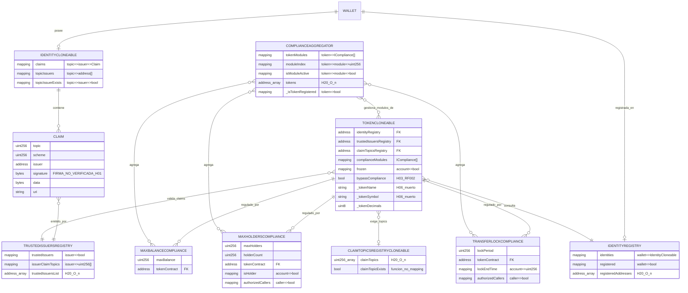
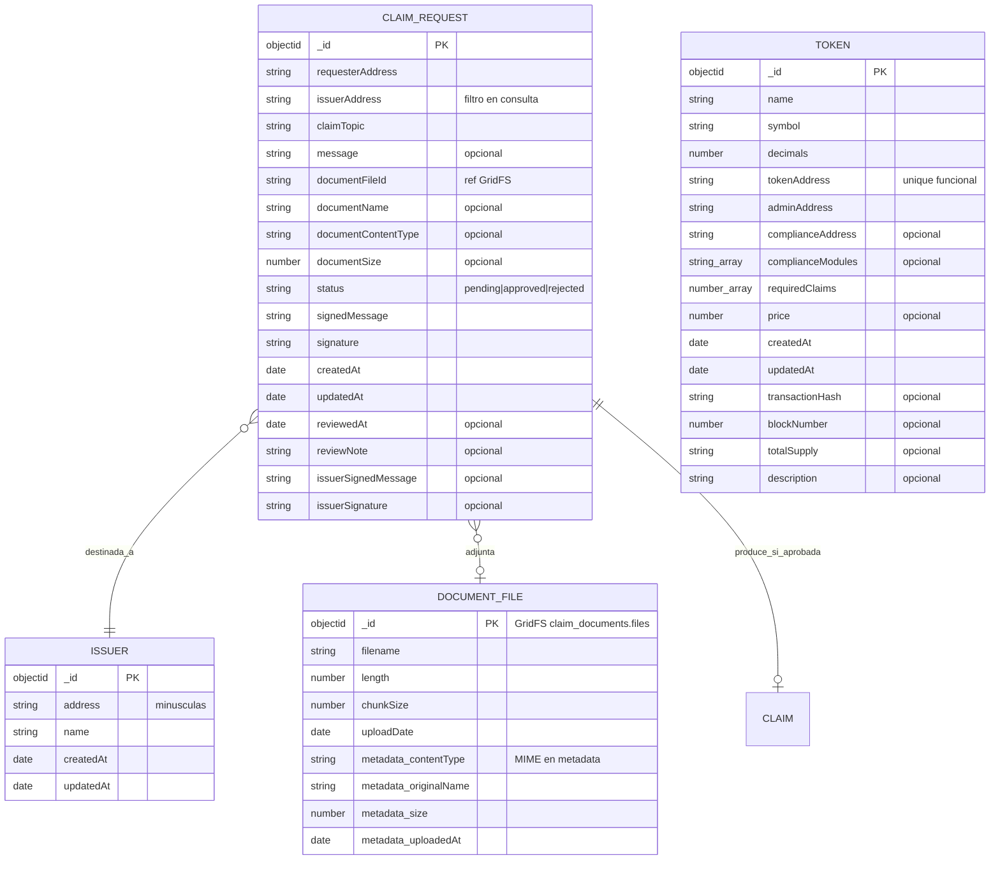
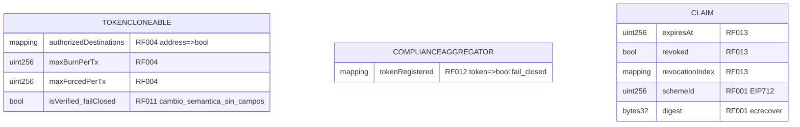

# 📐 Diagrama Entidad-Relación — RWA

> **Versión: v1.1 · 2026-10-03.** Cubre el modelo de datos del proyecto: on-chain (contratos de
> `rwa-sc/sc/src/`) y off-chain (MongoDB `rwa`).
> **Sincronizado con `diccionario_datos.md`** (mismo nombre para cada entidad, campo y topic) y con
> `base_datos.sql`.
>
> **Changelog v1.1:** regenerado contra el storage real (H-14); se eliminan `holders[]`, `holderIndex[]`,
> `firstReceiveTime`, `issuerTopics` y el campo `token` de los módulos/registro de topics; se añade el
> bloque **§3 PLANIFICADO** (RF-001, RF-004, RF-011, RF-012, RF-013); se corrige el modelo off-chain
> (`requesterAddress`, `tokenAddress`, `requiredClaims`, colección `issuers`, metadata GridFS).
> Trazabilidad: `INFORME_OPTIMIZACION_V1.md` (H-13, H-14, H-08, H-11, H-20).

## 1. Modelo on-chain — EXISTENTE hoy

> **H-14:** en esta versión **no** aparecen `holders[]`, `holderIndex[]`, `firstReceiveTime` ni
> `issuerTopics`. El estado por cuenta de holders es `isHolder` + `holderCount`; el lock es `lockEndTime`;
> la autorización por topic es `issuerClaimTopics`; el token en los módulos es `tokenContract`.

## 2. Modelo off-chain (MongoDB `rwa`) — EXISTENTE hoy

> **Corrección off-chain:** la solicitud se identifica por `requesterAddress` (no `wallet`),
> `issuerAddress` (no `issuer`), `claimTopic` (no `topic`) y `documentFileId` (no `documentId`); el token
> por `tokenAddress` (no `address`) y `requiredClaims` (no `requiredTopics`); se documenta la colección
> `issuers`. Sin índices explícitos en código (`createIndex` no aparece).

## 3. PLANIFICADO (aprobado y NO implementado) — `requerimientos.md` §3, D-014

> Bloque separado: **no existe hoy**. No debe confundirse con §1/§2.

| Requisito | Entidad afectada | Cambio planificado |
|---|---|---|
| RF-004 | `TokenCloneable` | `authorizedDestinations[address]`, `maxBurnPerTx`, `maxForcedPerTx` |
| RF-011 | `TokenCloneable` | `isVerified` fail-closed (cambio de comportamiento, sin campos) |
| RF-012 | `ComplianceAggregator` | estado explícito `tokenRegistered[token]` (hoy `_isTokenRegistered` implícito) |
| RF-013 | `IdentityCloneable` / `Claim` | `expiresAt`, `revoked`, índice de revocación |
| RF-001 | `IdentityCloneable` / `Claim` | `schemeId` + digest EIP-712 y `ecrecover` |

## 4. Relaciones clave a preservar

1. **wallet → identity → claims → trusted issuer**: cadena de verificación de `isVerified()` del token.
2. **token → claimTopicsRegistry (1:1 por token)**: requisitos dinámicos por emisión.
3. **compliance module: N agregados por token a través de `ComplianceAggregator`** (el token puede tener
   además módulos directos en `complianceModules`).
4. **claim_request off-chain → claim on-chain**: la aprobación del issuer dispara `addClaim` on-chain
   (flujo actual **sin verificación de firma** — H-01/RF-001).

## 5. Catálogo de claim topics (idéntico al diccionario §3)

- **Oficial:** `1 = KYC`, `7 = Accreditation`, `9 = Jurisdiction` (`rwa-web/README.md:325-327`).
- **Reservado/backlog:** `5 = Environmental`, `6 = Sanctions` (**no implementados**, H-10/R-2).
- **Deprecados:** catálogos `1/2/3/4` (`ARQUITECTURA_FINAL.md:65`), `1/2/3/9/10`
  (`REFERENCIA_TECNICA.md:823-833`) y `5/6/7`; y las fixtures de test `1/2`, `1/2/3` y `2=Accreditation`.
