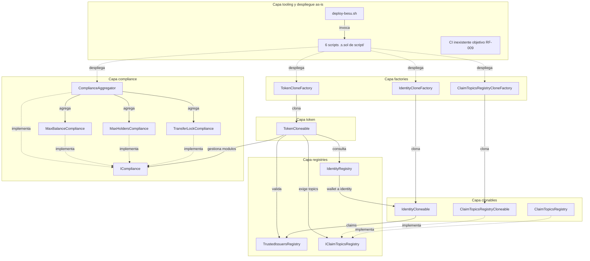
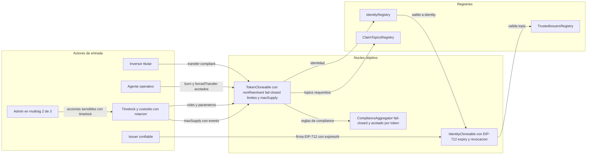
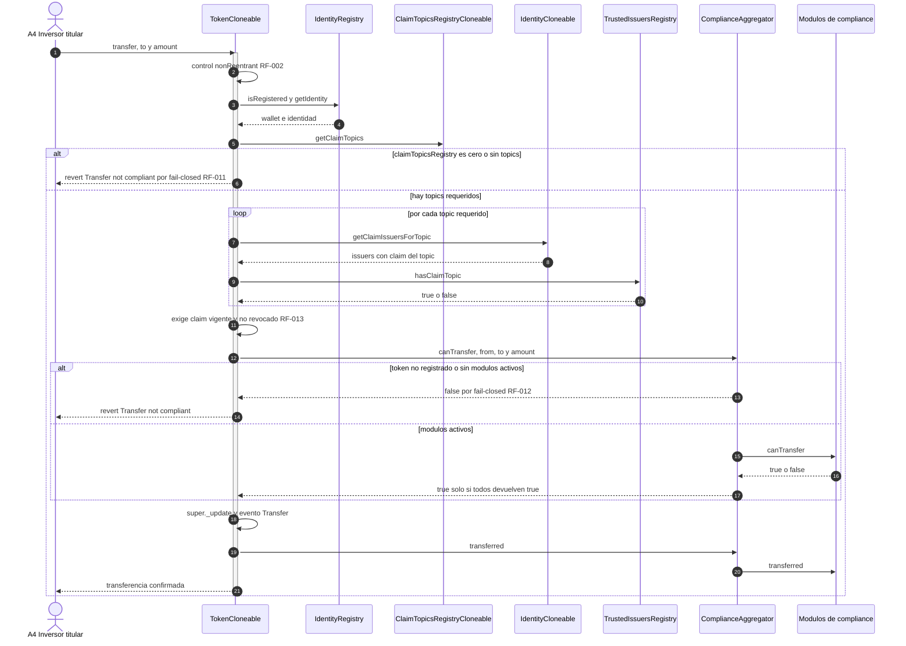
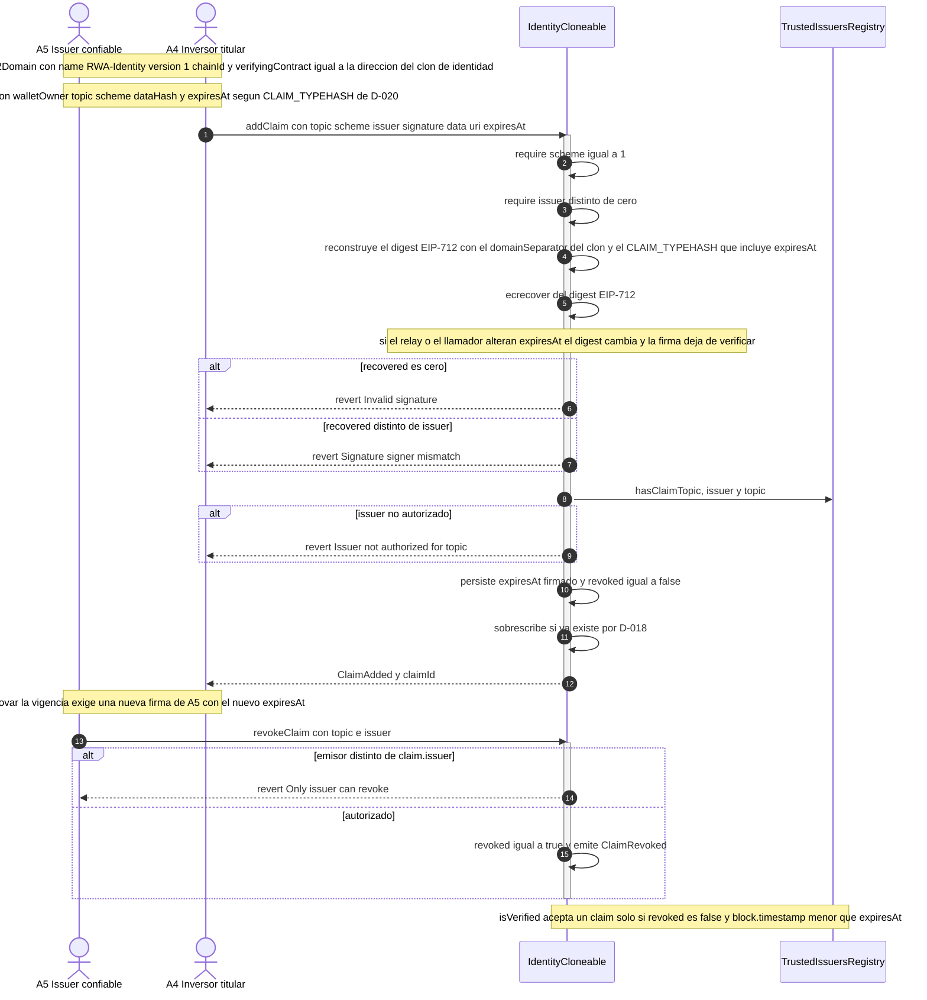
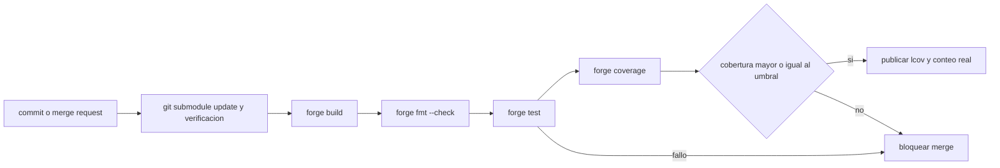

# Documento Técnico — Proyecto RWA (ERC-3643 sobre Solidity)

| Campo | Valor |
|---|---|
| **Título** | Documento Técnico del Proyecto RWA — arquitectura, modelo de datos, trazabilidad y plan de mejora |
| **Versión** | **v1.1 · 2026-10-03** |
| **Autor** | Asistente de Proyecto (`@asistenteProyecto`) |
| **Alcance** | Zona **`rwa-sc`** (contratos Solidity). `rwa-web` **fuera de alcance** por decisión **D-003** |
| **Fuentes usadas** | `requerimientos.md` v1.1 · `INFORME_OPTIMIZACION_V1.md` V1 · `casos_uso/casos_uso.md` v1.3 · `casos_uso/diagramas_casos_uso.md` v1.1 · `casos_uso/AUDITORIA_CASOS_USO.md` · `diccionario_datos.md` v1.1 · `diagrama_er.md` v1.1 · `base_datos.sql` v0.2 · `entornos_globales.md` · `metricas_ejecucion.md` · `estado_proyecto.md` · `evidencias/README.md`, `evidencias/lint_forge.txt`, `evidencias/PoC_H01_H05.t.sol`; código real en `rwa-sc/sc/src/`, `test/` y `script/` |
| **Convención de IDs** | Hallazgos del análisis base: **HB-01..HB-12**. Hallazgos de la auditoría V1: **H-01..H-34**, siempre marcados como **(auditoría V1)** |

> **Nota de alcance.** Este documento describe únicamente la zona de contratos `rwa-sc`. La zona `rwa-web`
> (5 micro-apps Next.js 16 / React 19 sobre MongoDB y Anvil, RT-002/RT-003/RT-004) queda explícitamente
> **fuera del ciclo** por **D-003**; se la menciona solo como contexto del modelo de datos off-chain y de los
> requisitos pausados **RF-007**, **RF-008** y **RNF-006**. No se ha modificado ningún otro archivo: el único
> artefacto escrito es este documento.

> **Changelog v1.1 · 2026-10-03 (cierre de la auditoría del documento).** Esta revisión resuelve los **13
> hallazgos `DT-01..DT-13`** de `AUDITORIA_DOCUMENTO_TECNICO.md` y registra las **6 decisiones del usuario
> D-019..D-024** (§8.2.1) que cierran las preguntas **P1..P6** de esa auditoría. En concreto:
> (1) **DT-01 → D-020:** se fija el dominio EIP-712 `("RWA-Identity","1",chainId,clon)` y el `CLAIM_TYPEHASH`
> con `expiresAt` dentro del digest, y se actualizan §3.1 y §3.4.
> (2) **DT-02:** se corrige la atribución de RF-004 a **HB-02** (era «H-02 (auditoría V1)») y se alinean las
> celdas de hallazgo de §3.1 a la convención HB-xx = análisis base / H-xx = auditoría V1.
> (3) **DT-03 → D-021/D-022:** se registran la gobernanza con roles separados, multisig 2-de-3, timelock y
> custodio con rotación, y el tope de suministro `maxSupply` administrable con evento; se reflejan también en
> §8.1 (R2) y en B-4.
> (4) **DT-04:** se publican las dos cifras explicadas: 151 tests declarados, 98 contados por Forge (93 pasan +
> 5 fallan), **53 tests que nunca arrancan** (29 + 24) y **2 `setUp` fallidos = 55 funciones afectadas** en las
> dos suites muertas.
> (5) **DT-05:** se retira la cita errónea `requerimientos.md:236` y se corrigen la etiqueta y las referencias
> de la decisión de datos off-chain (la «Q6» real era Besu/GitLab; el destino MongoDB vs GCP es backlog).
> (6) **DT-06:** la lista de arrays O(n) se alinea con la evidencia de H-20 y con grep en `src/`.
> (7) **DT-07 → D-024:** la auditoría externa pasa a riesgo explícito (§8.1) y a condición de salida.
> (8) **DT-08:** se corrige la cita de RT-001 y la de las «dos zonas» (§1.1).
> (9) **DT-09:** §2.1/§2.2 declaran explícitamente la capa de tooling/despliegue que faltaba (`deploy-besu.sh`,
> 6 scripts `.s.sol`, ausencia de CI).
> (10) **DT-10:** se corrige la cita del constructor de `IdentityCloneable` a `:42-44`.
> (11) **DT-11:** se ajustan las celdas sin respaldo de la matriz §5.1 y se reescribe su leyenda.
> (12) **DT-12:** §5.2 y §9 pasan a ser resúmenes que remiten a `casos_uso.md` e `INFORME_OPTIMIZACION_V1.md`
> en vez de copiarlos, para evitar deriva.
> (13) Se actualiza el estado de **DF3-01..DF3-04** (cerradas por D-019..D-023) y se conservan abiertas
> **DF3-05..DF3-10**.

---

## 1. Visión general y alcance

### 1.1 Qué es el sistema

RWA es una plataforma de **tokenización de activos del mundo real** cuyo núcleo es un *security token*
inspirado en **ERC-3643 / T-REX**: un token ERC-20 con controles de identidad, claims verificables y reglas de
*compliance* modulares.

El sistema se organiza en dos zonas (`requerimientos.md:13-18`; el requisito de toolchain Solidity es
**RT-001**, `requerimientos.md:83`):

- **Zona Contratos (`rwa-sc`)** — proyecto Foundry en `rwa-sc/sc/` con **15 contratos** en `src/` y
  `src/compliance/`, 8 suites de test y 6 scripts de despliegue. Patrones: **EIP-1167 (clones)**, compliance
  modular y *registries* de identidades/claims.
- **Zona WEB (`rwa-web`)** — fuera de alcance en este ciclo (D-003).

### 1.2 Qué problema resuelve

Permite emitir y transferir participaciones tokenizadas **solo entre wallets que acreditan identidad (KYC),
acreditación y jurisdicción** mediante *claims* emitidos por emisores de confianza, aplicando reglas de
*compliance* (límite de saldo, número máximo de tenedores, bloqueo temporal) y dotando al agente de
operaciones de ciclo de vida (emisión, quema, congelación y recuperación).

### 1.3 Límites del ciclo actual

- **Alcance activo (D-003):** solo `rwa-sc`. `rwa-web` no se toca.
- **Orden de trabajo (D-004):** RF-005 → RF-001 → RF-002 → RF-003 → RF-004 → RF-010 → RF-006 → RF-009 →
  RF-011 → RF-012 → RF-013. **RF-007 y RF-008 no aplican** este ciclo.
- **Redeploy limpio permitido (D-009 / RT-008):** se puede mover el *layout* de storage y re-desplegar todo;
  no hay obligación de compatibilidad binaria con lo desplegado previamente.
- **Rama de trabajo (D-005):** `rwa-sc-DSH-GCP` en `https://gitlab.com/anlucorporations/rwa-sc.git`.

### 1.4 Estado real y veredicto

| Pregunta | Veredicto | Sustento |
|---|---|---|
| ¿Apto para producción con activos reales? | **NO** | `INFORME_OPTIMIZACION_V1.md:16`; PoC reproducidos de H-01 y H-05 en `evidencias/README.md:11-14`; suite no verde y cobertura 42,86 % (`metricas_ejecucion.md:29-35,69-73`) |
| ¿Apto para continuar mejoras? | **SÍ, con condiciones** | `INFORME_OPTIMIZACION_V1.md:17`; el defecto dominante es de implementación, con mitigaciones ya mapeadas a RF-001..RF-013 |

Razones concretas del veredicto negativo, todas verificables:

1. **Claims auto-forjados (H-01, auditoría V1):** `IdentityCloneable.addClaim` (`src/IdentityCloneable.sol:63`)
   es `onlyOwner` —el *owner* es el propio inversor— y escribe el claim **sin verificar la firma**; no existe
   `ecrecover`/`EIP712` en `src/`. El PoC `test_H01_claim_forjado_firma_vacia` **pasa**
   (`evidencias/PoC_H01_H05.t.sol:17-47`).
2. **Fail-open de `isVerified` (H-05, auditoría V1):** `src/TokenCloneable.sol:245-247` devuelve `true` si
   `claimTopicsRegistry == address(0)`. El PoC `test_H05_isVerified_fail_open` **pasa**.
3. **La red de seguridad declarada no existe:** **151 tests declarados** en 8 suites, de los que Forge cuenta
   **98 (93 pasan + 5 fallan)**; además, **53 tests nunca arrancan** (29 de `Token.t.sol` + 24 de
   `ComplianceAggregator.t.sol`) porque sus 2 `setUp` fallan, lo que deja **55 funciones afectadas** en esas
   dos suites muertas (53 tests + 2 `setUp`) — el recuento directo de funciones `test*` es 30 + 25 = 55 y la
   resta de los 2 `setUp` explica los 53 que no llegan a ejecutarse. Cobertura de líneas **42,86 %** frente al
   objetivo ≥ 80 % (`metricas_ejecucion.md:29-35,69-73`). Los documentos originales publicaban
   "139 tests (100 % passing)" y "production-ready" (`INFORME_OPTIMIZACION_V1.md:174`).

---

## 2. Arquitectura actual (as-is)

### 2.1 Los 15 contratos de `src/` por capa

Todos los contratos fijan el pragma `^0.8.20` (RT-007). La columna **Evidencia** apunta a la línea de la
**declaración del contrato** en el código real.

> **Alcance de esta tabla (DT-09).** §2.1 inventaría **solo los 15 contratos de `src/` y `src/compliance/`**.
> La capa de **tooling y despliegue** del as-is, que no es un contrato, se declara aparte en §2.1-bis para que
> un lector de §2 no la pierda: `deploy-besu.sh`, los 6 scripts `.s.sol` de `rwa-sc/sc/script/` y la
> **ausencia total de CI**.

| Capa | Contrato | Responsabilidad | Patrón | Evidencia |
|---|---|---|---|---|
| Token | `TokenCloneable` | Token ERC-20 con roles (`DEFAULT_ADMIN_ROLE`, `AGENT_ROLE`, `COMPLIANCE_ROLE`), pausa, congelación, `isVerified`, `mint`/`burn`/`forcedTransfer`, módulos de compliance | `ERC20Upgradeable` + `AccessControlUpgradeable` + `PausableUpgradeable` + `ReentrancyGuard` (stateless, ERC-7201) + `Initializable`; **sin** flag `bypassCompliance` (RF-002); bypass acotado por la ruta interna `_forcedUpdate` | `rwa-sc/sc/src/TokenCloneable.sol:18` |
| Clonables | `IdentityCloneable` | Identidad por inversor: claims por `(topic, issuer)`, índice `topicIssuers`, `removeClaim` | `OwnableUpgradeable` + `Initializable`; `constructor` con `_disableInitializers` | `rwa-sc/sc/src/IdentityCloneable.sol:11` (constructor en `:42-44`) |
| Clonables | `ClaimTopicsRegistryCloneable` | Topics requeridos por token, mutables sin redeploy | `OwnableUpgradeable` + `IClaimTopicsRegistry` | `rwa-sc/sc/src/ClaimTopicsRegistryCloneable.sol:12` |
| Clonables | `ClaimTopicsRegistry` | Variante **no clonable** del registro de topics; la usan la suite y los PoC | `Ownable` + `IClaimTopicsRegistry` | `rwa-sc/sc/src/ClaimTopicsRegistry.sol:16` |
| Factories | `TokenCloneFactory` | Despliega la implementación y crea clones de token con los 3 registries y roles | `Ownable`; `implementation` inmutable; `Clones.clone` EIP-1167 | `rwa-sc/sc/src/TokenCloneFactory.sol:13` |
| Factories | `IdentityCloneFactory` | Crea identidades (y opcionalmente con claim en una transacción) | `Ownable`; `implementation` inmutable; EIP-1167 | `rwa-sc/sc/src/IdentityCloneFactory.sol:13` |
| Factories | `ClaimTopicsRegistryCloneFactory` | Crea un registro de topics por token (`createRegistryForToken`) | `Ownable`; `implementation` inmutable; EIP-1167 | `rwa-sc/sc/src/ClaimTopicsRegistryCloneFactory.sol:13` |
| Registries | `IdentityRegistry` | Vincula wallet ↔ contrato de identidad; `registered`, `registeredAddresses` | `Ownable`; array con *swap-and-pop* | `rwa-sc/sc/src/IdentityRegistry.sol:12` |
| Registries | `TrustedIssuersRegistry` | Emisores confiables y topics autorizados por emisor; `hasClaimTopic` | `Ownable`; array con *swap-and-pop* | `rwa-sc/sc/src/TrustedIssuersRegistry.sol:11` |
| Registries | `IClaimTopicsRegistry` | Interfaz de topics requeridos consumida por el token | `interface` | `rwa-sc/sc/src/IClaimTopicsRegistry.sol:9` |
| Compliance | `ICompliance` | Interfaz de módulos: `canTransfer`, `transferred`, `created`, `destroyed` | `interface is IERC165` (**RF-003, Ciclo 4**) | `rwa-sc/sc/src/ICompliance.sol:16` |
| Compliance | `ComplianceAggregator` | Agrega módulos por token y propaga `canTransfer`/notificaciones | `Ownable` + `ICompliance` + `ERC165`; modifier `onlyToken` | `rwa-sc/sc/src/compliance/ComplianceAggregator.sol:36` |
| Compliance | `MaxBalanceCompliance` | Limita el saldo máximo por cuenta | `Ownable` + `ICompliance` + `ERC165` | `rwa-sc/sc/src/compliance/MaxBalanceCompliance.sol:14` |
| Compliance | `MaxHoldersCompliance` | Limita el número máximo de tenedores | `Ownable` + `ICompliance` + `ERC165` | `rwa-sc/sc/src/compliance/MaxHoldersCompliance.sol:14` |
| Compliance | `TransferLockCompliance` | Bloqueo temporal tras la recepción | `Ownable` + `ICompliance` + `ERC165` | `rwa-sc/sc/src/compliance/TransferLockCompliance.sol:14` |

> **Nota de fidelidad.** Los *registries* usan `Ownable` de un paso, no `AccessControl`
> (`casos_uso.md:123-126`). El actor A1 acumula `owner()` y `DEFAULT_ADMIN_ROLE` **solo si es la misma
> cuenta**; el diseño no lo obliga, pero los scripts actuales sí lo hacen (H-06, auditoría V1).

### 2.1-bis Capa de tooling y despliegue (as-is) — DT-09

| Componente (no es contrato de `src/`) | Qué es hoy | Evidencia |
|---|---|---|
| `rwa-sc/sc/script/deploy.sh` + `DeployFullStack.s.sol` | **Script canónico end-to-end (Ciclo 9 / RF-010):** despliega registries + 3 factories + aggregator + token de ejemplo + módulo de compliance; lee la clave de entorno/Secret Manager, valida `cast chain-id` antes del broadcast, firma con keystore efímero, verifica con `cast code`/`cast call` y persiste `sc/deployments/<chainId>-<timestamp>.json` | `sc/script/deploy.sh`; `sc/script/DeployFullStack.s.sol` |
| `rwa-sc/deploy-besu.sh` | **Wrapper de compatibilidad** (Ciclo 9) hacia `sc/script/deploy.sh` con RPC por defecto de Besu; ya **no** lee archivos de claves ni decide el éxito por `grep` (H-24, H-28, H-31 cerrados en el Ciclo 9) | `deploy-besu.sh:1-45` |
| `CompleteDeploymentExample.s.sol` | Script Forge de ejemplo de despliegue completo | `rwa-sc/sc/script/CompleteDeploymentExample.s.sol` |
| `CreateTokenWithCloneFactory.s.sol` | Crea un token por `TokenCloneFactory` | `rwa-sc/sc/script/CreateTokenWithCloneFactory.s.sol` |
| `DeployTokenCloneFactory.s.sol` | Despliega la factory de tokens | `rwa-sc/sc/script/DeployTokenCloneFactory.s.sol` |
| `DeployIdentityCloneFactory.s.sol` | Despliega la factory de identidades | `rwa-sc/sc/script/DeployIdentityCloneFactory.s.sol` |
| `DeployClaimTopicsRegistryCloneFactory.s.sol` | Despliega la factory de registros de topics | `rwa-sc/sc/script/DeployClaimTopicsRegistryCloneFactory.s.sol` |
| `DeployComplianceAggregator.s.sol` | Despliega el aggregator de compliance | `rwa-sc/sc/script/DeployComplianceAggregator.s.sol` |
| **CI** | **No existe**: ni `.github/` ni `.gitlab-ci.yml`; el pipeline es el objetivo de RF-009 (§6.5) | `entornos_globales.md:101` |

Los 6 `.s.sol` históricos, el nuevo `DeployFullStack.s.sol`, `deploy.sh` y el wrapper `deploy-besu.sh`
componen la capa de despliegue. Desde el **Ciclo 9**, `DeployFullStack.s.sol` sí persiste un JSON de
direcciones/ABIs/bloque (M-14/M-15, H-21/H-24/H-29 cerrados).

### 2.2 Diagrama de componentes (as-is)

Incluye, además de los 15 contratos, la **capa de tooling/despliegue** de §2.1-bis (DT-09).

### 2.3 Defectos estructurales visibles en el as-is

Estos son los puntos que la arquitectura objetivo debe corregir, con evidencia directa:

- **`bypassCompliance` es un flag mutable en storage** (`src/TokenCloneable.sol:47`, activado/desactivado en
  `:212`/`:218` y consultado en `:317`/`:324`), sin `ReentrancyGuard` (H-03/H-18, auditoría V1).
- **`isVerified` es fail-open** sin `claimTopicsRegistry` (`src/TokenCloneable.sol:245-247`; H-05).
- **El aggregator es fail-open y de owner global:** `canTransfer` devuelve `true` con cero módulos
  (`ComplianceAggregator.sol:115-135`) y `onlyToken` (`:50-53`) autoriza al owner global sobre
  cualquier token (H-22).
- **Los claims no tienen vigencia ni revocación por el issuer:** el struct `Claim` es
  `{topic, scheme, issuer, signature, data, uri}` (`IdentityCloneable.sol:21-28`) y `removeClaim` es
  `onlyOwner` del **titular** (`:105-123`); H-08.
- **Validación ERC-165 (resuelta en el Ciclo 4 / RF-003):** `ICompliance.sol:16` ya hereda `IERC165` y los
  cuatro contratos de compliance implementan `supportsInterface`; `TokenCloneable.addComplianceModule`
  (`:134`, require en `:137`) y `ComplianceAggregator.addModule` (`:95`, require en `:98`) rechazan EOAs y
  contratos no conformes con `"Module does not implement ICompliance"` (H-17).
- **Storage muerto:** `_tokenName`/`_tokenSymbol` (`TokenCloneable.sol:31-32`) duplican el nombre ERC-20
  (HB-06).
- **Arrays no acotados O(n) (H-20, auditoría V1):** dos registries y dos factories mantienen arrays lineales
  con borrado/consulta O(n) y vistas sin paginar, verificados por grep en `src/`:
  `IdentityRegistry.registeredAddresses` (`IdentityRegistry.sol:20`, borrado *swap-and-pop* en `:73-79`),
  `TrustedIssuersRegistry.trustedIssuersList` (`TrustedIssuersRegistry.sol:19`, borrado en `:55-61`),
  `ClaimTopicsRegistryCloneable.claimTopics` (`ClaimTopicsRegistryCloneable.sol:14`, borrado en `:51-56`) y
  **los arrays de las factories** `TokenCloneFactory.adminTokens` + `allTokens`
  (`TokenCloneFactory.sol:20,23`) e `IdentityCloneFactory.userIdentities` + `allIdentities`
  (`IdentityCloneFactory.sol:20,23`), todos con *push* sin tope ni paginación.
  `ComplianceAggregator.tokens` (`ComplianceAggregator.sol:35`) es el mismo patrón en la capa de compliance.
  Evidencia V1: `INFORME_OPTIMIZACION_V1.md:129`; el detalle de campos está en `diccionario_datos.md:42,49,57,241-243`
  (que cita `trustedIssuersList`, `claimTopics` y `tokens`, sin los arrays de factories).
  **Nota (DT-06):** no se atribuye este hallazgo a `TrustedIssuersRegistry` más allá de
  `trustedIssuersList`; el array `tokens` pertenece al `ComplianceAggregator`, no al registry de emisores.

---

## 3. Arquitectura objetivo (to-be) tras RF-001..RF-013

### 3.1 Qué cambia en cada componente

| Componente | Cambio objetivo | RF | Hallazgo |
|---|---|---|---|
| `IdentityCloneable` / struct `Claim` | **EIP-712 tipado** en `addClaim` (D-020): dominio `EIP712Domain = {name: "RWA-Identity", version: "1", chainId, verifyingContract: address(this)}` —en clones EIP-1167 `verifyingContract` es la **dirección del clon**, no la implementación— y `CLAIM_TYPEHASH = keccak256("Claim(address walletOwner,uint256 topic,uint256 scheme,bytes32 dataHash,uint256 expiresAt)")`; `scheme == 1`, `signature.length == 65`, `ecrecover`, `recovered == issuer`, `hasClaimTopic(issuer, topic)` obligatorio; rechazo de firma vacía y sobrescritura solo con firma válida (D-018). La nueva firma de `addClaim` incorpora `expiresAt` y debe propagarse a `createIdentityWithClaim` y al CHANGELOG de ABIs | RF-001 | H-01 (auditoría V1); HB-01 (base) |
| `IdentityCloneable` / struct `Claim` | **Implementado (Ciclo 8 + 8c) — Ciclo de vida del claim:** struct `Claim` con `expiresAt` + `bool revoked` (append-only); **`expiresAt` forma parte del digest firmado (D-020)** ⇒ renovar la vigencia exige nueva firma del `issuer`; `revokeClaim(topic, issuer)` sin `onlyOwner`, firmado por el propio `claim.issuer` (conserva `data`/`uri`/`signature` y emite `ClaimRevoked`); vista `hasValidClaim(topic, issuer)` que aplica D-038 (`expiresAt == 0` = sin caducidad); `TokenCloneable.isVerified` deja de aceptar claims vencidos o revocados; sobrescritura/reactivación por D-018. **Ciclo 8c (D-050):** el digest incorpora `claimNonce[topic][issuer]` (`CLAIM_TYPEHASH` con `uint256 nonce`), que **solo** `revokeClaim` incrementa; la firma original deja de verificar tras la revocación (anti-replay) y reactivar exige firma nueva | RF-013 | H-08 (auditoría V1); D-046 |
| `TokenCloneable` — `isVerified` | **Fail-closed:** si `claimTopicsRegistry == address(0)` o `getClaimTopics()` está vacío, devuelve `false` (antes `true`; **implementado en el Ciclo 6**); se exige además claim vigente y no revocado | RF-011 | H-05 (auditoría V1) |
| `TokenCloneable` — bypass/reentrancia | Se **elimina** `bypassCompliance` del storage; el bypass del agente queda acotado a `forcedTransfer` hacia `authorizedDestinations` con tope `maxForcedPerTx`; `ReentrancyGuardUpgradeable` en `transfer`/`forcedTransfer`/`mint`/`burn` y en las entradas del aggregator | RF-002 | H-03, H-18 (auditoría V1) |
| `TokenCloneable` — `burn`/`forcedTransfer` | **Whitelist de destinos + límites:** `authorizedDestinations[address]`, `maxBurnPerTx`, `maxForcedPerTx`; administración solo por admin/compliance; guard `from != address(0)`; **tope de suministro** `maxSupply` administrable con evento, que no puede bajarse por debajo de lo ya emitido ni subirse sin evento (D-022) | RF-004 | **HB-02** (análisis base); H-06, H-27 (auditoría V1) |
| `ICompliance` + 4 contratos de compliance | **Implementado (Ciclo 4):** `ICompliance is IERC165` y `supportsInterface(type(ICompliance).interfaceId) == true` en `MaxBalanceCompliance`, `MaxHoldersCompliance`, `TransferLockCompliance` y `ComplianceAggregator` (todos con `ERC165`); validación ERC-165 al registrar módulos (token y aggregator) con `"Module does not implement ICompliance"` y rechazo de duplicados en el token | RF-003 | H-17 (auditoría V1) |
| `ComplianceAggregator` | **Fail-closed:** cero módulos o token no registrado ⇒ `canTransfer` devuelve `false`; administración de módulos restringida al **owner/rol del token** (no al owner global); **registro automático del token al añadir su primer módulo** (sin función `registerToken` externa, D-023) | RF-012 | H-22 (auditoría V1) |
| Gobernanza / custodia de claves | **Roles separados:** `DEFAULT_ADMIN_ROLE` en **multisig 2-de-3**, `AGENT_ROLE` en cuenta operativa con los límites de RF-004, `COMPLIANCE_ROLE` en cuenta propia; **timelock** para acciones sensibles; **custodio de claves designado con rotación** (D-021) | RF-002, RF-004, RF-010 | H-06, H-25, H-27 (auditoría V1); backlog R-7 |
| Repositorio / toolchain | Compilación reproducible: submódulos `forge-std`, OZ v5.5.0 y OZ-upgradeable v5.5.0 correctos, `forge build` y `forge test` al **100 %**, `solc`/optimizer/`evm_version` fijados | RF-005 | HB-05, HB-11, H-04 (auditoría V1) |
| Documentación | **Implementado (Ciclo 10):** referencias a archivos/contratos inexistentes corregidas, cifras sustituidas por las medidas, **`SECURITY.md`**, **`CHANGELOG_ABIS.md`** + línea base `sc/abis/` y gates `sc/script/ci/abi_diff.sh` y `check_docs.sh` | RF-006 | HB-07, H-15, H-16, H-23, H-33 |
| CI / secretos | **Implementado (Ciclo 9):** `sc/script/deploy.sh` lee `RPC_URL`/`CHAIN_ID` y la clave de entorno/Secret Manager GCP (`DS_`), valida `cast chain-id` antes del broadcast y firma con keystore cifrado efímero (`--keystore`+`--password-file`, sin `--private-key`); `deploy-besu.sh` pasa a wrapper. `.gitlab-ci.yml` en `rwa-sc-DSH-GCP` sigue en RF-009 | RF-010, RF-009 | HB-12, HB-10, H-28, H-04 |
| `TokenCloneable` — storage | Eliminar `_tokenName`/`_tokenSymbol` (HB-06); el *layout* puede moverse por D-009/RT-008 | RF-002/RF-005 | HB-06 |
| Ciclo de vida del contrato | **Sin proxy actualizable:** se mantiene **EIP-1167** y el ciclo de vida es **redeploy limpio con runbook de migración documentado** (D-019), amparado en D-009/RT-008 | RF-005 | H-07 (auditoría V1); backlog R-6 |

### 3.2 Diagrama de la arquitectura objetivo

### 3.3 Flujo objetivo de una transferencia compliant

### 3.4 Flujo objetivo de emisión, revocación y vigencia de un claim

El dominio EIP-712 y el `CLAIM_TYPEHASH` quedan **fijados por D-020**. Para clones EIP-1167 el
`verifyingContract` es la **dirección del clon** de identidad (`address(this)`), no la implementación.

---

## 4. Modelo de datos preliminar

### 4.1 On-chain (resumen; detalle en `diccionario_datos.md` §1)

El modelo on-chain real está inventariado campo a campo en `diccionario_datos.md:21-103` (v1.1), regenerado
contra el storage real (corrección de H-14). Entidades y relaciones: `diccionario_datos.md` §1 y
`diagrama_er.md:16-95`. Puntos clave que **este documento** necesita:

- **`IdentityCloneable`:** `claims[topic][issuer]` (`:13`), `topicIssuers` (`:16`),
  `topicIssuerExists` (`:19`) y struct `Claim` sin vigencia (`:21-28`).
- **`TokenCloneable`:** tres FKs a registries (`:23-25`), `complianceModules` (`:28`), `frozen` (`:44`),
  `bypassCompliance` (`:47`) y storage muerto `_tokenName`/`_tokenSymbol` (`:31-32`).
- **`ComplianceAggregator`:** `tokenModules` (`:26`), `moduleIndex` (`:29`), `isModuleActive` (`:32`),
  `tokens` (`:35`) y `_isTokenRegistered` (`:38`, implícito).
- **Módulos:** `tokenContract` es el FK real (no `token`); en `MaxHoldersCompliance` el estado por cuenta es
  `isHolder` + `holderCount`; en `TransferLockCompliance` es `lockEndTime` (`diccionario_datos.md:88-98`).

### 4.2 Off-chain (MongoDB `rwa`) — contexto, fuera de alcance

La BD activa es **MongoDB** (`rwa`), con `claim_requests`, `tokens`, `issuers` y el bucket GridFS
`claim_documents`. El detalle exacto (nombres camelCase reales) está en `diccionario_datos.md:105-190`,
`diagrama_er.md:101-170` y `base_datos.sql:34-113`. Recordatorios de fidelidad: `requesterAddress`,
`issuerAddress`, `claimTopic`, `documentFileId`, `tokenAddress`, `requiredClaims`
(`diccionario_datos.md:136-138,160-162`). El código web **no** ejecuta `createIndex`
(`diccionario_datos.md:244-245`). `base_datos.sql` es un **borrador PostgreSQL no ejecutable**
(`base_datos.sql:9-10,128-141`).

> **Corrección de etiqueta (DT-05).** La BD oficial es **MongoDB** por **D-002**
> (`estado_proyecto.md:33`); la eventual migración a GCP (Atlas vs Cloud SQL PostgreSQL) **no es la decisión
> «Q6»**: en `requerimientos.md` **Q6** es la **cadena destino Besu CodeCrypto + CI GitLab** (D-008,
> `requerimientos.md:102`). La migración de BD solo figura en el backlog de datos off-chain y **no tiene ID Q
> asignado**; `base_datos.sql:3,10,130` conserva por herencia la etiqueta «Q6» desfasada. La decisión está
> además **fuera de alcance** por D-003.

### 4.3 Cambios planificados por RF (no existen hoy)

Tabla tomada de `diccionario_datos.md` §5 (`:247-281`) y `diagrama_er.md:172-202`.

| RF | Entidad / campo planificado | Tipo | Efecto |
|---|---|---|---|
| RF-001 | struct `Claim`: `expiresAt` + digest EIP-712 | `uint256` + struct tipado + `ecrecover` | Digest EIP-712 (D-020) que liga `walletOwner, topic, scheme, keccak(data), expiresAt` a la wallet, `chainId` y `verifyingContract` (el clon) |
| RF-004 | `authorizedDestinations[address]` | `mapping(address => bool)` | Destinos autorizados para `burn`/`forcedTransfer` |
| RF-004 | `maxBurnPerTx` | `uint256` | Tope por transacción de `burn()` |
| RF-004 | `maxForcedPerTx` | `uint256` | Tope por transacción de `forcedTransfer()` |
| RF-004 | `maxSupply` | `uint256` | **Tope de suministro administrable con evento (D-022)**; no puede bajarse por debajo de `totalSupply()` ni subirse sin evento |
| RF-011 | *(sin campos)* | — | Cambio de semántica: `isVerified` pasa a `false` sin topics |
| RF-012 | *(sin `registerToken`)* | — | **Registro automático del token al añadir su primer módulo (D-023)**; sin registro o sin módulos ⇒ denegar |
| RF-013 | `expiresAt` | `uint256` en `Claim` | **Implementado (Ciclo 8):** marca temporal de caducidad **firmada por el issuer (D-020)**; `0` = sin caducidad (D-038); renovarla exige nueva firma |
| RF-013 | `revoked` | `bool` en `Claim` (al final) | **Implementado (Ciclo 8):** estado de revocación por el issuer autorizado; la renovación con firma válida lo devuelve a `false` |
| RF-013 | consulta de validez | `hasValidClaim(uint256,address) view` | **Implementado (Ciclo 8):** consulta O(1) desde `isVerified` (vía `staticcall`); un fallo se trata como no válido |
| RF-013 | `nonce` (Ciclo 8c) | `mapping(uint256 => mapping(address => uint256)) public claimNonce` | **Implementado (Ciclo 8c, D-050/D-051):** nonce por par `(topic, issuer)` firmado dentro del digest EIP-712; `revokeClaim` lo incrementa y el alta **no**, de modo que la firma original no puede reactivar un claim revocado (anti-replay) y D-018 sigue intacto. Vista pública `claimNonce(uint256,address)` (`0x8a2eff53`); no altera el struct `Claim` ni las 8 salidas de `getClaim` |

> **Regla de sincronización (H-14/H-13):** cada cambio de datos debe actualizar a la vez
> `diccionario_datos.md`, `diagrama_er.md` y `base_datos.sql` con los mismos nombres
> (`diccionario_datos.md:18-19`). Este documento **no duplica** esas tablas: las resume y remite.

---

## 5. Trazabilidad

### 5.1 Matriz componente → caso de uso (CU-01..CU-17)

Leyenda (DT-11):
**X** = el componente **interviene de forma directa** en el caso de uso (es el sujeto de su flujo principal o
de un flujo alternativo, o es modificado por la implementación del CU) y esa intervención está respaldada por
el apartado *Actor* o *Flujo* del CU.
**v** = participación **indirecta**: el componente es invocado de forma transitiva (p. ej. el token consume
`isVerified`, que a su vez usa los registries) o aparece solo en la cobertura del CU, sin flujo propio.
**(vacío)** = no participa.
Las celdas se han revisado contra el apartado *Actor* de `casos_uso.md` v1.3 (§2) y contra la matriz
actor↔CU de `diagramas_casos_uso.md:461-497`; cualquier celda dudosa se ha rebajado a **v**.

| Componente | CU-01 | CU-02 | CU-03 | CU-04 | CU-05 | CU-06 | CU-07 | CU-08 | CU-09 | CU-10 | CU-11 | CU-12 | CU-13 | CU-14 | CU-15 | CU-16 | CU-17 |
|---|---|---|---|---|---|---|---|---|---|---|---|---|---|---|---|---|---|
| `TokenCloneable` | | | | X | X | X | X | | X | X | | | | v | X | X | v |
| `IdentityCloneable` | | X | X | | | | | | X | | | | | | X | | X |
| `ClaimTopicsRegistryCloneable` | | | | | | | | | X | | | | | X | X | | |
| `ClaimTopicsRegistry` | | | | | | | | | | | | | | X | X | | |
| `IdentityCloneFactory` | | X | X | | | | | | X | | | | | | X | | |
| `TokenCloneFactory` | | | | | | | | X | X | | | | | | X | | |
| `ClaimTopicsRegistryCloneFactory` | | | | | | | | | | | X | | | X | | | |
| `IdentityRegistry` | | | | | | | v | | X | v | | | | | X | | |
| `TrustedIssuersRegistry` | X | X | X | | | | | | X | | | | | | | | X |
| `IClaimTopicsRegistry` | | | | | | | | | | | | | | X | X | | |
| `ICompliance` | | | | | X | | X | | | v | | | | | | X | |
| `ComplianceAggregator` | | | | | X | | X | | | X | | | | | | X | |
| `MaxBalanceCompliance` | | | | | X | | X | | | X | | | | | | | |
| `MaxHoldersCompliance` | | | | | X | | X | | | X | | | | | | | |
| `TransferLockCompliance` | | | | | X | | X | | | X | | | | | | | |
| Tooling / CI | | | | | | | | | | | X | X | X | | | | |

> **Nota (DT-11).** Se han retirado las celdas sin respaldo: `TokenCloneable` ya no marca CU-02/CU-03 (el
> alta y el rechazo de claims residen en `IdentityCloneable`, cuyo *Actor* es A4/A5) y la fila de CI se
> renombra a **Tooling / CI** —cubre `forge`, `foundry.toml`, `deploy-besu.sh` y los `ci_check_*` de
> CU-11/CU-12/CU-13, no la gobernanza del token—. `TokenCloneable` pasa a **v** en CU-14 (solo fija el
> registry de topics que el CU configura) y en CU-17 (consume `isVerified`).

### 5.2 Cómo se materializa cada requisito

> **Regla anti-deriva (DT-12).** El **mapa canónico RF→CU y RNF→CU** (con el criterio de respaldo de cada
> fila) vive en `casos_uso.md` §3.1 (`:1060-1076`) y §3.2 (`:1078-1084`), y el **estado medido** en
> `metricas_ejecucion.md`. Las tablas de esta sección son un **resumen de enlace**: conservan solo el
> componente concreto del documento técnico, el CU y el estado, y **remiten** al canónico en vez de copiar
> descripciones ni nombres de test. Si cambia el canónico, esta sección no se edita: se re-verifica contra él.

**Funcionales (RF-001..RF-013)** — resumen; fuente: `casos_uso.md:1057-1073` y `requerimientos.md:52-66`:

| RF | Componente(s) concreto(s) de este documento | CU | Estado (fuente canónica) |
|---|---|---|---|
| RF-001 | `IdentityCloneable.addClaim`, `TrustedIssuersRegistry.hasClaimTopic` | CU-01, CU-02, CU-03, CU-09 | **IMPLEMENTADO** (Ciclo 2) |
| RF-002 | `TokenCloneable` | CU-04, CU-06, CU-10 | **IMPLEMENTADO** (Ciclo 3) |
| RF-003 | `ICompliance` + 4 contratos de compliance + token/aggregator | CU-05, CU-07 | **IMPLEMENTADO** (Ciclo 4) |
| RF-004 | `TokenCloneable` (con D-022) | CU-06 | **IMPLEMENTADO** (Ciclo 5) |
| RF-005 | `foundry.toml`, `.gitmodules`, suites `Token.t.sol` y `ComplianceAggregator.t.sol` | CU-08, CU-11 | **IMPLEMENTADO** (Ciclos 1 y 1b) |
| RF-006 | Documentación raíz + `SECURITY.md` + `CHANGELOG_ABIS.md` + `sc/abis/` + `sc/script/ci/{abi_diff,check_docs}.sh` | CU-12 | **IMPLEMENTADO** (Ciclo 10) |
| RF-007 | *(ninguno — zona web)* | — | PAUSADO (D-003) |
| RF-008 | *(ninguno — zona web)* | — | PAUSADO (D-003) |
| RF-009 | `.gitlab-ci.yml` en `rwa-sc-DSH-GCP` | CU-11 | A IMPLEMENTAR |
| RF-010 | `sc/script/deploy.sh`, `sc/script/DeployFullStack.s.sol`, `sc/deployments/`, `deploy-besu.sh` | CU-13 | **IMPLEMENTADO** (Ciclo 9) |
| RF-011 | `TokenCloneable.isVerified` | CU-15 | **IMPLEMENTADO** (Ciclo 6) |
| RF-012 | `ComplianceAggregator.canTransfer` + `onlyToken` (con D-023) | CU-16 | **IMPLEMENTADO** (Ciclo 7) |
| RF-013 | `IdentityCloneable` / struct `Claim` (con D-020 y D-045..D-047) | CU-17 | **IMPLEMENTADO** (Ciclo 8) |

Anclajes de código de este documento (verificados con grep/read): RF-001 `IdentityCloneable.sol:63-98`;
RF-002 `TokenCloneable.sol:47,212,218`; RF-003 `ICompliance.sol:16`; RF-004 `TokenCloneable.sol:192-201`;
RF-005 `metricas_ejecucion.md:39-49`; RF-006 `requerimientos.md:59`; RF-007/RF-008 `requerimientos.md:60-61`;
RF-009 `entornos_globales.md:101`; RF-010 `sc/script/deploy.sh:1-370`, `sc/script/DeployFullStack.s.sol:1-215` y `sc/deployments/31337-20261010T162639Z.json`; RF-011 `TokenCloneable.sol:245-247`;
RF-012 `ComplianceAggregator.sol:115-135,50-53`; RF-013 `IdentityCloneable.sol:45,79,219,278` (`revoked`, `ClaimRevoked`, `revokeClaim`, `hasValidClaim`), `TokenCloneable.sol:343,398` y `IdentityRegistry.sol:95` (HB-14).

**No funcionales (RNF-001..RNF-006)** — resumen; fuente: `casos_uso.md:1075-1084`:

| RNF | Cómo se materializa (resumen) | CU | Estado | Evidencia |
|---|---|---|---|---|
| RNF-001 | Gas EIP-1167 medido y comparado de forma equivalente; `.gas-snapshot` versionado | CU-08 | **IMPLEMENTADO** (medido; gate de CI en RF-009) | `metricas_ejecucion.md:50-61`; `casos_uso.md:1079` |
| RNF-002 | `forge coverage` ≥ 80 % sobre `src/` excluyendo interfaces y `test/` (D-017) | CU-11 | **IMPLEMENTADO** (96,43 % en src/; gate de CI en RF-009) | `requerimientos.md:117-118`; `casos_uso.md:1080` |
| RNF-003 | 100 % de tests en CI antes de cada merge | CU-11 | **PARCIAL** (**353/353** en local; CI en RF-009) | `metricas_ejecucion.md` §16.3/§18; `casos_uso.md:1081` |
| RNF-004 | Ningún secreto en repo/scripts (Secret Manager GCP `DS_`, `.env` ignorado) | CU-13 | **IMPLEMENTADO** (Ciclo 9) | `sc/script/deploy.sh:1-370`; `casos_uso.md:1082`; `entornos_globales.md:35` |
| RNF-005 | Reglas de compliance extensibles sin tocar el token (módulos + aggregator) | CU-07, CU-14 | **PARCIALMENTE IMPLEMENTADO** | `ComplianceAggregator.sol:61-135`; `casos_uso.md:1083` |
| RNF-006 | *(docker compose de las apps web)* | — | **NO APLICA (D-003)** | `requerimientos.md:77`; `casos_uso.md:1084` |

**Hallazgos-base y de auditoría:**

| Hallazgo | Resolución | Estado |
|---|---|---|
| HB-01 | RF-001 | Cubierto por el plan |
| HB-02 | RF-004 | Cubierto por el plan |
| HB-03 | RF-002 | Cubierto por el plan |
| HB-04 | RF-003 | Cubierto por el plan |
| HB-05 | RF-005 | Parcialmente corregido de hecho: `lib/` existe clonada pero gitignored, y Forge v1.8.3 está instalado fuera del PATH (`metricas_ejecucion.md:10-17`) |
| HB-06 | CU-08 (eliminación de storage muerto) | A IMPLEMENTAR |
| HB-07 | RF-006 | **CORREGIDO** (Ciclo 10): sin referencias a archivos inexistentes en los documentos raíz (gate `sc/script/ci/check_docs.sh`) |
| HB-08 | *(zona web)* | Fuera de alcance (D-003) |
| HB-09 | *(zona web)* | Fuera de alcance (D-003) |
| HB-10 | RF-009 | Cubierto por el plan |
| HB-11 | RF-005 | Cubierto por el plan |
| HB-12 | RF-010 | **IMPLEMENTADO** (Ciclo 9): sin material de claves en scripts ni en el repo |
| H-01 (auditoría V1) | RF-001 | **IMPLEMENTADO** (Ciclo 2) |
| H-05 (auditoría V1) | RF-011 | **IMPLEMENTADO** (Ciclo 6) |
| H-08 (auditoría V1) | RF-013 | **IMPLEMENTADO** (Ciclo 8) |
| H-22 (auditoría V1) | RF-012 | **IMPLEMENTADO** (Ciclo 7) |
| H-15, H-16, H-23, H-33 (auditoría V1) | RF-006 | **IMPLEMENTADO** (Ciclo 10): referencias corregidas, declaración verificable en `SECURITY.md`, rúbrica observable y estado/rama alineados |
| H-02, H-03, H-04, H-06, H-07, H-09..H-14, H-17..H-21, H-24..H-32, H-34 | Cubiertos, parciales o al backlog | Ver `requerimientos.md` §8.1 y `SECURITY.md` §2 |

> **Resumen de cobertura (fuente V1):** 10 hallazgos cubiertos, 3 parcialmente cubiertos y 21 en backlog
> (`requerimientos.md:206-207`). Los cuatro fallos de seguridad del ciclo activo son H-01, H-05, H-08 y H-22
> (auditoría V1), mapeados a RF-001, RF-011, RF-013 y RF-012.

---

## 6. Entornos y despliegue previsto

### 6.1 Toolchain real

| Herramienta | Estado real (verificado 2026-10-03) | Nota |
|---|---|---|
| Forge / Anvil | **v1.8.3** en `/home/dsh/.foundry/bin/` — **fuera del `PATH`** | Usar `export PATH="$HOME/.foundry/bin:$PATH"` (`entornos_globales.md:95-97`) |
| `sc/lib/` | **Clonada** para la auditoría: forge-std v1.12.0, OZ v5.5.0, OZ-upgradeable v5.5.0 | `lib/` está en `.gitignore`: el bootstrap reproducible sigue pendiente (H-04/RF-005; `entornos_globales.md:98`) |
| Solidity | Pragma único `^0.8.20` (RT-001, RT-007) | `foundry.toml` **no** fija `solc_version`, optimizer ni `evm_version` (`INFORME_OPTIMIZACION_V1.md:194`) |
| Node.js / npm | v22.23.2 / 10.9.8 | Solo contexto `rwa-web` (fuera de alcance) |

### 6.2 Redes

| Red | RPC | Chain ID | Uso |
|---|---|---|---|
| Anvil local | `http://localhost:8545` | **31337** | Desarrollo y tests |
| Besu CodeCrypto | `https://besu1.proyectos.codecrypto.academy` | **pendiente de confirmar** | **Cadena destino (D-008)**; H-26 pide validar el `chainId` antes de cualquier broadcast |
| Anvil GCP | `$RPC_URL` (gcp-env) | **31337** | **Despliegue canónico verificado (Ciclo 9)**; Besu CodeCrypto queda como alternativa documentada |

Fuente: `entornos_globales.md:38-44`. Las direcciones desplegadas en Anvil que figuran en
`entornos_globales.md:66-74` son un *snapshot* 2026-09/10 y **no** son fuente de verdad (pendiente RF-008,
zona web).

### 6.3 GCP y secretos

- Cargador global: `source /home/dsh/workspace/gcp-env.sh`; proyecto por defecto `mcc-ecommerce`
  (`entornos_globales.md:26-36`).
- Secret Manager con prefijo **`DS_`** (`DS_RPC_URL`, `DS_DATABASE_URL`, `DS_KYC_SECRET`,
  `DS_RELAYER_PRIVATE_KEY`, `DS_PINATA_JWT`) más `DATABASE_URL`, `ADMIN_PRIVATE_KEY`,
  `RELAYER_PRIVATE_KEY`.
- Identidad de mínimos privilegios: `GCP_SA=ds-dev source gcp-env.sh`.
- **Ningún secreto en el repositorio (RNF-004) — implementado en el Ciclo 9.** `sc/script/deploy.sh`
  lee la clave de variables de entorno (`DS_DEPLOYER_PRIVATE_KEY`/`DEPLOYER_PRIVATE_KEY`/`DS_PRIVATE_KEY`/
  `ADMIN_PRIVATE_KEY`, o `USE_SECRET_MANAGER=1` con `gcloud`) y firma con un keystore cifrado **efímero**
  (`--keystore` + `--password-file`, modo 600, borrado por `trap`); la clave nunca viaja por `argv` y no se
  lee ningún archivo de claves en disco. `deploy-besu.sh` es ahora un wrapper de compatibilidad.

### 6.4 Rama de trabajo

- Rama de contratos: **`rwa-sc-DSH-GCP`** (D-005) en `https://gitlab.com/anlucorporations/rwa-sc.git`
  (`entornos_globales.md:105`).
- Estado del remoto: **HEAD = 1 commit (`2a4a683`) con solo `README.md`**; todo el árbol real está sin
  versionar (H-04). `git ls-files` devuelve únicamente `README.md`.
- Regla vigente: no se hace `push` sin orden explícita del usuario.

### 6.5 Pipeline CI a crear (RF-009)

Hoy **no existe** CI (ni `.github/` ni `.gitlab-ci.yml`; `entornos_globales.md:101`). Pasos exactos
propuestos para `.gitlab-ci.yml` sobre `rwa-sc-DSH-GCP`, coherentes con `casos_uso.md:705-742` (CU-11) y
`INFORME_OPTIMIZACION_V1.md:355`:

1. `git submodule update --init --recursive` y comprobación de `git submodule status` sin prefijos `-`/`+`
   (`ci_check_RF005_submodulos_pinneados`).
2. `forge build` (con `--deny-warnings` cuando las advertencias estén resueltas).
3. `forge fmt --check`.
4. `forge test -vvv` — **gate RNF-003**: cualquier fallo detiene el pipeline; el conteo real se publica como
   artefacto (no un número escrito a mano).
5. `forge coverage --report summary` y `--report lcov` — **gate RNF-002**: falla si la cobertura agregada es
   menor que el umbral leído de una única variable `COVERAGE_THRESHOLD` (**D-017**: sobre `src/` excluyendo
   `src/ICompliance.sol`, `src/IClaimTopicsRegistry.sol` y `test/`).
6. Publicación de `lcov.info` como *artifact* del job.
7. *Gates* adicionales ya especificados en CU-11/CU-12/CU-13: `ci_check_RF002_no_bypassCompliance_storage`
   (`forge inspect TokenCloneable storage-layout --json`), `ci_check_RF006_*` (referencias rotas,
   `SECURITY.md`, `CHANGELOG_ABIS.md`, `abi_diff.sh`) y escaneo de secretos.

### 6.6 Artefactos de despliegue (implementado, Ciclo 9 / RF-010)

El despliegue canónico vive en `sc/script/deploy.sh` (orquestación, secretos y verificación) y en
`sc/script/DeployFullStack.s.sol` (Solidity). Cubre el deploy end-to-end que H-24 señalaba incompleto y
sustituye la decisión de éxito por `grep` de logs (H-31) por verificación on-chain:

| Paso | Qué hace |
|---|---|
| 1 | Valida `RPC_URL` y `cast chain-id` == `CHAIN_ID` **antes** de cualquier broadcast (D-040) |
| 2 | Construye un keystore cifrado efímero (Python `eth_keyfile`, clave por entorno, modo 600, borrado por `trap`) y firma con `--keystore` + `--password-file` (sin `--private-key`) |
| 3 | `forge build` + `forge script script/DeployFullStack.s.sol:DeployFullStack --broadcast` |
| 4 | Verifica `cast code != 0x` en cada dirección (10/10) y `cast call` de `name()`, `identityRegistry()`, `trustedIssuersRegistry()`, `claimTopicsRegistry()`, `aggregator.getModuleCount() == 1`, `isModuleActiveForToken == true` y `module.tokenContract() == token` |
| 5 | Persiste `sc/deployments/<chainId>-<timestamp>.json` (versionado, **no** en `.gitignore`) y anexa los ABIs relevantes (`forge inspect … abi --json`) |

Pila desplegada por `DeployFullStack.s.sol`: `IdentityRegistry`, `TrustedIssuersRegistry`, las tres
factories (`TokenCloneFactory`, `IdentityCloneFactory`, `ClaimTopicsRegistryCloneFactory`),
`ComplianceAggregator`, un `ClaimTopicsRegistry` de ejemplo (vía factory), un **token** de ejemplo creado
por `createTokenWithRegistries`, un `MaxBalanceCompliance` dado de alta **por la ruta del token**
(`addComplianceModule` + `addModuleThroughAggregator`) y una identidad de ejemplo registrada.

**Despliegue real verificado en el Anvil de GCP (chain-id 31337, bloque 517; artefacto
`sc/deployments/31337-20261010T162639Z.json`):**

| Contrato | Dirección |
|---|---|
| IdentityRegistry | `0xF5b81Fe0B6F378f9E6A3fb6A6cD1921FCeA11799` |
| TrustedIssuersRegistry | `0x67baFF31318638F497f4c4894Cd73918563942c8` |
| TokenCloneFactory | `0x6533158b042775e2FdFeF3cA1a782EFDbB8EB9b1` |
| IdentityCloneFactory | `0x73C68f1f41e4890D06Ba3e71b9E9DfA555f1fb46` |
| ClaimTopicsRegistryCloneFactory | `0xD2D5e508C82EFc205cAFA4Ad969a4395Babce026` |
| ComplianceAggregator | `0x2b639Cc84e1Ad3aA92D4Ee7d2755A6ABEf300D72` |
| ClaimTopicsRegistry | `0xafAC6756b04A92C5C4a68cE3882b99531995eBBA` |
| Token (RWA Demo Token / RWAD) | `0x382F74873b3798BEca33Cf69623d0CF35dE0f369` |
| MaxBalanceCompliance | `0xB468647B04bF657C9ee2de65252037d781eABafD` |

El JSON es trazable (no está en `.gitignore`) y no contiene secretos (0 cadenas de 64 hex y 0 menciones a
material sensible). **Besu** se ejecuta con el mismo script cambiando `RPC_URL`/`CHAIN_ID`; el wrapper
`deploy-besu.sh` mantiene el nombre histórico y su RPC por defecto.

---

## 7. Estado de calidad medido

### 7.1 Métricas reales

| Métrica | Valor real (Ciclo 10) | Objetivo | Estado | Fuente |
|---|---|---|---|---|
| Tests ejecutados por Forge | **353** (18 suites) | 353 | ✅ | `forge test`; `metricas_ejecucion.md` §16.3 |
| Tests que pasan | **353** | 100 % | ✅ | `forge test` → `353 tests passed, 0 failed, 0 skipped` |
| Tests que fallan | **0** | 0 | ✅ | idem |
| Tests que nunca arrancan | **0** (ninguna suite revierte en `setUp`) | 0 | ✅ | `metricas_ejecucion.md` §16.3 |
| Cobertura de líneas `src/` (D-017) | **97,11 %** | ≥ 80 % (RNF-002) | ✅ | `metricas_ejecucion.md` §16.3 |
| Cobertura de ramas `src/` (D-017) | **86,13 %** | — | ✅ | `metricas_ejecucion.md` §16.3 |
| `.gas-snapshot` | **versionado** (`forge snapshot --check --tolerance 5` → exit 0) | RNF-001 | ✅ | `metricas_ejecucion.md` §16.3 |
| Ahorro de gas (comparación equivalente) | **45–59 %** | sin cifra sin respaldo | ✅ | `README.md`; `metricas_ejecucion.md` §7.3 |
| CI | **no existe todavía** | RF-009 | ❌ (Ciclo 11) | `entornos_globales.md` |
| Repositorio versionado | rama `rwa-sc-DSH-GCP` con el árbol completo | RF-005/RF-009 | ✅ | `git log` |

> **Baseline histórico de la auditoría V1 (2026-10-03), ya superado.** El punto de partida medido fue
> **151 tests declarados / 98 contados (93 pasan + 5 fallan) / 53 sin arrancar / 55 funciones afectadas** y
> cobertura **42,86 %** (`metricas_ejecucion.md` §3). La aritmética de las dos suites muertas (DT-04) se
> conserva en `metricas_ejecucion.md:39-49` como traza histórica. La cifra de **353** procede del conteo
> real de Forge y el baseline de **RNF-003** es ese mismo resultado en verde.

Desglose de los **52 avisos de lint** (`evidencias/lint_forge.txt`, `forge lint`), por regla:

| Regla | Nº | Comentario |
|---|---|---|
| `reentrancy-events` | 19 | Evento emitido tras llamada externa; se atenúa con RF-002 |
| `calls-loop` | 14 | Llamadas externas dentro de bucles (compliance/registries) |
| `reentrancy-no-eth` | 5 | Reentrancia sin valor; refuerza RF-002 |
| `environment-read-across-mutation` | 4 | `block.timestamp` reutilizado tras `vm.warp` (solo tests) |
| `empty-block` | 3 | Bloques vacíos |
| `block-timestamp` | 3 | Uso de `block.timestamp` |
| `missing-events-access-control` | 2 | Cambios de privilegios sin evento |
| `unused-return` | 1 | Retorno de `addClaim` no usado en la factory |
| `require-revert-in-loop` | 1 | `require` dentro de bucle |
| **Total** | **52** | |

Ficheros con más avisos: `src/TokenCloneable.sol` 17, `src/ClaimTopicsRegistryCloneFactory.sol` 10,
tests y módulos de compliance 3-4 cada uno.

### 7.2 Brecha de verificación

Los resultados anteriores son **mediciones puntuales reproducidas en el entorno de auditoría**
(`forge test` → `93 passed, 5 failed, 0 skipped, 98 total`), no el producto de un pipeline automatizado:
**no existe CI**. Deben tratarse como **brecha de verificación abierta** hasta que exista el pipeline de
RF-009. Adicionalmente, dos PoC independientes demuestran H-01 y H-05
(`evidencias/README.md:11-14`; `evidencias/PoC_H01_H05.t.sol`), y su inversión en pruebas de regresión
negativas es requisito de B-1 y B-2.

---

## 8. Riesgos técnicos y decisiones de diseño

### 8.1 Riesgos por categoría (los 34 hallazgos V1, agrupados)

No se repiten los 34 hallazgos uno a uno: se agrupan por categoría con su mitigación y el RF asociado.
Recuento por severidad del informe: **1 crítica, 11 altas, 18 medias, 4 bajas**
(`INFORME_OPTIMIZACION_V1.md:150`).

| # | Categoría | Hallazgos | Riesgo | Mitigación (RF / backlog) |
|---|---|---|---|---|
| R1 | Seguridad criptográfica y de compliance | H-01, H-05, H-08, H-17, H-18 (5) | Claims forjados; wallet verificada sin claim; claims sin caducidad ni revocación; módulos no conformes; reentrancia en callbacks | **RF-001, RF-011, RF-013, RF-003, RF-002** |
| R2 | Gobernanza y control de acceso | H-06, H-07, H-22, H-27, H-28 (5) | Una sola EOA con todos los roles; factories permissionless y EIP-1167 sin upgrade; aggregator fail-open con owner global; `forcedTransfer` sin topes y `mint` sin cap; clave privada en claro | **RF-004, RF-012, RF-010**; **gobernanza y custodia resueltas por D-021** (roles separados, multisig 2-de-3, timelock, custodio con rotación) y **tope de `mint` por D-022** (`maxSupply` con evento); ciclo de vida por **D-019** (redeploy limpio + runbook, sin proxy); factories a allowlist **M-7** |
| R3 | Reproducibilidad, build y CI | H-02, H-03, H-04 (3) | Código sin versionar, submódulos contradictorios, `lib/` gitignored, sin pin de `solc` ni CI; cifras de gas no medibles | **RF-005, RF-009, RNF-001**; `.gas-snapshot` (B-7); fijar `solc`/optimizer/`evm_version` **M-13** |
| R4 | Arquitectura, escala e integración | H-19, H-20, H-21, H-24, H-26, H-29 (6) | Estado singleton cross-token; arrays O(n) y vistas sin paginar; sin indexación ni artefactos de deploy; deploy parcial sin módulos; `chainId` sin validar | **RF-012** (aislamiento/fail-closed, **registro automático por D-023**); backlog **M-10, M-11, M-15, M-14, M-17** |
| R5 | Documentación, trazabilidad y conformidad | H-13, H-14, H-15, H-16, H-23, H-31, H-32, H-33, H-34 (9) | Catálogo de topics divergente; diccionario con storage inexistente; docs y contratos citados que no existen; "ERC-3643 compliant" sin criterio; éxito de deploy por `grep`; estado de fases contradictorio; sin evento `TokenContractSet` | **RF-006 (Ciclo 10) cierra H-15, H-16, H-23 y H-33** (`SECURITY.md`, rúbrica observable, docs sin referencias rotas, gates `abi_diff.sh`/`check_docs.sh`); **H-31 corregido en el Ciclo 9** (D-056, verificación on-chain); **H-32 parcial** (import de `IdentityCloneable` corregido); pendiente backlog **M-8, QW-6, QW-8** |
| R6 | RNF, cumplimiento regulatorio, datos y continuidad | H-09, H-10, H-11, H-12, H-25, H-30 (6) | Catálogo RNF ISO 25010 incompleto; sin screening de sanciones/PEP/AML; PII y documentos KYC sin custodio/base legal/cifrado; sin observabilidad ni indexación; sin actor regulador; sin backup/DR ni RPO/RTO | Backlog **R-1, R-2, R-3, R-4, R-5, R-7** |
| R7 | Ausencia de auditoría externa independiente | H-01, H-16 (2) | El código con fallos de seguridad (H-01/H-05) y afirmaciones de conformidad sin criterio (H-16) **no ha sido auditado por un tercero**; B-8 exige retirar "production-ready" antes de auditarlo y C-11 lo condiciona | **D-024:** la auditoría externa (**R-9**, `requerimientos.md:266`) es **bloqueante solo para producción con activos reales**; **no** bloquea el cierre de RF-001..RF-013; queda como **condición de salida** (§9) y backlog **R-9/M-8** |

### 8.2 Decisiones de la Fase 3

#### 8.2.1 Cerradas por el usuario (D-019..D-024) — origen: auditoría de este documento

Las seis preguntas **P1..P6** de `AUDITORIA_DOCUMENTO_TECNICO.md` §6 quedan **resueltas** y registradas aquí
como **D-019..D-024** (mismo texto que en `requerimientos.md:122-139`, donde se indica que también figuran en
`estado_proyecto.md`). **Todas provienen de la auditoría del documento técnico.**

| ID | Pregunta | Decisión registrada | Efecto / cierre |
|---|---|---|---|
| **D-019** | **P1** | Ciclo de vida = **redeploy limpio con EIP-1167**, **sin proxy actualizable**; se exige un **runbook de migración documentado** | Cierra **DF3-01**; coherente con D-009/RT-008 |
| **D-020** | **P2** | Firma del claim con dominio EIP-712 `{name: "RWA-Identity", version: "1", chainId, verifyingContract: <clon de identidad>}` y `CLAIM_TYPEHASH = keccak256("Claim(address walletOwner,uint256 topic,uint256 scheme,bytes32 dataHash,uint256 expiresAt,uint256 nonce)")` (el `nonce` se añade en el Ciclo 8c/D-050); **`expiresAt` y `nonce` van dentro del digest** ⇒ renovar la vigencia exige nueva firma del issuer y una firma anterior a una revocación no sirve (anti-replay) | Cierra **DT-01**; actualiza §3.1, §3.4 y §4.3; afecta a RF-001 + RF-013 (+RF-013/8c) |
| **D-021** | **P3** | Gobernanza = **roles separados** (admin en multisig, `AGENT_ROLE` en cuenta operativa con los límites de RF-004, `COMPLIANCE_ROLE` separado) + **multisig 2-de-3** + **timelock** para acciones sensibles + **custodio de claves designado con rotación** | Cierra **DF3-03** y la parte de gobernanza de **DT-03**; mitiga **H-06**; responsable/mitigación en **B-4** y §8.1-R2 |
| **D-022** | **P4** | **Tope de suministro administrable con evento** (`maxSupply`): **no puede bajarse por debajo de lo ya emitido** ni subirse sin evento | Cierra la parte de `mint` de **DT-03**; afecta a RF-004 y B-4 |
| **D-023** | **P5** | `ComplianceAggregator` **fail-closed** y **registro automático del token al añadir su primer módulo** (**sin** función `registerToken` externa); los tokens ya desplegados se corrigen por **redeploy** (D-019) | Cierra **DF3-04** y la parte de alcance de **DF3-03**; define la interfaz de RF-012 (CU-16) |
| **D-024** | **P6** | La **auditoría externa (R-9/H-16) es bloqueante solo para producción con activos reales**, **no** para cerrar RF-001..RF-013; debe figurar como **riesgo** (§8.1-R7) y como **condición de salida** (§9) | Cierra **DT-07**; fija la condición de salida y evita declarar "production-ready" sin auditoría (B-8/C-11) |

> **Estado de las preguntas P1..P6:** todas **RESUELTAS** (P1→D-019, P2→D-020, P3→D-021, P4→D-022,
> P5→D-023, P6→D-024). La auditoría `AUDITORIA_DOCUMENTO_TECNICO.md` queda cerrada en su bloque de preguntas.

#### 8.2.2 Pendientes y abiertas tras D-019..D-024

| ID | Decisión | Estado | Contexto y opciones | Referencias |
|---|---|---|---|---|
| **DF3-01** | Patrón de actualización (proxy vs redeploy limpio) | **CERRADA por D-019** | Redeploy limpio con EIP-1167 + runbook de migración exigido | D-019; H-07 (auditoría V1); D-009/RT-008 (`requerimientos.md:90`) |
| **DF3-02** | Fijar `solc_version`, optimizer y `evm_version` | ABIERTA | `foundry.toml` no los fija; hay artefactos compilados con 0.8.28 frente al pragma `^0.8.20`. Condición de B-5 | H-04 (auditoría V1); `INFORME_OPTIMIZACION_V1.md:194`; backlog M-13 |
| **DF3-03** | Alcance del fail-closed del aggregator en tokens ya desplegados | **CERRADA por D-019/D-023** | Los tokens existentes **se re-despliegan** (redeploy limpio); no hay registro retroactivo | D-019, D-023; RF-012; H-22 (auditoría V1) |
| **DF3-04** | Mecanismo de registro del token en el aggregator | **CERRADA por D-023** | **Registro automático al añadir el primer módulo**; **no** se añade `registerToken` externa. Hoy solo existe el estado privado `_isTokenRegistered` (`ComplianceAggregator.sol:38`) | D-023; CU-16 paso 1 (`casos_uso.md:947`); `diccionario_datos.md:263-268` |
| **DF3-05** | **Tratamiento de los tests muertos por D-015** | **ABIERTA** | Opciones: adaptar `Token.t.sol` y `ComplianceAggregator.t.sol` al patrón producción factory + clon + `initialize` (D-015), o mantener harness de test. Sin decidirlo, RF-005/RNF-003 no son alcanzables. Afecta a 55 funciones / 53 tests sin arrancar (§7.1) | D-015 (`requerimientos.md:113-114`); `metricas_ejecucion.md:39-49` |
| **DF3-06** | **Umbral de gas operativo de RNF-001** | **ABIERTA** | Fijar baseline, tolerancia y el artefacto `.gas-snapshot`; los 3 tests de ahorro actuales están rotos (underflow). RNF-001 exige 94-98 % sin método ni tolerancia | RNF-001; B-7; H-03 (auditoría V1); `metricas_ejecucion.md:50-61` |
| **DF3-07** | **Política de vigencia del claim (`expiresAt`)** | **ABIERTA** | Quién fija la vigencia (issuer vs admin), unidad, valor por defecto y proceso de renovación; D-020 fija que **`expiresAt` va firmado** y que renovar exige nueva firma del issuer, pero no la política de valores | D-020; RF-013; CU-17 (`casos_uso.md:990-1036`) |
| **DF3-08** | **Confirmación del `chainId` de Besu CodeCrypto y parametrización del RPC** | **RESUELTA para GCP (D-040); Besu pendiente** | El Ciclo 9 desplegó y verificó contra el **Anvil de GCP** (chain-id **31337** validado con `cast chain-id` antes del broadcast) y parametrizó `RPC_URL`/`CHAIN_ID`; Besu CodeCrypto queda como alternativa y su `chainId` sigue sin confirmar (el wrapper lo autodetecta) | `sc/script/deploy.sh`; `entornos_globales.md` §4/§12; H-26 (auditoría V1) |
| **DF3-09** | **Semántica de `maxBurnPerTx`/`maxForcedPerTx` y rol que administra la whitelist** | **ABIERTA** | Confirmar que el límite es por operación (no acumulado), que `0` desactiva la operación y qué rol (admin/compliance) administra destinos y topes | RF-004; CU-06 (`casos_uso.md:408-440`) |
| **DF3-10** | **Destino de datos off-chain** | **ABIERTA — fuera de alcance por D-003** | MongoDB local (BD `rwa`, D-002) vs migración a GCP (Atlas / Cloud SQL PostgreSQL). **No es la decisión Q6** (esa era Besu + GitLab, D-008); `base_datos.sql` es un borrador no ejecutable y no se crea ninguna tabla hasta la decisión | D-002 (`estado_proyecto.md:33`); D-003; `base_datos.sql:9-10,128-141`; `requerimientos.md:102` |

> **Nota (DT-05).** Se elimina la cita `requerimientos.md:236` que se usaba para DF3-10: esa línea es la fila
> **R-7 (gobernanza)** del backlog, no la decisión de datos. La referencia correcta es **D-002
> (`estado_proyecto.md:33`)**, y la opción Besu/GitLab con etiqueta «Q6» está en **`requerimientos.md:102`**.

---

## 9. Criterios de aceptación de la V2

> **Regla anti-deriva (DT-12).** El **texto canónico** de los criterios B-1..B-8 y C-1..C-11 vive en
> `INFORME_OPTIMIZACION_V1.md:378-409` (auditoría V1). Esta sección **no lo reproduce**: se limita a un
> **resumen de enlace** con el RF/backlog que cierra cada criterio y con las decisiones de este documento que
> lo condicionan. Ante cualquier discrepancia, prevalece el informe.

### 9.1 Criterios bloqueantes (B) — resumen

| Criterio | Qué exige (resumen; texto en el informe) | RF / decisión que lo cierra |
|---|---|---|
| **B-1** | Verificación criptográfica de claims en todas las rutas (sin firmas vacías) + test adversarial del PoC de forja | **RF-001**; concreta el dominio/tipo por **D-020** |
| **B-2** | Fail-closed de `isVerified` con registry ausente o sin topics + test de regresión | **RF-011** |
| **B-3** | Las 8 suites en verde con **0 fallos**, conteo real como artefacto, cobertura ≥ 80 % y pipeline por commit/MR | **RF-005, RF-009, RNF-002, RNF-003** |
| **B-4** | Gobernanza mínima: los tres roles no recaen en una única cuenta **sin decisión documentada**; `burn`/`forcedTransfer` acotados; clave privada fuera de `argv`/`keys.json` | **RF-004, RF-010**; **responsable y reparto por D-021** (multisig 2-de-3, timelock, custodio con rotación) y **tope de `mint` por D-022** |
| **B-5** | Reproducibilidad del clon limpio y toolchain fijada (`solc`/optimizer/`evm_version`, `foundry.lock`) | **RF-005** |
| **B-6** | Claims con vigencia y revocación + test que bloquea transferencias de claim caducado/revocado | **RF-013**; `expiresAt` firmado por **D-020** |
| **B-7** | RNF-001 operativo: `.gas-snapshot` versionado, umbral y tolerancia explícitos, tests de ahorro equivalentes en verde | **RNF-001** (con RF-005) |
| **B-8** | Trazabilidad documental, sin referencias inexistentes y sin "production-ready" sin auditoría | **RF-006** · **IMPLEMENTADO (Ciclo 10)**: `SECURITY.md`, `CHANGELOG_ABIS.md`, línea base `sc/abis/` y gates `abi_diff.sh`/`check_docs.sh`; declaración verificable sin "ERC-3643 compliant"; condicionado por **D-024** |

### 9.2 Criterios de calidad (C) — resumen

| Criterio | Qué exige (resumen; texto en el informe) | RF / backlog / decisión |
|---|---|---|
| **C-1** | `supportsInterface(ICompliance)` verificado en token y aggregator — **implementado (Ciclo 4)** | **RF-003** |
| **C-2** | `nonReentrant` en operaciones y entradas del aggregator + test con módulo malicioso | **RF-002** |
| **C-3** | Aggregator fail-closed y gestión de módulos acotada al token + tests cross-token | **RF-012**; registro automático por **D-023** |
| **C-4** | Escalabilidad: borrados/iteraciones O(1) y vistas paginadas | Backlog **M-11** (H-20; §2.3) |
| **C-5** | Observabilidad e indexación + artefactos de despliegue versionados | Backlog **R-4/M-15** (H-12, H-21) |
| **C-6** | Catálogo ISO 25010 completo con responsables | Backlog **R-1/R-2/R-5** (H-09, H-10, H-30) |
| **C-7** | Stakeholders definidos (custodio de claves, DPO, regulador, operador de red, soporte) | Backlog **R-7/R-3/R-2/M-17**; **custodio designado por D-021** |
| **C-8** | Política de protección de datos aprobada y PII fuera de cadena | Backlog **R-3** (H-11) |
| **C-9** | Despliegue completo end-to-end con verificación post-deploy | Backlog **M-14/M-15** (H-24, H-29) |
| **C-10** | Documentación consistente (topics, diccionario, rúbrica, evento `TokenContractSet`) | **RF-006 (Ciclo 10)**: rúbrica observable (H-23), docs sin referencias rotas (H-15), estado alineado (H-33) y declaración verificable (H-16); pendiente backlog **M-8/QW-6/QW-8** (H-13, H-14, H-34) |
| **C-11** | Auditoría externa aprobada y `SECURITY.md`/`LICENSE` antes de activos reales | **RF-006** + backlog **R-8/R-9**; alcance fijado por **D-024** |

> **Condición de salida (refleja D-024).** La V2 se declara **apta para continuar mejoras** al cerrar
> B-1..B-8 y **apta para producción con activos reales** solo al cerrar además C-1..C-11 y **superar una
> auditoría externa** (R-9/C-11). La auditoría externa **no bloquea** el cierre de RF-001..RF-013 ni la
> declaración de «apta para continuar mejoras», pero **sí bloquea** cualquier despliegue con activos reales.
> Hasta entonces permanece **NO apta para producción** (`INFORME_OPTIMIZACION_V1.md:407-409`).

---

## 10. Anexos

### 10.1 Artefactos de `RepoTecnico/`

| Artefacto | Versión | Propósito |
|---|---|---|
| `requerimientos.md` | v1.1 · 2026-10-03 | Requisitos funcionales (RF-001..RF-013), no funcionales (RNF-001..RNF-006), técnicos (RT-001..RT-008), hallazgos-base (HB-01..HB-12), decisiones (**D-003..D-024**, incluidas D-019..D-024 de la auditoría del documento) y backlog priorizado (§8) |
| `INFORME_OPTIMIZACION_V1.md` | V1 | Auditoría de 34 hallazgos (H-01..H-34), plan de acción (§8) y criterios de aceptación V2 B-1..B-8 y C-1..C-11 (§9) |
| `casos_uso/casos_uso.md` | v1.3 · 2026-10-03 | 17 casos de uso (CU-01..CU-17), 8 actores (A1..A8), 92 criterios Gherkin + 50 EARS = 142, y matriz de trazabilidad |
| `casos_uso/diagramas_casos_uso.md` | v1.1 · 2026-10-03 | Diagrama UML de casos de uso, 6 diagramas de secuencia y matriz actores↔CU |
| `casos_uso/AUDITORIA_CASOS_USO.md` | — | Auditoría adversarial de los CU: hallazgos A-01, A-02, M-01..M-08, B-01..B-07 y falsos positivos FD-01..FD-08 |
| `diccionario_datos.md` | v1.1 · 2026-10-03 | Fuente de verdad de datos: modelo on-chain real, modelo MongoDB off-chain, catálogo canónico de topics y cambios planificados por RF (§5) |
| `diagrama_er.md` | v1.1 · 2026-10-03 | Diagramas entidad-relación (on-chain, off-chain y planificado) sincronizados con el diccionario |
| `base_datos.sql` | v0.2 · 2026-10-03 | Borrador documental PostgreSQL (no ejecutable) y catálogo canónico de topics |
| `entornos_globales.md` | — | Rutas, repos, GCP, redes, cuentas, toolchain real y rama de trabajo |
| `metricas_ejecucion.md` | — | Métricas reales medidas: **353/353 tests**, cobertura **97,11 % líneas / 86,13 % ramas**, `.gas-snapshot` y Ciclo 10 (RF-006, gates de docs y ABIs), con reproducibilidad |
| `estado_proyecto.md` | 2026-10-03 | Estado de fases e hitos y compendio de decisiones D-001..D-011 (D-019..D-024 según `requerimientos.md`), con el hito del Ciclo 10 |
| `plan_desarrollo.md` | v1.0 · 2026-10-03 | Plan de desarrollo vertical de la Fase 3 (ciclos de entrega sobre RF-001..RF-013): consumidor de este documento técnico |
| `AUDITORIA_DOCUMENTO_TECNICO.md` | — | Auditoría adversarial de la **v1.0** de este documento: hallazgos DT-01..DT-13 y preguntas P1..P6 (resueltas por D-019..D-024) |
| `evidencias/README.md`, `evidencias/PoC_H01_H05.t.sol`, `evidencias/salida_poc.txt`, `evidencias/lint_forge.txt` | — | PoC reproducidos de H-01 y H-05, salida del PoC y 52 avisos de lint de Forge |
| **`documento_tecnico.md`** | **v1.1 · 2026-10-03** | **Este documento:** visión, arquitectura as-is/to-be, modelo de datos, trazabilidad, entornos, calidad, riesgos, decisiones D-019..D-024 y criterios de aceptación |

### 10.2 Código de referencia

- Contratos: `rwa-sc/sc/src/` (11 archivos) y `rwa-sc/sc/src/compliance/` (4 archivos) = **15 contratos**
  (`INFORME_OPTIMIZACION_V1.md:82`).
- Tests: `rwa-sc/sc/test/` — **18 suites** (353 tests): `Token`, `TokenCloneFactory`, `TokenLimits`,
  `TokenReentrancy`, `ComplianceAggregator`, `RF012_AggregatorFailClosed`, `IdentityCloneFactory`,
  `IdentityCloneable` (RF-001), `RF013_ClaimLifecycle`, `IdentityRegistry`, `TrustedIssuersRegistry`,
  `ClaimTopicsRegistry`, `ClaimTopicsRegistryCloneFactory`, `RF011_FailClosed`, `RF003_ERC165`,
  `MaxBalanceCompliance`, `MaxHoldersCompliance`, `TransferLockCompliance`.
- Scripts: `rwa-sc/sc/script/` — 7 `.s.sol` (`CompleteDeploymentExample`, `CreateTokenWithCloneFactory`,
  `DeployClaimTopicsRegistryCloneFactory`, `DeployComplianceAggregator`, `DeployIdentityCloneFactory`,
  `DeployTokenCloneFactory`, `DeployFullStack`), `deploy.sh` y el wrapper `rwa-sc/deploy-besu.sh`.

---

*Fin del documento — `documento_tecnico.md` v1.1 · 2026-10-03. Cierra la auditoría `AUDITORIA_DOCUMENTO_TECNICO.md`
(DT-01..DT-13 y P1..P6 → D-019..D-024).*
