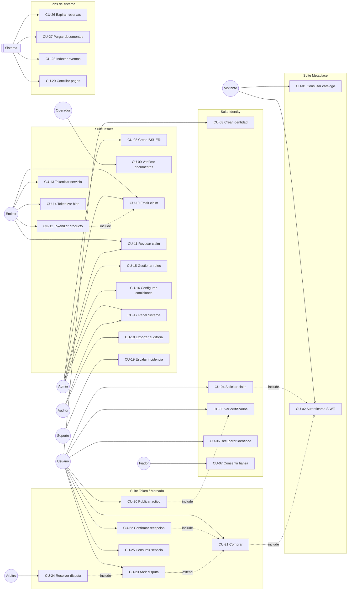
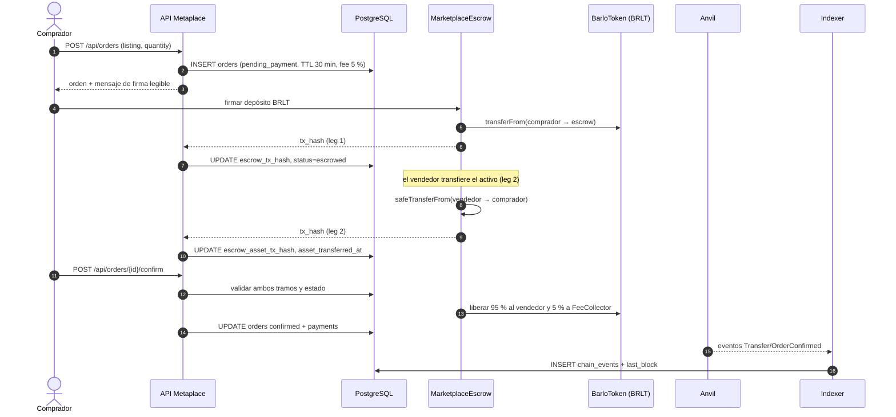
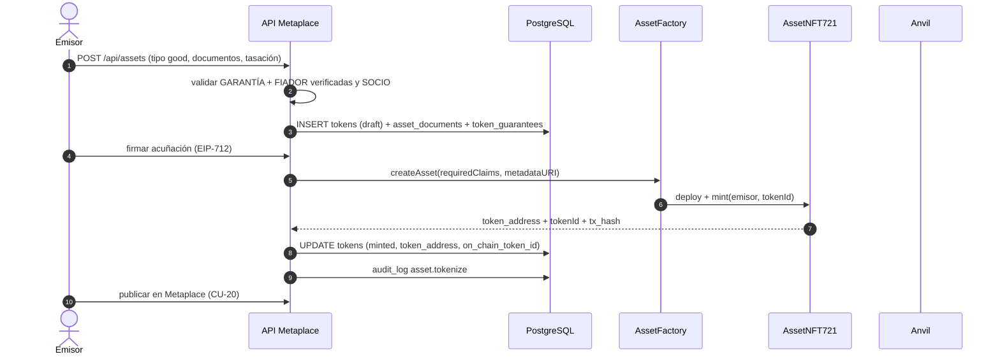
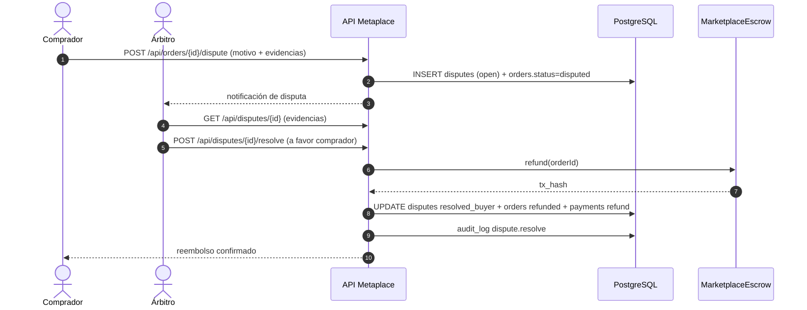
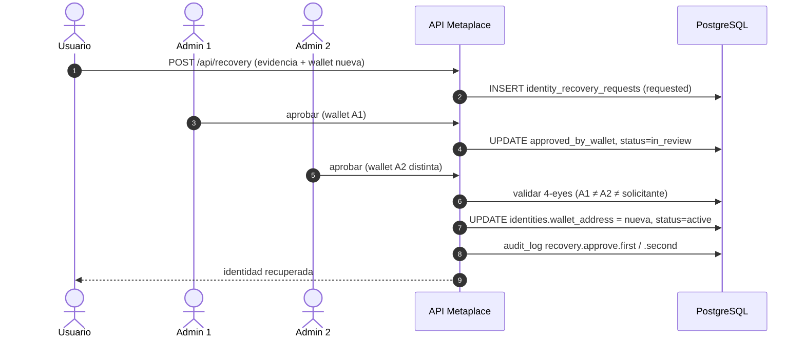
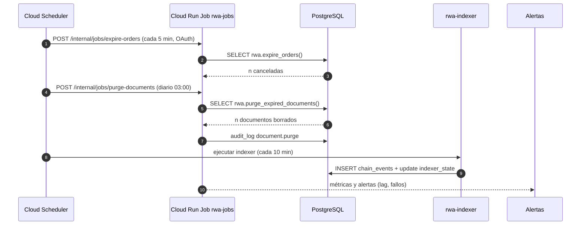
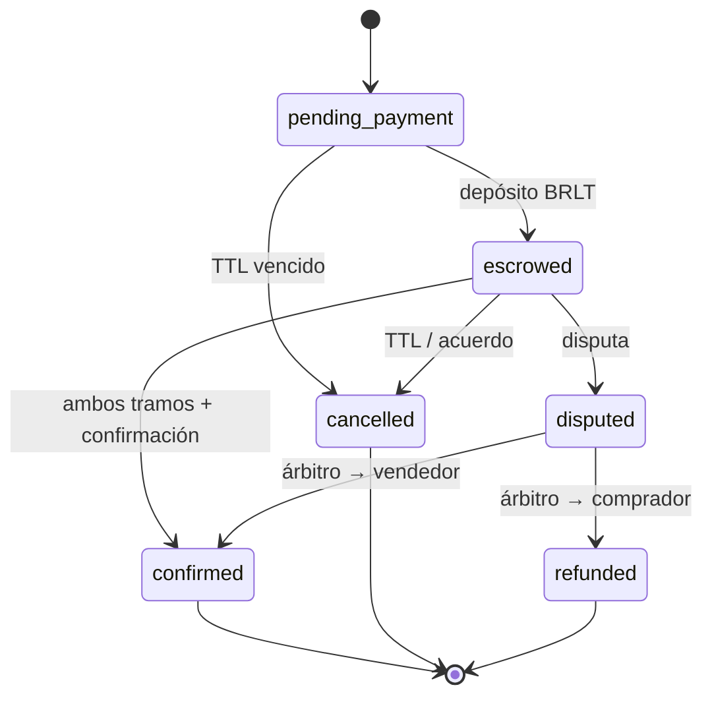

# Diagramas de casos de uso — RWA v3 «Barlo Metaplace»

> **Versión:** v3.2 · **Fecha:** 2026-11-04 · **Fase:** 2
> **Fuente:** `casos_uso.md` v3.2 (29 CU, 10 actores). Todos los diagramas son **Mermaid** renderizable
> en cualquier visor. Mismos nombres de actor y de caso que el documento de casos de uso.

## 1. Diagrama de casos de uso (actores ↔ CU)



## 2. Secuencia — Alta y certificación de Socio (CU-02/03/04/09/10)

```mermaid
sequenceDiagram
    autonumber
    actor U as Usuario
    participant W as Wallet
    participant API as API Metaplace
    participant DB as PostgreSQL
    participant OP as Operador
    participant EM as Emisor
    participant AN as Anvil (contratos)

    U->>API: GET /api/auth/nonce
    API->>DB: crear nonce (1 uso, TTL 5 min)
    API-->>U: nonce + mensaje SIWE
    U->>W: firmar mensaje
    W-->>U: firma
    U->>API: POST /api/auth/verify (firma)
    API->>API: validar firma, domain, chainId, nonce
    API-->>U: cookie httpOnly + sesión
    U->>API: POST /api/identity
    API->>DB: INSERT identities (alias, kyc_level=0)
    U->>API: POST /api/claims (ISSUER kyc-base + documentos)
    API->>API: validar MIME, tamaño, cuota; cifrar AES-256-GCM
    API->>DB: INSERT claim_requests (pending) + document_files
    OP->>API: abrir cola /emisor/verificacion
    OP->>API: marcar documentos verificados
    API->>DB: UPDATE verified_by_wallet, verified_at, status=documents_verified
    EM->>API: aprobar claim (firma EIP-712)
    API->>AN: addClaim(topic, issuer, expiry, signature, data)
    AN-->>API: tx_hash + evento ClaimAdded
    API->>DB: UPDATE claim_requests (approved, issuer_id, tx_hash)
    API-->>U: certificado vigente
```

## 3. Secuencia — Compra con escrow BRLT + NFT (CU-21/22)



## 4. Secuencia — Tokenización de un bien (CU-14)



## 5. Secuencia — Disputa y resolución (CU-23/24)



## 6. Secuencia — Recuperación de identidad con 4-eyes (CU-06)



## 7. Secuencia — Jobs programados (CU-26/27/28/29)



## 8. Máquina de estados de la orden (referencia)



---

*Diagramas v3.2 · coherentes con `casos_uso.md` y `base_datos.sql` (triggers de estado).*
