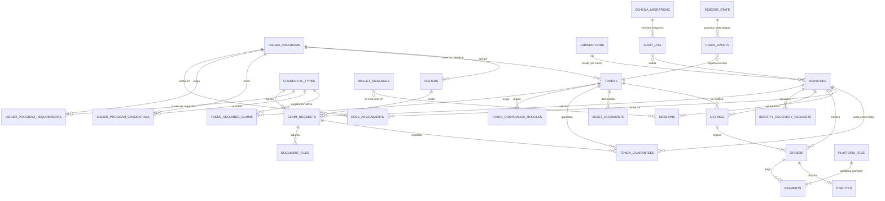
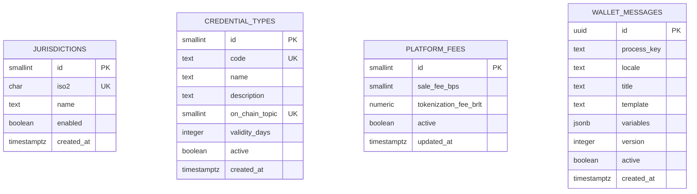
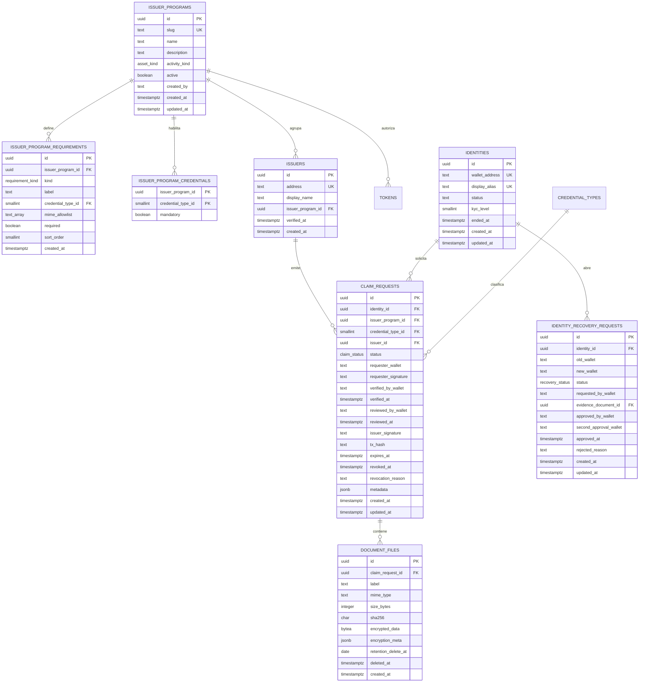

# Diagrama Entidad-Relación — RWA v3 «Barlo Metaplace»

> **Versión:** v3.1 (esquema 3.0) · **Fecha:** 2026-10-31 · **Motor:** PostgreSQL 15 · **Esquema:** `rwa`
> **Sincronía obligatoria:** los nombres de entidades y atributos son **idénticos** a
> `base_datos.sql` y `diccionario_datos.md`.
> **Cobertura:** 27 tablas del esquema `rwa` en 5 bloques (global + 4 dominios). Sin tablas ni
> relaciones fuera del diagrama.

## 1. Vista global (entidades principales y cardinalidades)



## 2. Dominio: catálogos y configuración



## 3. Dominio: ISSUER, identidad y certificaciones



## 4. Dominio: activos tokenizados

```mermaid
erDiagram
    ISSUER_PROGRAMS ||--o{ TOKENS : "autoriza"
    TOKENS ||--o{ TOKEN_REQUIRED_CLAIMS : "exige"
    TOKENS ||--o{ TOKEN_COMPLIANCE_MODULES : "regula"
    TOKENS ||--o{ TOKEN_GUARANTEES : "respaldado por"
    TOKENS ||--o{ ASSET_DOCUMENTS : "documenta"
    IDENTITIES ||--o{ TOKEN_GUARANTEES : "fiador"
    CLAIM_REQUESTS ||--o{ TOKEN_GUARANTEES : "claim que respalda"

    TOKENS {
        uuid id PK
        uuid issuer_program_id FK
        text token_address UK
        numeric on_chain_token_id
        asset_kind asset_kind
        asset_standard standard
        text name
        text symbol
        smallint decimals
        numeric total_supply
        text unit
        numeric price_brlt
        numeric valued_brlt
        text metadata_uri
        asset_status status
        text minted_tx_hash
        text created_by
        timestamptz created_at
        timestamptz updated_at
    }
    TOKEN_REQUIRED_CLAIMS {
        uuid token_id PK
        smallint credential_type_id PK
    }
    TOKEN_COMPLIANCE_MODULES {
        uuid token_id PK
        text module_address PK
        text module_kind
    }
    TOKEN_GUARANTEES {
        uuid id PK
        uuid token_id FK
        guarantee_kind kind
        uuid identity_id FK
        uuid claim_request_id FK
        boolean verified
        timestamptz verified_at
        text validated_by_wallet
        timestamptz created_at
    }
    ASSET_DOCUMENTS {
        uuid id PK
        uuid token_id FK
        asset_doc_kind doc_kind
        text mime_type
        integer size_bytes
        char sha256
        bytea encrypted_data
        jsonb encryption_meta
        date retention_delete_at
        timestamptz deleted_at
        timestamptz created_at
    }```

## 5. Dominio: Metaplace, pagos y operación

```mermaid
erDiagram
    TOKENS ||--o{ LISTINGS : "se publica"
    IDENTITIES ||--o{ LISTINGS : "vende"
    LISTINGS ||--o{ ORDERS : "origina"
    IDENTITIES ||--o{ ORDERS : "compra"
    ORDERS ||--o{ PAYMENTS : "liquida"
    ORDERS ||--o| DISPUTES : "abre"
    ISSUER_PROGRAMS ||--o{ ROLE_ASSIGNMENTS : "acota"
    IDENTITIES ||--o{ PAYMENTS : "paga"
    IDENTITIES ||--o{ SESSIONS : "autentica"
    CHAIN_EVENTS }o--|| INDEXER_STATE : "indexado"
    AUDIT_LOG }o--o{ IDENTITIES : "audita"

    LISTINGS {
        uuid id PK
        uuid token_id FK
        uuid seller_identity_id FK
        numeric price_brlt
        numeric quantity
        numeric remaining_quantity
        text currency
        text status
        timestamptz created_at
        timestamptz updated_at
        timestamptz closed_at
    }
    ORDERS {
        uuid id PK
        uuid listing_id FK
        uuid buyer_identity_id FK
        uuid seller_identity_id FK
        numeric quantity
        numeric price_brlt
        numeric fee_brlt
        order_status status
        text escrow_tx_hash
        text escrow_asset_tx_hash
        timestamptz asset_transferred_at
        timestamptz created_at
        timestamptz updated_at
        timestamptz expires_at
        timestamptz confirmed_at
        timestamptz cancelled_at
    }
    PAYMENTS {
        uuid id PK
        uuid order_id FK
        uuid payer_identity_id FK
        text payee_wallet
        payment_kind kind
        numeric amount_brlt
        numeric fee_brlt
        payment_status status
        text tx_hash
        timestamptz created_at
    }
    SESSIONS {
        uuid id PK
        text nonce UK
        text wallet_address
        session_role role
        text domain
        timestamptz issued_at
        timestamptz expires_at
        timestamptz revoked_at
    }
    AUDIT_LOG {
        bigint id PK
        text actor_wallet
        text actor_role
        text action
        text resource_type
        text resource_id
        text request_id
        inet ip
        jsonb metadata
        timestamptz created_at
    }
    CHAIN_EVENTS {
        bigint id PK
        bigint chain_id
        bigint block_number
        text block_hash
        text parent_hash
        text tx_hash
        integer log_index
        text event_name
        text contract_address
        jsonb payload
        boolean removed
        timestamptz created_at
    }
    ROLE_ASSIGNMENTS {
        uuid id PK
        text wallet_address
        session_role role
        text scope
        uuid issuer_program_id FK
        text granted_by_wallet
        timestamptz granted_at
        timestamptz revoked_at
        text reason
    }
    DISPUTES {
        uuid id PK
        uuid order_id FK
        uuid opened_by_identity_id FK
        text reason
        dispute_status status
        text arbiter_wallet
        text resolution
        timestamptz opened_at
        timestamptz resolved_at
    }
    INDEXER_STATE {
        smallint id PK
        bigint chain_id
        bigint last_block
        text last_block_hash
        timestamptz updated_at
    }
    SCHEMA_MIGRATIONS {
        text version PK
        text description
        timestamptz applied_at
    }
```

## 6. Reglas de integridad reflejadas (resumen)

- `claim_requests`: aprobado ⇒ `reviewed_by_wallet` + `reviewed_at` + `issuer_signature`; revocado ⇒ `revoked_at`.
- `tokens`: precio de listado ≤ valor de tasación (Q9); bien ⇒ `on_chain_token_id`; servicio ⇒ ERC-721.
- `token_guarantees`: como máximo una fila `garantia` y una `fiador` por activo; fiador exige `identity_id`.
- `identity_recovery_requests`: aprobado/completado ⇒ doble aprobación (Q5).
- `document_files` / `asset_documents`: retención y borrado lógico con `deleted_at`.

*Fin del diagrama ER v3.0 — 27 tablas cubiertas.*
