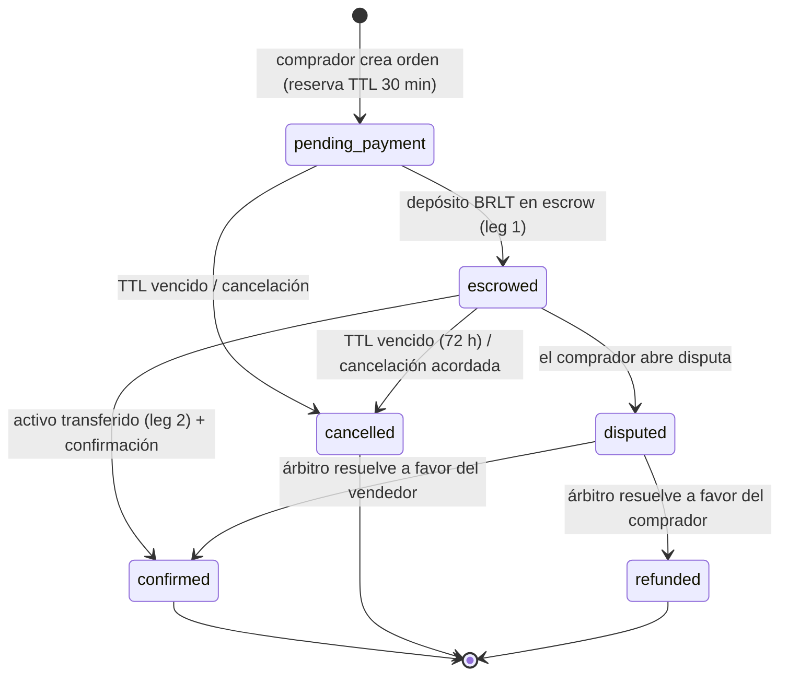

# Diseño de cierre de compuerta — B3, B5, B6, B7, B8, B9 · RWA v3.2

> **Fecha:** 2026-11-02 · **Base:** `INFORME_CIERRE_V3_1.md` §8.1 (criterios B1–B12)
> **Objetivo:** convertir los bloqueantes de diseño/operación en especificaciones verificables,
> con DDL, contratos, jobs y pruebas definidas. **No** implementa código de producción: fija el
> contrato de cada pieza para los ciclos C0–C6.
> **Estado:** B3, B5, B6, B7, B8 y B9 **diseñados**; B1/B2 verificados por ejecución; B10/B11 hechos;
> **B12 pendiente de la re-auditoría final**.

## 0. Mapa B-item → artefacto

| B | Tema | Dónde queda |
|---|---|---|
| **B3** | Escrow/marketplace verificable | §1 + DDL (`trg_validate_order_transition`, `trg_set_order_economics`, `trg_validate_payment_payee`, `expire_orders`) |
| **B5** | RBAC real | §2 + `role_assignments` + semillas por rol |
| **B6** | Compliance on-chain | §3 (spec de contratos) + `token_required_claims` |
| **B7** | Retención Q10 ejecutable | §4 + triggers + `purge_expired_documents` |
| **B8** | Operación y coste | §5 + `entornos_globales.md` §9.1 |
| **B9** | RNF falsables | §6 + Anexo A de `requerimientos.md` + RNF-V3-04/05/06 |

---

## 1. B3 — Escrow y marketplace verificables

### 1.1 Máquina de estados

Transiciones implementadas en `rwa.validate_order_transition` (cualquier otra revierte).
Cada transición escribe en `audit_log` (actor + `order.status`) y emite `OrderStatusChanged`.

### 1.2 Modelo de atomicidad (dos tramos)

| Tramo | Qué mueve | Evidencia on-chain | Condición para confirmar |
|---|---|---|---|
| **leg 1 — BRLT** | Precio del comprador → escrow | `orders.escrow_tx_hash` (único) | `status = escrowed` |
| **leg 2 — activo** | NFT/ERC-1155 del vendedor → comprador | `orders.escrow_asset_tx_hash` | `asset_transferred_at` no nulo |
| **finalización** | escrow → vendedor (menos comisión) · comisión → `FeeCollector` | `payments` (`sale` + fee) | ambos tramos + `confirmed_at` |

- El contrato `MarketplaceEscrow` ejecuta **ambos tramos en la misma transacción**
  (`safeTransferFrom` del activo + `transferFrom` del BRLT); si falta `approve` o el activo no está
  en venta, revierte y no hay estado intermedio.
- La BD **no** da por confirmada una orden sin los dos hashes (trigger de aplicación + API).
- Si el vendedor no transfiere el activo en 72 h, `expire_orders()` cancela y el escrow se reembolsa.

### 1.3 Validaciones (DDL + aplicación)

| Regla | Implementación |
|---|---|
| Una sola orden abierta por publicación | índice único parcial `ux_orders_open` |
| Reserva con TTL (30 min por defecto) | `trg_reserve_listing_inventory` |
| Remanente nunca negativo | trigger + `remaining_quantity` |
| Vendedor = dueño de la publicación | `trg_set_order_economics` |
| Comisión = `platform_fees.sale_fee_bps` vigente | `trg_set_order_economics` |
| Pago solo a la wallet del vendedor | `trg_validate_payment_payee` |
| Precio ≤ tasación | `tokens_price_leq_valued` + `trg_listings_price_cap` |
| `tx_hash` idempotentes | `ux_orders_escrow_tx`, `ux_payments_tx` |
| Transiciones válidas | `trg_validate_order_transition` |

### 1.4 Jobs

| Job | Frecuencia | Acción | Idempotencia | Evidencia |
|---|---|---|---|---|
| `expire_orders` | cada 5 min | cancela `pending_payment`/`escrowed` vencidas y libera inventario | `WHERE expires_at <= now() AND status IN (…)` | `audit_log` + contador de métricas |

Ejecución: **Cloud Scheduler → Cloud Run Job `rwa-jobs`** (OAuth con SA `rwa-scheduler@…`) → endpoint
interno `/internal/jobs/expire-orders` (autenticado, sin acceso público) → `SELECT rwa.expire_orders()`.
El job registra cuántas órdenes expiró; si falla, alerta `job_failure`.

### 1.5 Criterios de aceptación (C4)

1. Dos compradores concurrentes sobre la misma publicación: **1 orden abierta**, la segunda recibe `409`
   y **ningún** BRLT duplicado (test de concurrencia 40 hilos).
2. Confirmar sin `escrow_asset_tx_hash` → rechazo.
3. TTL 30 min vencido → `cancelled` + remanente liberado (test con reloj simulado).
4. Transición `pending_payment → confirmed` → rechazo de la BD.
5. Pago a wallet distinta del vendedor → rechazo.
6. Comisión calculada = 5 % (500 bps) de `price_brlt` y registrada en `payments`.
7. Reembolso por disputa → `refunded` + evento indexado + `payments.kind = refund`.

---

## 2. B5 — RBAC real

### 2.1 Principios y ámbitos

- **Principal ≠ claim:** los roles se asignan a wallets en `role_assignments`; los claims (SOCIO,
  GARANTÍA, FIADOR…) siguen siendo credenciales on-chain. Un rol **no** sustituye un claim.
- Dos ámbitos: `platform` (global) y `issuer_program` (el rol solo opera sobre un ISSUER concreto).
- Rol efectivo de una petición = unión de asignaciones **vigentes** (`revoked_at IS NULL`) verificada
  en servidor en cada request; la cookie de sesión solo identifica la wallet.

### 2.2 Matriz definitiva (roles × capacidades)

| Capacidad | Visitante | Usuario | Fiador | Operador | Issuer | Auditor | Árbitro | Soporte | Admin |
|---|---|---|---|---|---|---|---|---|---|
| Catálogo público (GET) | ✅ | ✅ | ✅ | ✅ | ✅ | ✅ | ✅ | ✅ | ✅ |
| Comprar/vender (con SOCIO) | ❌ | ✅ | ✅ | ❌ | ❌ | ❌ | ❌ | ❌ | ✅ |
| Solicitar claims | ❌ | ✅ | ✅ | ❌ | ❌ | ❌ | ❌ | ❌ | ✅ |
| Verificar documentos | ❌ | ❌ | ❌ | ✅ | ❌ | ❌ | ❌ | ❌ | ✅ |
| Aprobar/emitir claims | ❌ | ❌ | ❌ | ❌ | ✅ solo su programa | ❌ | ❌ | ❌ | ✅ |
| Crear/editar ISSUER | ❌ | ❌ | ❌ | ❌ | ❌ | ❌ | ❌ | ❌ | ✅ |
| Tokenizar | ❌ | ❌ | ❌ | ❌ | ✅ solo su programa | ❌ | ❌ | ❌ | ✅ |
| Arbitrar disputa | ❌ | ❌ | ❌ | ❌ | ❌ | ❌ | ✅ | ❌ | ✅ |
| Panel Sistema | ❌ | ❌ | ❌ | ❌ | ❌ | ✅ lectura | ❌ | ❌ | ✅ |
| Exportar auditoría | ❌ | ❌ | ❌ | ❌ | ❌ | ✅ | ❌ | ❌ | ✅ |
| Recuperación de identidad | solicita | solicita | ❌ | ❌ | ❌ | ❌ | ❌ | escala | custodia |
| Escalar incidencias (SLA 24 h) | ❌ | ❌ | ❌ | ❌ | ❌ | ❌ | ❌ | ✅ | ✅ |

### 2.3 Ciclo de vida de una asignación

`grant` (Admin, motivo) → asignación vigente → `revoke` (Admin, motivo) → `revoked_at`.
Cada operación escribe en `audit_log` (`role.grant` / `role.revoke`). Un rol revocado deja de valer
**inmediatamente** (consulta a `role_assignments` en cada request, sin caché de sesión).

### 2.4 Cuentas semilla (SOLO DEV) y rotación

| Rol | Wallet semilla (Anvil) | Nota |
|---|---|---|
| Admin | `0x14dc…9955` | nunca la cuenta #0 |
| Auditor | `0x2361…c1f4` | solo lectura/exportación |
| Árbitro | `0xa0ee…9720` | disputas |
| Operador | `0x15d3…6a65` | verificación documental |
| Soporte | `0x2361…c1f4` | escalado (puede compartir wallet en dev) |
| Issuer (por programa) | `0x7099…79c8` (kyc-base), `0x3c44…93bc` (garantía), `0x90f7…b906` (fiador), `0x9965…a4dc` (socio) | ámbito `issuer_program` |

En **C0** se generan claves dedicadas fuera de Anvil, se cargan en Secret Manager y un gate de CI
falla si una wallet de rol coincide con una cuenta conocida de Anvil (H-11).

### 2.5 `audit_log` append-only y retención

- Triggers `trg_audit_log_append_only` rechazan `UPDATE`/`DELETE`.
- Retención ≥ 12 meses; particionado mensual (`audit_log_YYYYMM`) a partir de 10 M filas.
- Rol **Auditor** con `SELECT` y exportación (CSV firmado con `sha256`).

### 2.6 Criterios de aceptación (C5)

1. Matriz de autorización 8 roles × 12 capacidades ejecutada como test positivo/negativo: **100 %**
   de las celdas ❌ devuelven `403` y las ✅ `200`.
2. Revocar un rol surte efecto en la siguiente petición (< 1 s).
3. `UPDATE`/`DELETE` sobre `audit_log` fallan con error.
4. Un Issuer no puede emitir un claim de otro programa (`trg_claim_issuer_program`).
5. Un Auditor no puede escribir en ninguna tabla.

---

## 3. B6 — Compliance on-chain

### 3.1 Hooks por contrato

| Contrato | Hook | Regla |
|---|---|---|
| `AssetNFT721` (bienes, servicios) | `_update(from, to, tokenId, auth)` | si `to ≠ 0`: `IdentityRegistry.isVerified(to, requiredClaims)` y módulos de compliance del activo; si falla → revert |
| `AssetERC1155` (productos/lotes) | `_update(from, to, ids, values, auth)` | idem por lote |
| `MarketplaceEscrow` | `list` / `buy` | `list`: vendedor verificado y dueño; `buy`: comprador verificado y SOCIO vigente |
| `BarloToken` | `_update` | allowlist de contrapartes de plataforma (escrow, FeeCollector, tesorería) |

### 3.2 Fuente de requisitos por activo

- Al acuñar, `AssetFactory` copia `token_required_claims` de la BD al estado del contrato
  (`mapping(address => uint16[]) requiredTopics`) — **la BD es la intención, el contrato la aplica**.
- `isVerified` fail-closed: registry sin configurar ⇒ `false` (cierra RF-011/012 de v2).
- Revocación de claim: la app pausa el token y el contrato bloquea transferencias de wallets afectadas
  (consulta en vivo, sin caché).

### 3.3 Comportamiento esperado

| Escenario | Resultado |
|---|---|
| Transferir un bien a wallet sin SOCIO/KYC | revert `ReceiverNotVerified` |
| Comprar sin SOCIO vigente | revert `BuyerNotVerified` |
| Listar un activo con claim GARANTÍA revocado | revert `AssetNotCompliant` |
| Quemar un servicio usado por su titular | permitido (`burn` del holder) |
| Transferencia a wallet con KYC vencido | revert |

### 3.4 Criterios de aceptación (C3)

1. Test adversarial: 6 escenarios de §3.3, todos revierten/omiten según tabla.
2. `isVerified` devuelve `false` si el registry no está configurado (fail-closed).
3. `token_required_claims` de la BD coincide con los `requiredTopics` on-chain del activo
   (gate anti-deriva en CI).

---

## 4. B7 — Retención Q10 ejecutable

### 4.1 Cálculo de fechas

| Hecho | Regla | Implementación |
|---|---|---|
| Claim **rechazado** | `retention_delete_at = +30 días` | `trg_claim_revocation_cascade` |
| **Fin de relación** (`identities.ended_at`) | documentos de la identidad → `+12 meses` | `trg_identity_end_retention` |
| Documentos de **activo** vendido | `+12 meses` desde la venta | trigger `trg_asset_retention_on_sale` (C1) |
| Documento aprobado con relación vigente | `NULL` (se conserva) | — |

### 4.2 Job de purga

| Job | Frecuencia | Acción | Evidencia |
|---|---|---|---|
| `purge_documents` | diario 03:00 UTC | `DELETE` de documentos con `retention_delete_at <= current_date`; devuelve contador; registra `document.purge` en `audit_log` (desde la app) | contador + `audit_log` |

Ejecución: Cloud Scheduler → Cloud Run Job `rwa-jobs` → `/internal/jobs/purge-documents` (OAuth).
Modo `DRY_RUN=1` para ensayo. La API **nunca** sirve un documento con `deleted_at` no nulo.

### 4.3 Criterios de aceptación (C1)

1. Documento rechazado: a los 30 días deja de servirse y se purga; `audit_log` registra `document.purge`.
2. Cierre de relación: a los 12 meses se purga; antes, se conserva.
3. 0 filas vencidas servidas por API (test que recorre la tabla).
4. `asset_documents` sigue la misma regla.

---

## 5. B8 — Operación, continuidad y coste

| Tema | Compromiso | Verificación |
|---|---|---|
| **Backup Cloud SQL** | backups automáticos **7 días** + **PITR 7 días** | `gcloud sql instances describe` + restore drill |
| **RPO / RTO** | **RPO ≤ 15 min · RTO ≤ 4 h** | ensayo trimestral documentado (fecha, RTO medido) |
| **Restauración** | ensayo mensual a instancia `-restore-test`, validar 27 tablas + conteos | acta `pruebas/restore_<fecha>.md` |
| **Clave KYC** | Secret Manager con **versiones** + envelope encryption KMS; rotación 90 días; copia en `truekeate-main` | `gcloud secrets versions list` + test de descifrado con versión anterior |
| **Pooling** | `PG_POOL_MAX=5` × `max-instances=3` = 15 conexiones (≤ 30 % del límite de la instancia); pgbouncer si se supera | test de carga + métrica de conexiones |
| **RPC** | primario + secundario (`RPC_URL`/`RPC_URL_FALLBACK`) con health-check y conmutación | test de caída del primario |
| **Anvil** | runbook de reset con reconciliación off-chain; snapshot del estado; nunca producción | runbook en `pruebas/` |
| **Región** | apps `europe-west1` y BD `southamerica-east1`: medir p95 real; si incumple, mover apps a `southamerica-east1` | medición en C0 |
| **Coste** | presupuesto demo **≤ 50 USD/mes** con budget alerts 10/25/50 USD; desglose: Cloud Run ~10, Cloud SQL ~15, storage/egress ~10, Secret Manager ~2, extras ~13 | factura mensual + alertas activas |

### 5.1 Criterios de aceptación (C13)

1. Restore drill ejecutado con RTO medido y < 4 h.
2. Rotación de `KYC_ENCRYPTION_KEY` probada (descifrado con versión anterior + nueva).
3. budget alerts configuradas (10/25/50 USD) y verificadas.
4. Test de failover del RPC con conmutación < 5 s.

---

## 6. B9 — RNF falsables

### 6.1 Manifiesto de las 12 rutas (Anexo A de `requerimientos.md`)

| # | Ruta | Suite | Criticidad |
|---|---|---|---|
| 1 | `/` | Metaplace | alta |
| 2 | `/login` | Metaplace | alta |
| 3 | `/catalogo` | Token | alta |
| 4 | `/activo/[id]` | Token | alta |
| 5 | `/compras` | Token | media |
| 6 | `/identidad` | Identity | alta |
| 7 | `/identidad/claims` | Identity | alta |
| 8 | `/identidad/recuperacion` | Identity | media |
| 9 | `/emisor` | Issuer | media |
| 10 | `/emisor/solicitudes` | Issuer | alta |
| 11 | `/emisor/verificacion` | Issuer | alta |
| 12 | `/sistema` | Issuer (admin) | media |

- **axe:** `wcag2aa`, 0 violaciones de impacto `serious`/`critical`; baseline por ruta versionado.
- **p95:** k6/Artillery, 50 VU durante 5 min, dataset ≥ 10 k `chain_events`, `min-instances=1`;
  lectura < 800 ms, escritura < 1,5 s.
- **S-14 (pico):** 60 servicios/mes ⇒ ~2/día; pico definido = **20 compras concurrentes + 5 claims/min**;
  la prueba de carga usa **2× el pico = 40 compras concurrentes**.
- **SLI/SLO:** disponibilidad ≥ 99,5 % mensual, error rate < 1 %, lag del indexer < 2 bloques,
  panel Sistema con alertas y dueño.

### 6.2 Criterios de aceptación

1. Manifiesto de 12 rutas automatizado (el test falla si se añade una ruta sin clasificar).
2. Gate de axe en CI con umbral `serious`/`critical = 0`.
3. Informe de carga con los 4 números (p50/p95/p99 y errores) y 0 dobles ventas.
4. Alertas con dueño declaradas y probadas.

---

## 7. Riesgos residuales de esta ronda

| Riesgo | Mitigación |
|---|---|
| La atomicidad NFT↔BRLT depende de contratos que se implementan en C3/C4 | spec §1.2 + tests de contrato en C4 |
| Roles seed en Anvil son dev | rotación obligatoria en C0 (gate de CI) |
| Jobs requieren Cloud Run Job y Scheduler nuevos | se aprovisionan en C0/C1 con `deploy_gcp.sh` |
| Región BD distante | medición en C0; decisión de mover apps o réplica |

## 8. Conclusión

- **B3, B5, B6, B7, B8, B9:** ✅ **diseñados y con criterios falsables**; el DDL ya materializa la
  máquina de estados, los roles, la retención y los jobs invocables.
- Queda **implementar** en los ciclos C0–C5 y ejecutar las pruebas; después, **re-auditoría final**
  (B12) para declarar cerrada la Fase 1.

*Fin del diseño v3.2.*
