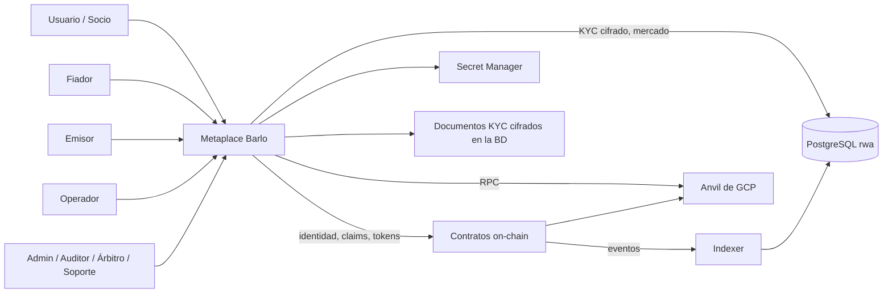
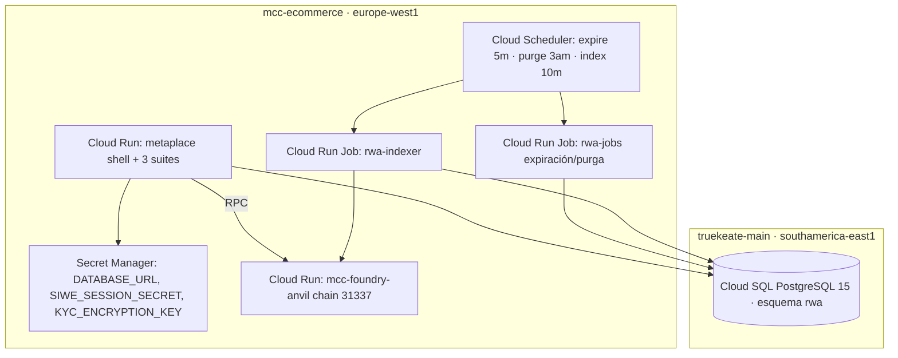

# Documento técnico — RWA v3 «Barlo Metaplace»

> **Versión:** v3.2 · **Fecha:** 2026-11-04 · **Fase:** 2 (Casos de uso + documento técnico)
> **Base:** `requerimientos.md` v3.2 · `casos_uso.md` v3.2 (29 CU) · `base_datos.sql` v3.2 (27 tablas) ·
> `diseno_cierre_v3_2.md` · `INFORME_CIERRE_V3_2.md` · decisión **Q14a** (Fase 1 cerrada como baseline de diseño).
> **Naturaleza:** especificación técnica de arquitectura y de implementación por ciclos. No declara
> implementado nada que no esté en un acta de ejecución.

---

## 1. Visión general y alcance

**Barlo Metaplace** es una plataforma de tokenización de activos reales (RWA) con identidad Web3
certificada, tres suites (Identity, Issuer, Token) bajo un mismo shell visual y una moneda de pago
propia (**BRLT**, ERC-20 de 8 decimales, sin valor real en esta versión).

| Dimensión | Alcance v3.0 |
|---|---|
| Identidad | Alta seudónima, KYC avanzado, claim **SOCIO** obligatorio para operar |
| Certificación | ISSUER configurable (proceso + requisitos + N claims), claims **SOCIO/KYC/GARANTÍA/FIADOR/JURISDICCIÓN/ACREDITACIÓN** |
| Tokenización | Productos (ERC-1155), servicios (ERC-721 quemable), bienes (ERC-721 único) |
| Mercado | Precio fijo, escrow BRLT + activo, comisión 5 %, disputa con árbitro |
| Operación | Admin/Operador/Emisor/Auditor/Árbitro/Soporte, panel Sistema, jobs de expiración y purga |
| Fuera de alcance | Valor real, custodia FIAT, subastas/barter (v3.1), producción con activos reales |

## 2. Decisiones que gobiernan el diseño

| Decisión | Efecto técnico |
|---|---|
| Q1 v3 sustituye a v2 en la misma infraestructura | rama `rwa-web-DSH-GCP-v3`; reutilización de Cloud Run/Anvil/Cloud SQL |
| Q2 BRLT utilidad sin valor real | `cap` 100 M, `maxMintPerTx`, multisig+timelock, sin respaldo |
| Q3 precio fijo | `listings`/`orders` sin ofertas ni subastas |
| Q4 comisión 5 % + fee | `platform_fees` + `FeeCollector` on-chain |
| Q5 non-custodial + recuperación asistida | `identity_recovery_requests` con 4-eyes |
| Q6 catálogo BRLT + RWA | sin stablecoin/BTC demo |
| Q7 LatAm piloto | `jurisdictions` (VE, CO, PA, MX, CL, PE, AR) |
| Q8 claims sin caducidad | `expires_at NULL`; revocación sí |
| Q9 tasación documental | `valued_brlt` + tope de precio |
| Q10 retención 30 d / 12 m | triggers + `purge_expired_documents()` |
| Q11 Emisor = rol | `issuer` en `role_assignments` + `claim_requests.issuer_id` |
| Q12 escrow completo | máquina de estados + tramo NFT + disputa |
| Q13 demo sin activos reales | gate legal antes de valor real (RNF-V3-12) |
| Q14a Fase 1 = baseline de diseño | implementación se cierra en C0–C6 |

## 3. Arquitectura

### 3.1 Contexto (C4 nivel 1)

### 3.2 Contenedores (C4 nivel 2)

### 3.3 Componentes internos

| Componente | Responsabilidad | Ciclo | Dueño |
|---|---|---|---|
| `apps/web` (Metaplace shell) | navegación, sesión, design system, 3 suites | C1 (shell) · C5 (UX) | Web |
| `packages/shared` | config de red, ABIs, tipos, BD, zod, cliente API | C0–C5 | Web |
| `packages/wallet-messages` | plantillas de firma legibles (8 procesos × es/en) + test digest↔texto | C5 | Web |
| API (route handlers) | auth SIWE, identidad, claims, ISSUER, activos, mercado, disputas, admin, jobs | C1–C4 | Backend |
| Indexer | eventos on-chain → `chain_events`, `indexer_state` | C0–C4 | Backend |
| Contratos | identidad/claims (v2) + BarloToken + AssetNFT721/1155 + AssetFactory + MarketplaceEscrow + FeeCollector + DisputeManager + AssetComplianceHook + RoleRegistry | C0 (BRLT) · C3 (activos) · C4 (mercado) · C5 (roles) | Contratos |
| BD `rwa` | 27 tablas (ver diccionario) | C0 (migración) | Datos |
| Jobs | `expire_orders`, `purge_expired_documents`, indexer, conciliación | C0 (infra) · C1 (purga) | DevOps/Backend |

## 4. Contratos (estado y responsabilidades)

| Contrato | Red | Responsabilidad | Ciclo | Dueño |
|---|---|---|---|---|
| `IdentityRegistry` + clones | reutilizado v2 | identidad on-chain por wallet | C0 | Contratos |
| `TrustedIssuersRegistry` / `ClaimTopicsRegistry` | reutilizado v2 | emisores autorizados y topics | C0 | Contratos |
| `ClaimLifecycle` | nuevo/ampliado | expiry/revocation (v3.0 sin caducidad, revocación sí) | C3 | Contratos |
| `BarloToken` (ERC-20, 8 dec) | nuevo | moneda de pago, cap, mint/burn/pause, multisig | **C0** | Contratos |
| `AssetNFT721` | nuevo | bienes y servicios; `_update` con compliance | C3 | Contratos |
| `AssetERC1155` | nuevo | productos/lotes; compliance por lote | C3 | Contratos |
| `AssetFactory` | nuevo | acuñación y registro de activos | C3 | Contratos |
| `MarketplaceEscrow` | nuevo | leg1 BRLT + leg2 activo en la misma tx | C4 | Contratos |
| `DisputeManager` | nuevo | apertura, plazos y resolución por árbitro | C4 | Contratos |
| `FeeCollector` | nuevo | comisión 5 % (500 bps configurable) | C4 | Contratos |
| `AssetComplianceHook` | nuevo | **B6**: `_update`/`beforeTokenTransfer` → `IdentityRegistry.isVerified` + `token_required_claims` | C3 | Contratos |
| `RoleRegistry` | nuevo | **B5**: principales por programa (issuer/operator/auditor/arbiter/support) | C5 | Contratos |
| `IdentityRecovery` | nuevo | cambio de wallet con doble aprobación | C5 | Contratos |
| `GovernanceMultisig` | reutilizado v2 | gobernanza y timelock | C0 | Contratos |

**Fuente de verdad de ABIs/direcciones:** `sc/deployments/31337-<ts>-v3.json` + gate anti-deriva.

## 5. Modelo de datos (resumen)

27 tablas en el esquema `rwa` (detalle completo en `diccionario_datos.md`):

| Dominio | Tablas |
|---|---|
| Catálogos | `jurisdictions`, `credential_types`, `platform_fees`, `wallet_messages` |
| Identidad y certificación | `issuer_programs`, `issuer_program_requirements`, `issuer_program_credentials`, `issuers`, `identities`, `claim_requests`, `document_files`, `identity_recovery_requests` |
| Activos | `tokens`, `token_required_claims`, `token_compliance_modules`, `token_guarantees`, `asset_documents` |
| Mercado | `listings`, `orders`, `payments`, `disputes` |
| Operación | `role_assignments`, `sessions`, `audit_log`, `chain_events`, `indexer_state`, `schema_migrations` |

Reglas de integridad clave: aprobación con firma+verificación+emisor; anti-autoaprobación; segregación
Operador/Admin; 4-eyes en recuperación; fail-closed de Garantía+Fiador; máquina de estados de la orden;
dos tramos del escrow; `tx_hash` únicos; tope precio ≤ tasación; `audit_log` append-only; retención Q10.

## 6. API y eventos

### 6.1 Endpoints principales (por suite)

| Suite | Endpoints | CU |
|---|---|---|
| Metaplace | `GET /api/catalog`, `GET /api/catalog/{id}`, `GET/POST /api/auth/{nonce,verify,session,logout}` | CU-01, CU-02 |
| Identity | `POST/GET /api/identity`, `GET/POST /api/claims`, `POST /api/recovery`, `GET /api/documents/{id}` | CU-03…CU-06 |
| Issuer | `POST/GET/PATCH /api/issuer-programs`, `GET /api/review-queue`, `POST /api/claims/{id}/verify`, `POST /api/claims/{id}/issue`, `POST /api/claims/{id}/revoke`, `POST /api/assets`, `POST /api/assets/{id}/mint`, `POST /api/guarantees/{id}/consent` | CU-07…CU-14 |
| Admin | `GET/POST/PATCH /api/roles`, `GET/PATCH /api/fees`, `GET /api/system`, `GET /api/audit/export` | CU-15…CU-19 |
| Mercado | `GET/POST /api/listings`, `POST /api/orders`, `POST /api/orders/{id}/confirm`, `POST /api/orders/{id}/dispute`, `POST /api/disputes/{id}/resolve`, `POST /api/services/{id}/consume` | CU-20…CU-25 |
| Jobs (internos, OAuth) | `POST /internal/jobs/expire-orders`, `POST /internal/jobs/purge-documents`, `POST /internal/jobs/reconcile-payments` | CU-26, CU-27, CU-29 |

Convenciones: respuestas `{success, data}` o `{success:false, error}` con código de error de lista
cerrada; `401/403/404/409/422/503` semánticos (RNF-V3-06); `503` tipado si PostgreSQL o RPC caen.

### 6.2 Eventos on-chain indexados

`ClaimAdded`, `ClaimRevoked`, `IdentityRegistered`, `AssetMinted`, `ListingCreated`, `OrderEscrowed`,
`OrderConfirmed`, `OrderCancelled`, `OrderDisputed`, `OrderRefunded`, `ServiceBurned`, `FeeCollected`,
`RoleGranted`, `RoleRevoked`. Persistidos en `chain_events` con `chain_id`, `block_hash`, `removed`.

### 6.3 Mensajes de firma (EIP-712) y legibilidad

Catálogo `wallet_messages` (**8** procesos × `es`/`en`, incluido `guarantee.consent` para CU-07), con umbral: título ≤ 40 caracteres, texto ≤ 200,
sin jerga de lista cerrada, Flesch-Szigriszt ≥ 55; test que verifica que el texto mostrado corresponde
al digest firmado.

## 7. Seguridad y cumplimiento

| Control | Implementación |
|---|---|
| Autenticación | SIWE (EIP-4361) con nonce de un uso, cookie `httpOnly`+`SameSite=Strict`+`Secure` |
| Autorización | `role_assignments` por ámbito + `claims`; verificación en servidor por petición |
| Segregación | Operador verifica (`verified_by`) vs Admin aprueba (`reviewed_by`), wallets distintas |
| 4-eyes | recuperación con dos aprobadores distintos, ninguno el solicitante |
| PII | documentos AES-256-GCM en BD; servidos solo a titular/operador/admin; acceso auditado |
| Retención | triggers de fecha + job de purga + vista de vencidos |
| Secretos | Secret Manager (3 secretos); rotación 90 d; sin secretos en repo |
| Claves | no-custodial; dev wallets solo Anvil y rotación en C0; gate anti-cuentas Anvil |
| Compliance on-chain | hook `_update` + `token_required_claims` + `isVerified` fail-closed |
| Legal | BRLT sin valor real; DPIA y opinión legal antes de piloto (gate C1/piloto) |
| Auditoría | `audit_log` append-only con `request_id`; exportación solo Auditor |

## 8. Despliegue y entornos

| Elemento | Valor |
|---|---|
| Apps | Cloud Run en `mcc-ecommerce` / `europe-west1`, 1 GiB, max 3 instancias, público con SIWE |
| BD | Cloud SQL `truekeate-main:southamerica-east1:truekeate-db-dev`, esquema `rwa`, pool 5 |
| On-chain | Anvil de GCP (chain 31337), artefacto `31337-<ts>-v3.json` |
| Jobs | Cloud Run Job `rwa-jobs` + `rwa-indexer`, Scheduler (5 min / 3 am / 10 min) |
| Secretos | `DATABASE_URL`, `SIWE_SESSION_SECRET`, `KYC_ENCRYPTION_KEY` |
| CI | `.gitlab-ci.yml`: validate (submódulos + `artefactos-v3`), build, fmt, test, coverage, gas, ci-checks, slither |
| Pipeline de despliegue | `rwa-web/scripts/deploy_gcp.sh provision|build|deploy|scheduler|verify` |

## 9. Trazabilidad CU ↔ componente ↔ RF

| Componente | Casos de uso | RF |
|---|---|---|
| Shell Metaplace | CU-01, CU-02, CU-17 | RF-V3-01, RF-V3-02, RF-V3-05, RF-V3-23 |
| API Identity | CU-03…CU-06 | RF-V3-03, RF-V3-06, RF-V3-07, RF-V3-08, RF-V3-09, RF-V3-10, RF-V3-11 |
| API Issuer | CU-07…CU-14 | RF-V3-04, RF-V3-12, RF-V3-13, RF-V3-14, RF-V3-15, RF-V3-16, RF-V3-17, RF-V3-18, RF-V3-24 |
| API Issuer (cola de revisión) | CU-09 | RF-V3-22 |
| API Admin | CU-15…CU-19 | RF-V3-20, RF-V3-23, RF-V3-25, RF-V3-27, RF-V3-29 |
| API Mercado | CU-20…CU-25 | RF-V3-19, RF-V3-20, RF-V3-25, RF-V3-31 |
| Contratos identidad/claims | CU-02, CU-03, CU-10, CU-11 | RF-V3-06, RF-V3-24, RF-V3-31 |
| Contratos de activo | CU-12, CU-13, CU-14, CU-20, CU-25 | RF-V3-15, RF-V3-16, RF-V3-17, RF-V3-31 |
| Contratos mercado | CU-21, CU-22, CU-23, CU-24 | RF-V3-19, RF-V3-20, RF-V3-25 |
| Jobs | CU-26, CU-27, CU-28, CU-29 | RF-V3-23, RF-V3-25, RF-V3-30 |
| `packages/wallet-messages` | CU-02, CU-04, CU-07, CU-10, CU-21, CU-22 | RF-V3-21 |
| Indexer | CU-17, CU-28 | RF-V3-23 |
| **Migración v2→v3** (script ETL) | — (no es CU) | RF-V3-26 |
| **UI de asistencia guiada** | CU-01…CU-04 (transversal) | RF-V3-28 |

## 10. Riesgos técnicos y decisiones pendientes

| # | Riesgo | Mitigación / gate |
|---|---|---|
| R-1 | Contratos v3 aún no implementados | C3/C4 + auditoría externa antes de piloto |
| R-2 | Atomicidad NFT↔BRLT depende del contrato | spec §1.2 de diseño + tests de contrato en C4 |
| R-3 | Jobs cloud no aprovisionados | C0 (infra) + C1 (purga) |
| R-4 | Región BD vs apps | medir p95 en C0; mover apps a `southamerica-east1` si incumple |
| R-5 | DPIA/legal pendientes | gate C1/piloto (RNF-V3-12) |
| R-6 | Reorg/reset de Anvil | indexer con `block_hash`/`removed` + runbook |
| R-7 | Threat model y rate limiting | **RNF-V3-15** + gate de piloto **G-Piloto.2** (`INFORME_CIERRE_V3_1.md` §7) |
| R-8 | Restore drill y rotación de clave | gate antes de C0/piloto (B8) |

## 11. Plan de ciclos y criterios de salida

| Ciclo | Alcance | Criterio de salida (gates de implementación) |
|---|---|---|
| **C0** | infra + `BarloToken` + migración real en CI + claves dedicadas | BRLT con cap/límites desplegado; migración contra `pg_dump` real; 0 cuentas Anvil como roles |
| **C1** | alta/KYC/SOCIO + retención + jobs base + DPIA | E2E de alta KYC→SOCIO; purga diaria probada; DPIA firmada |
| **C2** | ISSUER configurable + claims genéricos + RBAC API | crear ISSUER sin redeploy; matriz de autorización en verde |
| **C3** | tokenización + compliance on-chain | mint de producto/servicio/bien; transferencia a wallet no verificada revierte |
| **C4** | marketplace + escrow + disputa + conciliación | compra E2E con dos tramos; 0 dobles ventas en carga 2×; disputa resuelta |
| **C5** | firma legible + Admin/Sistema + auditoría | 100 % procesos con mensaje legible; auditoría exportable; panel con SLI |
| **C6** | endurecimiento, SLO, restore drill, manuales | cobertura, SLO, restore RTO ≤ 4 h, manuales |

Cada ciclo se considera entregado solo con **evidencia reproducible** (acta) y sin ALTAS abiertas de su ámbito.

## 12. Criterios de aceptación del documento técnico

1. Todo componente tiene responsabilidad, ciclo y dueño declarado.
2. Toda CU tiene componente(s) y RF asociados (matriz §9), y todo RF aparece al menos una vez.
3. Las decisiones Q1–Q14a se reflejan en la arquitectura y en el modelo de datos.
4. Los riesgos tienen mitigación y gate.
5. Los ciclos tienen criterios de salida verificables.

## 13. Preguntas abiertas para el sponsor

| # | Pregunta | Impacto |
|---|---|---|
| Q15 | ¿Asistencia guiada como wizard o ayuda contextual? | UX y CU transversales |
| Q16 | ¿Soporte dentro del Metaplace o canal externo? | Alcance de la suite Admin |
| Q17 | ¿JURISDICCIÓN obligatoria desde el alta o diferida? | Flujo de CU-04/CU-10 |
| Q18 | ¿Exportación de auditoría con datos personales o solo metadatos? | RNF-V3-02/12 |
| Q19 | ¿Se ratifica Q14a como estado único de la Fase 1? | gobernanza |
| Q20 | ¿Threat model y rate limiting son RNF exigibles antes del piloto? | RNF-V3-15 |
| Q21 | ¿El consentimiento de fianza (CU-07) exige firma EIP-712 con mensaje legible? | C5 / RF-V3-21 |
| Q22 | ¿Dueño nominal por componente o delegado al plan de ciclos? | criterio §12.1 |
| Q23 | ¿Se confirma servicios=ERC-721, productos=ERC-1155, bienes=ERC-721? | RT-V3-03 |
| Q24 | ¿RF-V3-26 y RF-V3-28 se aceptan como transversales sin CU? | §12.2 |

---

*Documento técnico v3.2 · Fase 2 · Se sincroniza con `casos_uso.md`, `requerimientos.md` y `base_datos.sql`.*
