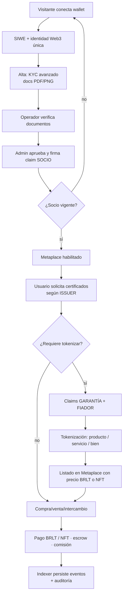

# Propuesta de nueva versión — RWA v3 «Barlo Metaplace»

> **Preparado por:** Asistente de Proyecto (director de proyecto + ingeniero senior)
> **Fecha:** 2026-10-31 · **Fase:** 1 (Concepto) — propuesta para validación
> **Entrada:** `RepoTecnico/BRIEF_BARLOBLOKCHAIN_v3.md` (32 líneas, sin fecha)
> **Base heredada:** RWA v2 — monorepo `rwa-web` (3 apps Next + indexer) y `rwa-sc`
> (Foundry/EVM), desplegada en GCP el 2026-10-29.
> **Estado:** propuesta **v3.1**, corregida tras la auditoría `INFORME_OPTIMIZACION_V3.md`
> (Q11–Q13 aprobadas). No quedan decisiones bloqueantes.

---

## 1. Resumen ejecutivo

El brief pide un **Metaplace de RWA** («Barlo») que no es una iteración cosmética de la v2, sino un
**cambio de producto** en cuatro ejes:

1. **De 3 apps sueltas a un Metaplace** con identidad visual y sesión únicas.
2. **De un claim fijo de KYC a un sistema de certificaciones configurable**: el Administrador
   define ISSUER (proceso + requisitos) y emite claims como *Socio*, *Garantía* y *Fiador*.
3. **De un token demo (RWAD, 18 dec) a una economía real de tres clases de activo** (productos,
   servicios, bienes) más una **moneda de pago propia: BRLT (8 decimales)**.
4. **De una UI de administración a un marketplace** con compra/venta/intercambio y con **mensajes
   de billetera en lenguaje llano** como requisito de producto, no como detalle.

**La buena noticia:** ~55–60 % del trabajo de infraestructura de la v2 es reutilizable tal cual
(identidad clonable, registries, compliance, SIWE, Postgres, indexer, CI, Cloud Run). Lo que hay
que construir es el **núcleo económico** (BRLT, NFTs, marketplace, ISSUER configurable) y la **capa
de producto** (Metaplace, plantillas de firma, roles Admin/Operador, Sistema y recuperación).

**Esfuerzo estimado:** 7 ciclos verticales, ~14–18 semanas de un equipo pequeño (1 dev full-stack
+ 0,5 dev blockchain + revisión). Detalle en §8. Es una **estimación de orden de magnitud sin línea
base medida** (limitación H-30); se recalibra con el histórico real al cerrar C0 y C1.

---

## 2. Lectura del brief (interpretación)

### 2.1 Qué dice, literalmente

| Sección | Contenido |
|---|---|
| `[OBJETIVO]` | Metaplace de intercambio/compra/venta de tokens RWA; certifica identidades; metodología para crear identidad Web3; 3 instancias (suites) con soporte a los grandes pasos; **BRLT (8 dec)** como moneda de pago de servicios, bienes, productos y NFTs. |
| `[contexto]` | Estructura METAPLACE con 3 suites bajo **un mismo concepto visual**; mensajes de firma/autorización/NFT **entendibles y coloquiales**, con **plantillas por tipo de proceso**. |
| `[procesos generales]` | 1) Alta → claim **Socio** (KYC avanzado) → acceso. 2) Tokenizar activo exige **Garantía + Fiador** y documentos PDF de tenencia. 3) Cada actividad genera **ISSUES** para solicitar certificados. 4) Metaplace de artículos tokenizados bajo condiciones del **ISSUER**. |
| `[WEB-IDENTITY]` | Alta, identidad única sin comprometer datos de la billetera; gestión de solicitudes de claims. |
| `[WEB-ISSUSER]` | Suite de Administrador: crear ISSUER (proceso + requisitos), aprobar certificaciones, **Sistema** (monitoreo), **recuperación de identidad**; roles **Administrador** y **Operador** (este último solo verifica documentos); tokenización de **Productos** (cantidad final, artesanal), **Servicios** (~60/mes, precio en BRLT, posible NFT quemable) y **Bienes** (1 NFT por bien). |
| `[WEB-TOKEN]` | Metaplace de compra/venta/intercambio de tokens, NFTs y criptomonedas **simbólicas** (sin valor real). |

### 2.2 Interpretación de términos ambiguos del brief

| Término del brief | Interpretación propuesta | Motivo |
|---|---|---|
| **ISSUER / ISSUSER / ISSUES** | Se usa como **plantilla de certificación**: define el proceso, los requisitos documentales y los claims que puede emitir. «ISSUES» = instancias/actividades de certificación creadas a partir de esa plantilla. | Los tres usos del brief apuntan al mismo objeto. Se normaliza el nombre a `issuer_template` / `issuer_program`. |
| **Metaplace** | Shell único con 3 suites + catálogo público + área de usuario; no 3 webs independientes. | `[contexto] 1` exige concepto visual único. |
| **«3 instancias para cada tarea»** | 3 suites (Identity, Issuer, Token), cada una con soporte guiado en los pasos grandes. | Coherente con los tres encabezados del brief. |
| **Certificado de Garantía / Fiador** | Dos claims distintos: uno acredita la **garantía** (respaldo/valuación del activo) y otro la **idoneidad del fiador** que respalda al emisor. Ambos son requisitos previos a tokenizar. | `[procesos generales] 2`. |
| **«criptomonedas (solo simbólico sin valor real)»** | Tokens de utilidad/demostración listables en el Metaplace (p. ej. BRLT y stablecoins demo), explícitamente **sin valor monetario**. | `[WEB-TOKEN]`. |
| **«NFT que se queman al uso» (servicios)** | Cada servicio prestado consume (burn) el NFT que lo representa. | `[WEB-ISSUSER] 2`. |

---

## 3. Estado actual (v2) — qué hay y qué se reutiliza

### 3.1 Inventario verificado

| Capa | Activo v2 | Reutilización en v3 |
|---|---|---|
| Contratos | `IdentityRegistry`, `IdentityCloneable`, `IdentityCloneFactory`, `TrustedIssuersRegistry`, `ClaimTopicsRegistry(+CloneFactory)`, `TokenCloneable`, `TokenCloneFactory`, `ComplianceAggregator` + 3 módulos, `GovernanceMultisig` (10 desplegados en Anvil GCP, chain 31337) | **Alta**: base de identidad, claims y compliance. **Media**: token ERC-20 genérico (sirve para productos, no para BRLT/NFT). |
| Web | Monorepo pnpm: `apps/identity`, `apps/issuer`, `apps/token`, `apps/indexer`; `packages/shared` (config de red, ABIs, contratos, BD, tipos) | **Alta**: shell, auth SIWE, capa de datos, indexer. **Media**: UI (rediseño Metaplace). |
| Datos | PostgreSQL Cloud SQL, esquema `rwa` con 12 tablas (identidades, claims, documentos cifrados, tokens, sesiones, auditoría, eventos) | **Alta**: se evoluciona con migraciones v3. |
| Infra | Cloud Run ×3 + Cloud Run Job + Scheduler, SA `rwa-web-run`, Secret Manager, pipeline `deploy_gcp.sh` (provision/build/deploy/verify), CI GitLab | **Alta**: reutilización directa. |
| Calidad | 42 tests web, suite Foundry + coverage, gates anti-deriva/secretos/literales, E2E contra Anvil GCP en verde | **Alta**: se hereda como línea base. |

### 3.2 Brechas brief v3 → v2

| # | Requerimiento v3 | v2 | Brecha |
|---|---|---|---|
| 1 | Metaplace con shell único y SSO | 3 apps con estilos convergentes pero sin shell | **Construir** capa de producto |
| 2 | Claim **Socio** (KYC avanzado) como puerta de entrada | Topics fijos 1/7/9; no existe Socio | **Construir** topic + flujo + gate |
| 3 | **ISSUER configurable** (proceso + requisitos + N claims) | Emisores con topics fijos; sin plantillas | **Construir** modelo ISSUER |
| 4 | **Garantía + Fiador** como precondición de tokenización | Ausentes | **Construir** claims y regla |
| 5 | **BRLT** (ERC-20, 8 dec) como moneda de pago | Solo RWAD demo (18 dec) | **Construir** contrato + economía |
| 6 | **NFTs**: 1 por bien; servicios quemables; productos por cantidad | Solo ERC-20 genérico | **Construir** ERC-721/1155 + factories |
| 7 | **Marketplace** compra/venta/intercambio | Catálogo de tokens sin mercado | **Construir** listings, órdenes, escrow |
| 8 | **Roles Admin/Operador** (Operador = solo verificar docs) | Roles investor/issuer/admin | **Extender** RBAC |
| 9 | **Sistema** de monitoreo y **recuperación de identidad** | Health + indexer; sin recuperación | **Construir** |
| 10 | **Plantillas de mensajes** de billetera en lenguaje llano | Mensajes EIP-712 técnicos | **Construir** catálogo + render |
| 11 | Claims con vigencia y revocación | Pendiente (RF-013 v2) | **Cerrar** deuda v2 |
| 12 | Compliance fail-closed (RF-011/012 v2) | Pendiente | **Cerrar** deuda v2 |

**Conclusión de brecha:** no es un refactor, es una **versión nueva sobre cimientos reutilizados**.
La v2 aporta el «sistema operativo» (identidad, claims, datos, infra); la v3 aporta el «negocio»
(ISSUER, BRLT, NFTs, marketplace, experiencia de firma).

---

## 4. Propuesta funcional

### 4.1 Modelo de producto: 3 suites + 1 shell

```
                          ┌──────────────────────────────────────────┐
                          │  METAPLACE (shell único, es/en, WCAG AA) │
                          │  sesión SIWE · navegación · design system│
                          └───────────────┬──────────────────────────┘
          ┌───────────────────────────────┼───────────────────────────────┐
          ▼                               ▼                               ▼
   WEB-IDENTITY                     WEB-ISSUSER                      WEB-TOKEN
   · alta + identidad               · ISSUER (plantillas)            · catálogo RWA
   · solicitudes de claims          · certificación (Admin)          · compra/venta
   · mis certificados               · tokenización                   · intercambio
   · recuperación de identidad      · Operador: verifica docs        · pagos en BRLT
   · (Socio obligatorio)            · Sistema (monitoreo)            · NFTs y simbólicas
```

### 4.2 Flujo maestro de extremo a extremo



### 4.3 Catálogo de certificaciones (claims) propuesto

| Claim (topic) | Quién lo emite | Para qué | Vigencia |
|---|---|---|---|
| **SOCIO** | Admin/Issuer de onboarding | Acceso al Metaplace (KYC avanzado) | Sin caducidad en v3.0 (revocable) |
| **GARANTÍA** | Admin/Issuer de garantía | Respalda la tokenización de un activo | Ligado al activo (revocable) |
| **FIADOR** | Admin/Issuer de fiador | Acredita la idoneidad del fiador | Sin caducidad en v3.0 (revocable) |
| **KYC** (base) | Operador + Admin | Verificación de identidad/documentos | Sin caducidad en v3.0 |
| **JURISDICCIÓN** | Issuer de jurisdicción | País/residencia para reglas locales | Sin caducidad en v3.0 |
| **ACREDITACIÓN** | Issuer de acreditación | Inversor acreditado (si aplica) | Sin caducidad en v3.0 |
| **Personalizados** | Cualquier ISSUER definido | Requisitos propios del ISSUER | Configurable (por defecto sin caducidad) |

> El catálogo deja de ser un enum cerrado (v2) y pasa a ser **datos** (`credential_types`) que el
> Administrador extiende sin redeploy. Reutiliza el `ClaimTopicsRegistry` on-chain para los topics
> que deban ser on-chain.

### 4.4 Tokenización: tres clases de activo

| Clase | Estándar propuesto | Acuñación | Consumo | Precio |
|---|---|---|---|---|
| **Producto** (artesanal) | ERC-1155 (lote/SKU) o ERC-20 con supply fijo | Cantidad final declarada en el ISSUER | Transferible hasta agotar | BRLT por unidad |
| **Servicio** | ERC-721 **burnable** (1 NFT = 1 servicio) | Cantidades por periodo (≈60/mes) | **Se quema al usarse** | BRLT por servicio |
| **Bien** | ERC-721 único (1 NFT = 1 bien) | 1 acuñación | Transferencia de propiedad | BRLT o subasta/oferta |

**Precondición on-chain:** el contrato de tokenización exige `isVerified(emisor, GARANTÍA)` y
`isVerified(emisor, FIADOR)` antes de acuñar; si falta, revierte (fail-closed).

### 4.5 BRLT — moneda de la plataforma

- **ERC-20, 8 decimales** (`BarloToken`, símbolo `BRLT`), supply y política de emisión gobernados.
- Uso: pago de servicios, bienes, productos y NFTs; comisiones de plataforma.
- **No** es un token RWA: se separa conceptualmente de los activos tokenizados (esto es clave para
  no mezclar compliance de activos con medio de pago).
- Roles: `MINTER_ROLE`, `BURNER_ROLE`, `PAUSER_ROLE`; pausa de emergencia; sin `mint` libre.
- **Decidido (Q2):** token de **utilidad sin valor real** en esta versión; se documenta en UI y
  contratos. El contrato deja `cap` y roles preparados por si más adelante se respalda.
- **Política numérica (H-26):** `cap` = 100.000.000 BRLT; `maxMintPerTx` = 10.000 BRLT; emisión y
  pausa con **multisig + timelock**; `FeeCollector` on-chain es la única autoridad de comisión
  (la tabla `platform_fees` es caché de UI).

### 4.6 Mensajes de billetera en lenguaje llano (requisito de producto)

Catálogo versionado de plantillas por proceso, con variables y tono coloquial:

| Proceso | Plantilla (ejemplo) |
|---|---|
| Alta de identidad | «Vas a crear tu identidad en Barlo. No compartimos tus datos ni el saldo de tu billetera con nadie.» |
| Solicitud de certificado | «Vas a pedir tu certificado de **Socio**. Revisaremos tus documentos y te avisaremos.» |
| Emisión de claim | «Firmas que **{emisor}** certifica que cumples los requisitos de **{claim}**. Vence el {fecha}.» |
| Tokenización | «Vas a crear **{cantidad} {unidad}** de **{activo}**, respaldados por el certificado **{garantía}**.» |
| Compra | «Compras **{activo}** por **{precio} BRLT**. El pago queda retenido hasta que confirmes la recepción.» |
| Quema de servicio | «Confirmas que usaste **{servicio}**; su certificado digital se destruye.» |
| Recuperación | «Pides recuperar tu identidad. Un administrador revisará tu caso y te contactará.» |

Diseño técnico: `wallet_messages` (BD) + paquete compartido que construye el `message` EIP-712
legible, y tests que verifican que el texto mostrado es el que se firma (hash del mensaje).

### 4.7 Roles y permisos (RBAC v3)

| Capacidad | Visitante | Usuario/Socio | Fiador | Operador | Admin |
|---|---|---|---|---|---|
| Ver catálogo público | ✅ | ✅ | ✅ | ✅ | ✅ |
| Comprar/vender/intercambiar | ❌ | ✅ (Socio) | ✅ | ❌ | ✅ |
| Solicitar claims | ❌ | ✅ | ✅ | ❌ | ✅ |
| Verificar documentos | ❌ | ❌ | ❌ | ✅ | ✅ |
| Emitir/revocar claims **de sus programas** | ❌ | ❌ | ❌ | ❌ | ✅ Admin · ✅ **Issuer (rol)** |
| Crear/editar ISSUER | ❌ | ❌ | ❌ | ❌ | ✅ |
| Emitir/revocar claims | ❌ | ❌ | ❌ | ❌ | ✅ |
| Tokenizar | ❌ | ❌ | ❌ | ❌ | ✅ |
| Recuperación de identidad | ❌ | solicita | ❌ | ❌ | custodia |
| Panel Sistema | ❌ | ❌ | ❌ | ❌ (solo verificación de docs, RF-V3-22) | ✅ |
| Arbitrar una disputa | ❌ | ❌ | ❌ | ❌ | ✅ (rol árbitro) |
| Exportar auditoría (solo lectura) | ❌ | ❌ | ❌ | ❌ | ✅ Auditor |

---

## 5. Arquitectura técnica propuesta

### 5.1 Componentes

| Capa | Componente | Cambio respecto a v2 |
|---|---|---|
| Frontend | Shell `apps/metaplace` (o `apps/web` unificado) + 3 suites como rutas | **Nuevo** shell; suites migradas |
| Frontend | `packages/ui` design system «Barlo» | **Extender** con tokens visuales del Metaplace |
| Frontend | `packages/wallet-messages` (plantillas + firma legible) | **Nuevo** |
| API | Rutas por suite sobre `packages/shared` | **Extender** con marketplace, ISSUER, recovery, sistema |
| Contratos | Identity/Claims (v2) + `BarloToken` + `AssetNFT721` + `AssetERC1155` + `AssetFactory` + `MarketplaceEscrow` + `FeeCollector` + `IdentityRecovery` | **Nuevo** núcleo económico |
| Datos | `rwa` v3: + `issuer_programs`, `issuer_program_requirements`, `issuer_program_credentials`, `credential_types`, `identities`, `identity_recovery_requests`, `tokens` (activos), `token_guarantees`, `asset_documents`, `listings`, `orders`, `payments`, `disputes`, `platform_fees`, `wallet_messages` | **Extender** esquema |
| Indexer | Eventos de BRLT, NFTs, marketplace y claims | **Extender** |
| Infra | Cloud Run ×3 (o 1 shell + 3 suites), Job indexer, Scheduler | **Ajustar** |
| Observabilidad | Panel Sistema + logs estructurados + métricas | **Nuevo** panel |

### 5.2 Contratos (delta sobre v2)

```solidity
// 1) Moneda de plataforma
BarloToken is ERC20Permit, Pausable, AccessControl        // 8 decimales, supply gobernado

// 2) Activos tokenizados
AssetNFT721 is ERC721Burnable, AccessControl               // bienes y servicios
AssetERC1155 is ERC1155Supply, AccessControl               // productos/lotes
AssetFactory                                               // registra & despliega clones
IAssetCondition                                            // exige GARANTÍA + FIADOR

// 3) Mercado y pagos
MarketplaceEscrow                                          // órdenes, escrow en BRLT, comisión
FeeCollector                                               // comisión de plataforma
PriceOracle (simple, admin-managed para demo)              // precio simbólico por activo

// 4) Identidad avanzada (deuda v2 + v3)
ClaimLifecycle (expiry/revocation)                         // RF-013 v2
IdentityRecovery                                           // cambio de wallet con aprobación
IssuerRegistry (roles acotados por programa)               // Q11(a): autoridad del Emisor
DisputeManager                                             // Q12(a): árbitro, plazos y resolución
AssetComplianceHook                                        // _update/beforeTokenTransfer -> IdentityRegistry (H-07)
```

### 5.3 Modelo de datos (delta sobre las 12 tablas v2)

| Tabla nueva | Papel |
|---|---|
| `issuer_programs` | ISSUER: nombre, proceso, tipo de actividad, claims que emite, condiciones de tokens |
| `issuer_requirements` | Requisitos por ISSUER: documentos, types MIME, claims previos, obligatoriedad |
| `credential_types` | Catálogo extensible de claims (Socio, Garantía, Fiador, KYC, Jurisdicción, Acreditación, custom) |
| `assets` | Activo tokenizado: tipo (producto/servicio/bien), supply, precio BRLT, contrato y token_id |
| `asset_documents` | PDFs de tenencia/garantía (cifrados, mismo patrón que `document_files`) |
| `guarantors` | Fiador: wallet, claim de fiador, activos respaldados |
| `listings` | Publicación en Metaplace (precio, moneda, estado) |
| `orders` | Órdenes de compra/venta/intercambio y su estado |
| `payments` | Pagos en BRLT, escrow, comisión, tx_hash |
| `platform_fees` | Configuración de comisiones |
| `recovery_requests` | Recuperación de identidad: caso, evidencias, aprobador, wallet nueva |
| `wallet_messages` | Plantillas de mensajes de firma por proceso e idioma |

> `base_datos.sql`, `diccionario_datos.md` y `diagrama_er.md` se escribirán **juntos** (regla de
> sincronía) al cerrar la Fase 1.

### 5.4 Seguridad (invariantes)

1. **Nadie sin claim SOCIO opera en el mercado** (validado en API y en contrato de marketplace).
2. **Tokenizar exige GARANTÍA + FIADOR** verificado on-chain, no solo en UI.
3. **BRLT** con roles acotados, pausa y sin mint arbitrario; límites por tx.
4. **Claims con expiry/revocation** y `isVerified` fail-closed (cierra RF-011/012/013 de v2).
5. **Documentos PII** cifrados AES-256-GCM, servidos solo a titular/operador/admin, con auditoría.
6. **Recuperación de identidad** con doble aprobación y rastro inmutable.
7. **0 secretos en repo**; Secret Manager y SA de mínimos privilegios (heredado).
8. **Mensajes de firma** legibles y verificables: el texto mostrado corresponde al digest firmado y
   cumple el umbral numérico de legibilidad (RNF-V3-04).
9. **Escrow atómico (Q12a):** BRLT y activo se mueven en la misma operación o no se mueve ninguno;
   una sola orden abierta por publicación, `tx_hash` único y disputa con árbitro.
10. **Autoridad del Emisor (Q11a):** solo un emisor registrado y autorizado para el programa puede
    firmar un claim, y queda persistido en `claim_requests.issuer_id`.
11. **Entorno de demo (Q13):** claves dedicadas (nunca la cuenta #0 de Anvil), RPC restringido y gate
    de CI que falla si una wallet de rol coincide con una cuenta conocida de Anvil.

---

## 6. Estrategia de reutilización y migración

### 6.1 Opción aprobada (Q1: sustitución sobre la misma infraestructura)

- **Repos:** mantener `rwa-sc` y `rwa-web`; abrir **rama `rwa-v3`** (no `main`, que queda intacta).
  La v2 sigue desplegada y congelada como referencia.
- **Contratos:** añadir contratos nuevos sin romper los existentes; nuevo artefacto de despliegue
  `31337-<ts>-v3.json`. Redeploy limpio permitido (D-009 vigente).
- **Datos:** **una sola convención de versión: `3.0`**; script `migracion_v2_a_v3.sql` (archiva las
  12 tablas v2 como `*_v2`, crea el esquema v3 con `\ir base_datos.sql`, hace el ETL y registra `3.0`
  en una transacción). Se ensaya en CI sobre un `pg_dump` v2 antes de tocar Cloud SQL.
- **Infra:** mismo proyecto `mcc-ecommerce`, mismas Cloud Run (nuevas revisiones) + Anvil global +
  Cloud SQL. Sin duplicar nodos ni bases (D-095/D-096/D-101).
- **CI:** heredar los gates v2 + añadir `check-wallet-messages` y cobertura de contratos nuevos.

### 6.2 Qué se descarta o se reescribe

| Elemento v2 | Decisión |
|---|---|
| Token demo RWAD (18 dec) | Se retira del producto; queda como fixture de tests |
| Mensajes EIP-712 técnicos | Se sustituyen por plantillas legibles manteniendo el mismo `digest` |
| UI de las 3 apps | Se rehace sobre el design system «Barlo» (la lógica de API se reutiliza) |
| Topics fijos 1/7/9 | Se generalizan a `credential_types` |

---

## 7. Plan de desarrollo vertical (ciclos entregables)

Cada ciclo es una entrega **100 % operativa y verificable** (regla de la Fase 3).

| Ciclo | Nombre | Entregable operativo | Criterio de aceptación |
|---|---|---|---|
| **C0** | Fundación v3 | Rama `rwa-v3`, esquema `rwa` **3.0** (migración probada en CI), `BarloToken` (8 dec) desplegado y verificado en Anvil GCP, CI verde | BRLT con 8 dec/cap/límites, mint/burn/pause probados; migración v2→v3 con conteos cuadrados; `deploy_gcp.sh verify` OK |
| **C1** | Identidad + Socio | Alta con KYC avanzado, identidad única, claim **SOCIO** emitido y gate de acceso | Un usuario sin Socio no entra al Metaplace; con Socio sí; E2E en verde |
| **C2** | ISSUER configurable | Admin crea ISSUER (proceso + requisitos + N claims); Operador verifica docs; solicitud/aprobación genérica | Crear ISSUER nuevo sin redeploy; 3 tipos de requisito probados |
| **C3** | Tokenización | Claims GARANTÍA + FIADOR; acuñación de producto (1155), servicio (721 burnable) y bien (721); documentos | Tokenizar sin Garantía/Fiador revierte; los 3 tipos acuñan y se verifican on-chain |
| **C4** | Metaplace marketplace | Listados, compra/venta a **precio fijo**, pago en BRLT, **escrow atómico**, comisión y **disputa con árbitro** (ofertas/subastas → v3.1) | Compra E2E: BRLT debitado y activo transferido en la misma operación, una sola orden abierta, evento indexado, comisión correcta y flujo de disputa resuelto |
| **C5** | Experiencia de firma + Admin/Sistema | Plantillas de billetera (es/en), roles Admin/Operador/**Issuer**/Auditor, panel Sistema, recuperación de identidad | 100 % de procesos con mensaje legible (umbral numérico); recuperación con **4-eyes real** (dos wallets distintas, ninguna el solicitante) |
| **C6** | Endurecimiento y piloto | Cobertura ≥ 80 % contratos / ≥ 70 % web, suite E2E completa, despliegue final y manuales | Fase 4 al 100 %; manuales generados; despliegue verificado |

**Dependencias:** C0 → C1 → C2 → C3 → C4; C5 puede solaparse con C3/C4; C6 al final.

---

## 8. Estimación de esfuerzo (orden de magnitud)

| Ciclo | Esfuerzo | Riesgo principal |
|---|---|---|
| C0 Fundación | 1–1,5 sem | Contrato BRLT + migraciones |
| C1 Identidad + Socio | 2 sem | KYC avanzado y UX de alta |
| C2 ISSUER configurable | 2–3 sem | Modelo de requisitos flexible |
| C3 Tokenización | 3 sem | Diseño de estándares y condition gates |
| C4 Marketplace | 3–4 sem | Escrow, órdenes y concurrencia |
| C5 Firma + Admin/Sistema | 2 sem | Catálogo de plantillas y RBAC |
| C6 Endurecimiento | 1,5–2 sem | Cobertura y E2E |
| **Total** | **≈ 14–18 semanas** | Equipo: 1 full-stack + 0,5 blockchain + revisión |

---

## 9. Riesgos

| # | Riesgo | Prob. | Impacto | Mitigación |
|---|---|---|---|---|
| R-1 | El brief usa «ISSUER» con 3 significados y no define el proceso de certificación | Media | Medio | **Cerrado (Q11a):** Emisor = rol de plataforma acotado, persistido por claim; ISSUER = plantilla |
| R-2 | BRLT sin política de emisión/suministro definida | Media | Alto | Decidir en Q2; cap y roles desde C0 |
| R-3 | Marketplace con escrow introduce concurrencia y disputas | Media | Alto | **Acotado por Q3/Q12a:** precio fijo, reserva con TTL, atomicidad y disputa con árbitro; ofertas/subastas/barter en v3.1 |
| R-4 | KYC avanzado puede implicar obligaciones regulatorias | Media | Medio | **Acotado por Q2:** BRLT sin valor real y modo demostración explícito en UI/contratos/manuales |
| R-5 | Reutilizar v2 con deuda abierta (compliance fail-open, claims sin expiry) | Media | Medio | Cerrar RF-011/012/013 en C0/C3 |
| R-6 | Alcance del marketplace crece (subastas, barter, cripto simbólica) | Alta | Medio | Congelar alcance por ciclo; backlog v3.1 |
| R-7 | Anvil GCP es nodo de desarrollo (estado volátil) | Alta | Alto | Runbook de reset con reconciliación off-chain, snapshot periódico, segundo RPC y artefacto reejecutable (H-12) |
| R-8 | Rediseño visual del Metaplace rompe accesibilidad | Media | Bajo | Design system + `axe` en CI desde C1 |

---

## 10. Decisiones del Bloque 1 (respondidas 2026-10-31)

| ID | Pregunta | Decisión aprobada |
|---|---|---|
| **Q1** | Relación con la v2 | **La v3 sustituye a la v2 sobre la misma infraestructura**: rama `rwa-v3` en los repos actuales, despliegue progresivo sobre `mcc-ecommerce` + Anvil GCP + Cloud SQL. La v2 queda congelada como referencia y plan de retorno. |
| **Q2** | Naturaleza de BRLT | **Token de utilidad sin valor real** (entorno demo/Anvil): emisión controlada por el Admin, sin custodia de dinero FIAT ni obligaciones regulatorias en esta versión. |
| **Q3** | Alcance del marketplace | **Precio fijo con escrow y comisión** en v3.0. Ofertas, subastas e intercambio (barter) pasan al backlog **v3.1**. |

**Consecuencias directas en el diseño**

- **Q1:** no se crean repos ni proyectos GCP nuevos; `main` de ambos repos queda intacta; el
  artefacto de despliegue se versiona como `31337-<ts>-v3.json` y las migraciones arrancan en **`3.0`**.
- **Q2:** `BarloToken` sin respaldo 1:1 ni `mint` libre; se documenta explícitamente «sin valor real»
  en UI, contratos y manuales (mitiga R-4). El diseño deja `cap` y roles listos por si se respalda.
- **Q3:** el alcance de C4 se acota a listado + compra directa + escrow/cancelación/confirmación;
  el modelo de datos deja espacio (`orders.type`) para órdenes de intercambio futuras.

### Bloque 2 (respondido 2026-10-31)

| ID | Pregunta | Decisión aprobada |
|---|---|---|
| **Q4** | Comisiones | **Comisión por venta del 5 % configurable + fee fijo de tokenización**; recauda el Admin vía `FeeCollector` (on-chain) y se refleja en `payments`. |
| **Q5** | Custodia | **Non-custodial**: el usuario custodia su clave; la plataforma nunca la maneja. Recuperación **asistida** (doble aprobación del Admin, auditada) para cambio de wallet. |
| **Q6** | Tokens simbólicos | Catálogo v3.0 limitado a **BRLT + tokens/NFTs RWA**; sin stablecoin ni BTC demo. El catálogo queda gobernado por el Admin para ampliarlo en v3.1. |

### Bloque 3 (respondido 2026-10-31)

| ID | Pregunta | Decisión aprobada |
|---|---|---|
| **Q7** | Jurisdicciones | **Piloto LatAm**: `VE, CO, PA, MX, CL, PE, AR` como semilla; el Admin habilita/deshabilita países sin redeploy. |
| **Q8** | Renovación de claims | **Sin caducidad en v3.0**; la columna `expires_at` queda preparada (`NULL`) y la **revocación** sí está soportada. |
| **Q9** | Valuación | **Tasación documental en BRLT**; el precio de listado **no puede exceder** la tasación (regla de BD + trigger). |
| **Q10** | Retención documental | **30 días tras rechazo / 12 meses tras fin de relación**, con purga programada y registro en `audit_log`. |

**Entrevista completa (Q1–Q10).** No quedan decisiones bloqueantes; el resto pasa a backlog v3.1.

### Bloque A de correcciones (respondido 2026-10-31)

| ID | Pregunta | Decisión aprobada |
|---|---|---|
| **Q11** | Autoridad del Emisor | **(a)** Emisor = **rol de plataforma** acotado: gestiona sus ISSUER, emite/revoca solo claims de sus programas, firma EIP-712 con clave propia y queda persistido en `claim_requests.issuer_id`. |
| **Q12** | Escrow y disputa | **(a)** Escrow **completo en v3.0**: reserva con TTL, atomicidad NFT↔BRLT, una sola orden abierta por publicación, `tx_hash` único y **disputa con rol árbitro** y plazos. |
| **Q13** | Postura regulatoria | **(a)** **Demo/piloto sin activos reales**: exclusión documentada (BRLT sin valor) y **gate legal** antes de cualquier uso con valores reales; compliance como RNF-V3-12. |

---

## 11. Próximos pasos

1. ~~Bloque 1 (Q1–Q3)~~ ✅ · ~~Bloque 2 (Q4–Q6)~~ ✅ · ~~Bloque 3 (Q7–Q10)~~ ✅ — 2026-10-31.
2. ~~Cerrar Fase 1: `diccionario_datos.md`, `diagrama_er.md`, `base_datos.sql` v3 sincronizados y
   `entornos_globales.md` v3~~ ✅ (26/26 tablas consistentes en los tres artefactos).
3. **Confirmar cierre de Fase 1** → Fase 2: auditoría (@audita) + casos de uso Gherkin/EARS +
   documento técnico + gráficos.
4. Fase 3: aprobar el plan de ciclos (C0–C6) y arrancar **C0** (`BarloToken` 8 dec + migraciones).

---

*Propuesta v3.1 · 2026-10-31 · Corregida tras la auditoría (Q11–Q13 aplicadas).*
